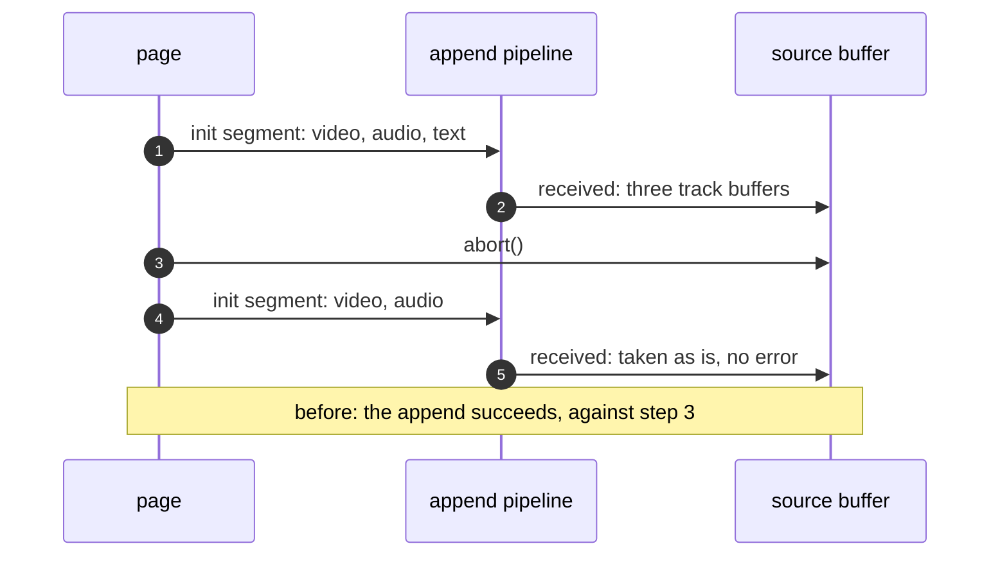

> One change of the GStreamer fork: `review/31`, 31 of 33 in the stack.
> Below it: [`review/30`](https://github.com/Airodonack/gstreamer/tree/review/30). Above it: [`review/32`](https://github.com/Airodonack/gstreamer/tree/review/32).
> The change itself: [commit a8dac231b8816104224ce59fe14fd577653ba3fc](https://github.com/Airodonack/gstreamer/commit/a8dac231b8816104224ce59fe14fd577653ba3fc). This README sits in a commit on top of it and is not part of the merge request.
> The whole stack: [overview README](https://github.com/Airodonack/gstreamer/blob/mse-fixes-main/README.md).

# An init segment with other tracks fails the append

MSE requires every initialization segment after the first to have the same
number of audio, video and text tracks, and runs the append error algorithm
when one does not. mselib did not check. A later initialization segment with
fewer tracks, for example after a reset, was taken as it was, and the samples
of a track the first segment did not have reached a `NULL` track buffer. The
change adds the check. It is 35 lines in one file.

It comes before `review/33`, which lets a page change a buffer's type and so
makes such segments easy to send.

## The problem

`on_received_init_segment()` made track buffers for the first initialization
segment's tracks and took any later segment as it came. A later segment with
a track the first did not have gave that track no track buffer, and
`on_new_sample()` then looked one up for its samples.

## The change

- [`has_first_init_segment_tracks_unlocked()`](https://github.com/Airodonack/gstreamer/blob/a8dac231b8816104224ce59fe14fd577653ba3fc/subprojects/gst-plugins-bad/gst-libs/gst/mse/gstsourcebuffer.c#L1067-L1081)
  checks that the current initialization segment's tracks are exactly those
  with a track buffer. The append pipeline hands back the same track objects
  for the same type and position (`review/11`, and `review/23` for a lone
  track whose id changes), so a segment with the first's tracks passes.
- [`on_received_init_segment()`](https://github.com/Airodonack/gstreamer/blob/a8dac231b8816104224ce59fe14fd577653ba3fc/subprojects/gst-plugins-bad/gst-libs/gst/mse/gstsourcebuffer.c#L1092-L1105)
  runs it for every segment after the first. On a mismatch it sets
  `append_failed`, as `on_error()` does, and the append task runs the
  append error algorithm.
- [`on_new_sample()`](https://github.com/Airodonack/gstreamer/blob/a8dac231b8816104224ce59fe14fd577653ba3fc/subprojects/gst-plugins-bad/gst-libs/gst/mse/gstsourcebuffer.c#L957-L959)
  drops the samples of a track without a track buffer.

## Options considered

| Option | Why not chosen |
|---|---|
| **Compare the segment's track objects with the track buffers** (this change) | Chosen: the track objects already carry the type and position the spec's step 3 compares, so one set comparison does it. |
| Compare counts per type | Misses a track replaced by another of the same type, which would still have no track buffer. |
| Fail from the append pipeline's streaming thread | The error is reported by the append task, as for a parse error, so that error and update-end come once and in order (`review/14`). |

## Spec

[MSE, Initialization Segment Received](https://w3c.github.io/media-source/#sourcebuffer-init-segment-received),
step 3, for every initialization segment after the first: if any of these
checks fails, run the append error algorithm.

> The number of audio, video, and text tracks match what was in the first
> initialization segment.

> If more than one track for a single type are present (e.g., 2 audio
> tracks), then the Track IDs match the ones in the first initialization
> segment.

## How it was checked

Unit tests in `tests/check/libs/mse.c`:

- [`test_source_buffer_init_segment_other_tracks`](https://github.com/Airodonack/gstreamer/blob/a8dac231b8816104224ce59fe14fd577653ba3fc/subprojects/gst-plugins-bad/tests/check/libs/mse.c#L1737-L1762)
  appends `mse.mp4` (video, audio and text), aborts, then appends an
  initialization segment with only video and audio, and expects an error.
- Two tests of the check's premises:
  [`test_source_buffer_append_after_two_aborts`](https://github.com/Airodonack/gstreamer/blob/a8dac231b8816104224ce59fe14fd577653ba3fc/subprojects/gst-plugins-bad/tests/check/libs/mse.c#L2045-L2082)
  (the track objects survive two resets in a row, `review/11`) and
  [`test_source_buffer_init_segment_new_track_id`](https://github.com/Airodonack/gstreamer/blob/a8dac231b8816104224ce59fe14fd577653ba3fc/subprojects/gst-plugins-bad/tests/check/libs/mse.c#L1764-L1790)
  (a lone video track whose track ID changes is not a new track).

From the 1.28 series' gate (2026-11-05, on 1.28.6):

- the first test with the previous change's gstsourcebuffer.c: "timed out
  waiting for error 1, have 0";
- with this change, the whole suite: `100%: Checks: 153, Failures: 0,
  Errors: 0`.

On GStreamer main (2026-11-05), the whole suite at this commit gave the same.

## Questions a reviewer may ask

- **What about a later segment that the demuxer path does not report?** On
  `review/23`'s demuxer path, a segment that only drops a track makes qtdemux
  say `no-more-pads`, adds nothing and is not reported, so this check does
  not run for it. Not tested.
- **An initialization segment with no tracks at all?** It is reported, and
  fails here after the first, as it has none of the first's tracks. As the
  very first segment it is not refused, where the spec runs the append error
  algorithm.
