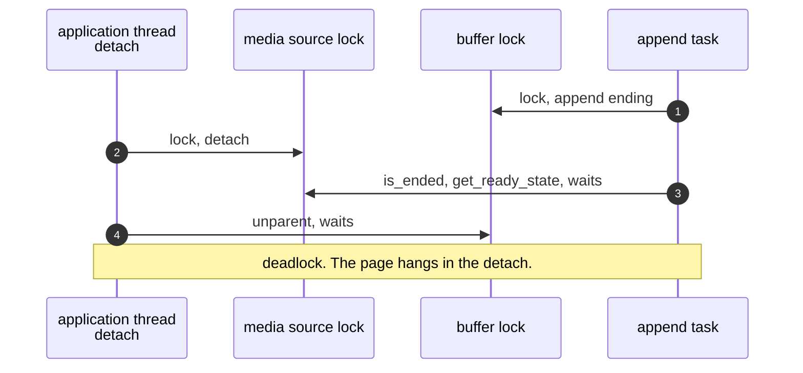
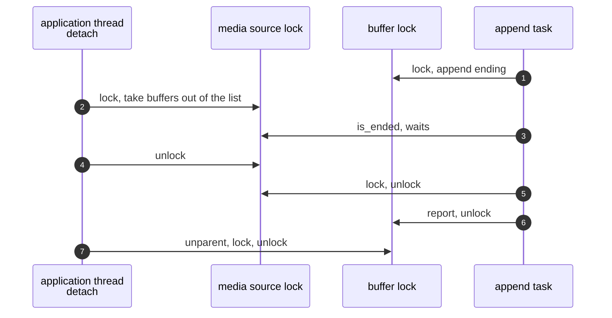

> One change of the GStreamer fork: `review/15`, 15 of 33 in the stack.
> Below it: [`review/14`](https://github.com/Airodonack/gstreamer/tree/review/14). Above it: [`review/16`](https://github.com/Airodonack/gstreamer/tree/review/16).
> The change itself: [commit f49140cbc5a64d057863f53559a446b481bfad67](https://github.com/Airodonack/gstreamer/commit/f49140cbc5a64d057863f53559a446b481bfad67). This README sits in a commit on top of it and is not part of the merge request.
> The whole stack: [overview README](https://github.com/Airodonack/gstreamer/blob/mse-fixes-main/README.md).

# Removing or detaching a source buffer mid-append no longer hangs

Removing a source buffer, or detaching the media source, while an append was
running could deadlock the application's thread. The media source held its
own lock while it called into each source buffer, the same inversion
`review/07` removed from two other paths. The inversion is upstream, on main and in 1.28. This
change takes the buffers out of the lists under the lock and tears them down
after releasing it.

## The problem

The lock order, from `review/07` and `review/12`: a source buffer's object
lock, then the media source's object lock. An append follows it: the append
task holds the buffer's lock when it asks whether the source has ended
([line 1837](https://github.com/Airodonack/gstreamer/blob/f49140cbc5a64d057863f53559a446b481bfad67/subprojects/gst-plugins-bad/gst-libs/gst/mse/gstsourcebuffer.c#L1837),
`is_ended_unlocked()` -> `gst_media_source_get_ready_state()`).

Three media source paths held the media source's lock while they called
into source buffers:

- [`gst_media_source_remove_source_buffer()` on main](https://github.com/Airodonack/gstreamer/blob/74f679f8de/subprojects/gst-plugins-bad/gst-libs/gst/mse/gstmediasource.c#L920-L951)
  tore down a buffer that was updating (`gst_source_buffer_teardown()` takes
  the buffer's lock and resets its append pipeline) and unparented it
  (`gst_object_unparent()` takes the buffer's lock);
- [detaching](https://github.com/Airodonack/gstreamer/blob/74f679f8de/subprojects/gst-plugins-bad/gst-libs/gst/mse/gstmediasource.c#L516-L524),
  through `detach_unlocked()` and
  [`empty_buffers()`](https://github.com/Airodonack/gstreamer/blob/74f679f8de/subprojects/gst-plugins-bad/gst-libs/gst/mse/gstmediasource.c#L165-L177),
  unparented every buffer;
- attaching to a new msesrc and disposing the media source detach the same
  way.

The teardown also resets the append pipeline, which joins its background
task, and that task needs the buffer's lock to deliver a sample.

## The change

Under the media source's lock, buffers are now only taken out of the lists.
Everything that takes a buffer's lock happens after the media source's lock
is released.

- [`take_buffers_unlocked()`](https://github.com/Airodonack/gstreamer/blob/f49140cbc5a64d057863f53559a446b481bfad67/subprojects/gst-plugins-bad/gst-libs/gst/mse/gstmediasource.c#L165-L182)
  empties the list and returns the buffers, with a reference each.
  [`release_buffers()`](https://github.com/Airodonack/gstreamer/blob/f49140cbc5a64d057863f53559a446b481bfad67/subprojects/gst-plugins-bad/gst-libs/gst/mse/gstmediasource.c#L184-L193)
  unparents and unrefs them.
- [`detach_unlocked()`](https://github.com/Airodonack/gstreamer/blob/f49140cbc5a64d057863f53559a446b481bfad67/subprojects/gst-plugins-bad/gst-libs/gst/mse/gstmediasource.c#L510-L527)
  returns the buffers it took. Its three callers release them once unlocked:
  [`gst_media_source_detach()`](https://github.com/Airodonack/gstreamer/blob/f49140cbc5a64d057863f53559a446b481bfad67/subprojects/gst-plugins-bad/gst-libs/gst/mse/gstmediasource.c#L537-L546),
  [`gst_media_source_attach()`](https://github.com/Airodonack/gstreamer/blob/f49140cbc5a64d057863f53559a446b481bfad67/subprojects/gst-plugins-bad/gst-libs/gst/mse/gstmediasource.c#L487-L507)
  and [dispose](https://github.com/Airodonack/gstreamer/blob/f49140cbc5a64d057863f53559a446b481bfad67/subprojects/gst-plugins-bad/gst-libs/gst/mse/gstmediasource.c#L195-L212).
- [`gst_media_source_remove_source_buffer()`](https://github.com/Airodonack/gstreamer/blob/f49140cbc5a64d057863f53559a446b481bfad67/subprojects/gst-plugins-bad/gst-libs/gst/mse/gstmediasource.c#L980-L1019)
  takes a reference, removes the buffer from both lists and bumps the
  active-list generation under the lock, then tears down and unparents after
  it
  ([lines 1006 to 1012](https://github.com/Airodonack/gstreamer/blob/f49140cbc5a64d057863f53559a446b481bfad67/subprojects/gst-plugins-bad/gst-libs/gst/mse/gstmediasource.c#L1006-L1012)).

A buffer out of the list already counts as removed for its own append task:
`is_removed_unlocked()` checks the parent's list, not only the parent. The
teardown already resets the parser without the buffer's lock since
`review/12`. This change adds to its comment that it must also be called
without the media source's lock
([`gst_source_buffer_teardown()`](https://github.com/Airodonack/gstreamer/blob/f49140cbc5a64d057863f53559a446b481bfad67/subprojects/gst-plugins-bad/gst-libs/gst/mse/gstsourcebuffer.c#L2251-L2265)).

## Options considered

| Option | What it would take | Why not chosen |
|---|---|---|
| **Take out under the lock, tear down and unparent after** (this change) | About 60 lines in the media source | Chosen: the lists change atomically, as before, and no buffer lock is taken under the media source's lock. |
| Make the append task release its lock before asking the ready state | Restructure the end of the append | The ready state decides what the append reports, under the same lock as `updating`. Other buffer paths ask the media source the same way. |
| Leave buffers parented until dispose | Skip the unparent | The parent is how a buffer finds its media source. A removed buffer must stop reaching it. |

## Spec

[MSE, removeSourceBuffer()](https://www.w3.org/TR/media-source-2/#dom-mediasource-removesourcebuffer),
step 2:

> If the sourceBuffer.updating attribute equals true, then run the following
> steps:
> Abort the buffer append algorithm if it is running.
> Set the sourceBuffer.updating attribute to false.
> Queue a task to fire an event named abort at sourceBuffer.
> Queue a task to fire an event named updateend at sourceBuffer.

The teardown does the first two. The library schedules no events for a
removed buffer.

## How it was checked

There is no unit test. The race was made deterministic for detaching with a
temporary 2 s sleep in the append task while it holds the buffer's lock, just
before it asks the ready state, in a copy of the sources. A browser page
detaches 500 ms after an append:

- Before: it hung in 6 of 6 runs. gdb showed the application thread in
  `gst_media_source_detach()` -> `empty_buffers()` -> `gst_object_unparent()`
  and the append task in `is_ended_unlocked()` ->
  `gst_media_source_get_ready_state()`, the cycle in the first diagram.
- After: 6 of 6 completed.
- Without the sleep, a page removing or detaching at 30 timings from 100 to
  770 ms completes.

Removal did not hang in the browser used, which aborts the append before it
removes the buffer. The inversion on that path is the same and is not
reproduced on its own.

These runs are from when the change was made, not repeated for this README.

At this commit, the gate on GStreamer main (2026-11-05) ran the whole unit
test suite: `100%: Checks: 74, Failures: 0, Errors: 0`, as on the 1.28 series.

## Questions a reviewer may ask

- **Why the extra reference in `remove_source_buffer()`?** Removing the
  buffer from the lists drops their references. The caller's reference may be
  the only one left, and the teardown and unparent after the unlock still
  need the object.
- **Does `release_buffers()` keep the order of `sourceclose`?** The close
  event is scheduled under the lock in `detach_unlocked()`, as before. The
  buffers are released after it is queued.
