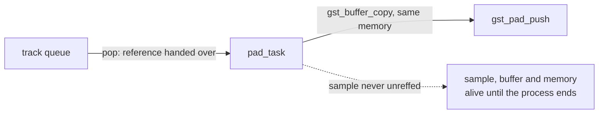

> One change of the GStreamer fork: `review/04`, 4 of 33 in the stack.
> Below it: [`review/03`](https://github.com/Airodonack/gstreamer/tree/review/03). Above it: [`review/05`](https://github.com/Airodonack/gstreamer/tree/review/05).
> The change itself: [commit 75bd182ae9992e247676df0bab61c957663fdd16](https://github.com/Airodonack/gstreamer/commit/75bd182ae9992e247676df0bab61c957663fdd16). This README sits in a commit on top of it and is not part of the merge request.
> The whole stack: [overview README](https://github.com/Airodonack/gstreamer/blob/mse-fixes-main/README.md).

# Media played through msesrc is freed after playback

Every sample msesrc played stayed in memory for as long as the process ran,
with its buffer and the buffer's memory: removing the media, detaching or
tearing the pipeline down freed none of it. msesrc's pad task never dropped
the reference that popping a sample hands it. The change drops it on both of
the task's ways out. It is in one function of gstmsesrc.c, and the code
applies to stock GStreamer main alone, as to 1.28.6.

## The problem

Each msesrc pad runs
[`pad_task()`](https://github.com/Airodonack/gstreamer/blob/75bd182ae9992e247676df0bab61c957663fdd16/subprojects/gst-plugins-bad/gst-libs/gst/mse/gstmsesrc.c#L967-L1108),
which pops the next sample or event of its track with
`gst_media_source_track_pop()`. The pop hands the caller the track's
reference. For a sample, the task pushed a copy of its buffer
(`gst_buffer_copy()` shares the memory) and never unreffed the sample, so the
sample, its buffer and the memory lived on. The early exits before that point,
when pushing the stream start, the caps, the segment or the stream collection
failed, leaked the popped object too.

## The change

`pad_task()` declares the popped object at the top, so both exits see it, and
clears it at each: the normal end and the `pause:` label
([lines 1098 and 1106](https://github.com/Airodonack/gstreamer/blob/75bd182ae9992e247676df0bab61c957663fdd16/subprojects/gst-plugins-bad/gst-libs/gst/mse/gstmsesrc.c#L1098-L1106)).
The event branch still steals the object into `gst_pad_push_event()`
([line 1084](https://github.com/Airodonack/gstreamer/blob/75bd182ae9992e247676df0bab61c957663fdd16/subprojects/gst-plugins-bad/gst-libs/gst/mse/gstmsesrc.c#L1084)),
which leaves `NULL` behind, so an event is not released twice. Nothing else
used the task's reference: the track's queue gives its own up on pop, and the
sample map and the track feed hold theirs.

## Why it sits above `review/03`

The change itself applies to GStreamer main with nothing below it. Its test needs
`review/03`: without that fix, each initialization segment leaks a source
buffer list, whose event queue task keeps `gst_task_cleanup_all()` from
returning after the test, and the test ends in a timeout. In a gate build of
the 1.28 restack that put this change below `review/03`, the test failed with
"(after this point) Test timeout expired". The test is also written next to
`review/02`'s in `tests/check/libs/mse.c`, so a patch of this commit alone
conflicts with stock main there by position only; `git merge-file` of
gstmsesrc.c against main 74f679f8de is clean. The same holds on 1.28.6.

## Options considered

| Option | Why not chosen |
|---|---|
| **Hold the popped object for the whole function, clear it on both exits** (this change) | Chosen: one owner for the reference, and every early `goto pause` is covered. |
| Unref the sample right after `gst_pad_push()` | Leaves the leaks on the failed-push exits before it. |

## How it was checked

Unit test
[`test_media_source_element_frees_played_media`](https://github.com/Airodonack/gstreamer/blob/75bd182ae9992e247676df0bab61c957663fdd16/subprojects/gst-plugins-bad/tests/check/libs/mse.c#L475-L541)
plays `mse.mp4` through msesrc into fakesinks to the end of stream, holds a
weak reference on the memory of every buffer the pads push
([`watch_played_media`](https://github.com/Airodonack/gstreamer/blob/75bd182ae9992e247676df0bab61c957663fdd16/subprojects/gst-plugins-bad/tests/check/libs/mse.c#L411-L431)),
stops the pipeline, detaches and releases the media source and the source
buffer, and expects all that memory freed. At this commit the track feeds
still hold a reference to their source buffer until they have pushed the end
of stream, so the test waits for those to go first.

From the gate on GStreamer main (2026-11-05):

- The test against `review/03`'s gstmsesrc.c: "'await_played (&played,
  &played.freed, &played.pushed)' (0) is not equal to 'played.pushed'
  (564)".
- With this change, the whole suite, three runs: `100%: Checks: 69,
  Failures: 0, Errors: 0`.

The 1.28 series' gate on 1.28.6 gave the same, with 904 buffers pushed.

From the commit message, not re-run: on the whole series, with `mse.mp4`
appended 20 times in sequence mode (1:53.7 of media), played to the end,
every byte removed, a seek, then teardown, all 18023 pushed memories
(9412107 bytes) were still alive after teardown before this change, and none
after it.

Not done here: media removed while the page plays stays alive until the next
seek, held by the track feed. `review/25` fixes that.

## Questions a reviewer may ask

- **How much does it cost?** Everything played: for `mse.mp4`, 9412107 bytes
  over 1:53.7 of media, about 83 kB per second, freed only at process exit.
- **Is anything freed too early now?** No user of the sample remains after
  the push: downstream holds the copied buffer, which keeps its own reference
  to the shared memory.
