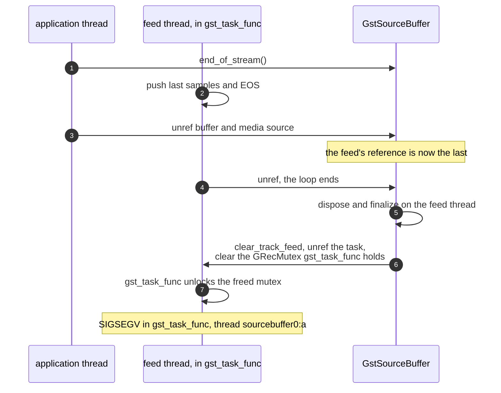
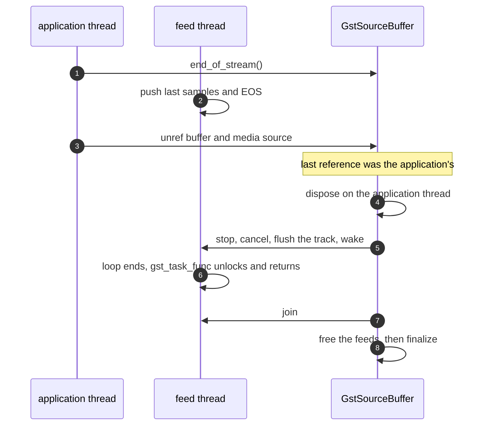

> One change of the GStreamer fork: `review/21`, 21 of 33 in the stack.
> Below it: [`review/20`](https://github.com/Airodonack/gstreamer/tree/review/20). Above it: [`review/22`](https://github.com/Airodonack/gstreamer/tree/review/22).
> The change itself: [commit 830791de97489ce5d7c1160e0c0e878e9855d390](https://github.com/Airodonack/gstreamer/commit/830791de97489ce5d7c1160e0c0e878e9855d390). This README sits in a commit on top of it and is not part of the merge request.
> The whole stack: [overview README](https://github.com/Airodonack/gstreamer/blob/mse-fixes-main/README.md).

# A source buffer with media is freed when the application lets go

Each track of a source buffer has a feed task that pushes its samples to
msesrc. The feed held a strong reference to its source buffer while it ran.
That leaked every removed buffer that still had media. It also crashed when
the feed's reference happened to be the last one. With this change the
feed holds a plain pointer, and the buffer stops and joins its feeds when
it is disposed.

## The problem

The feed kept a weak reference to the buffer and upgraded it to a strong
one for the whole run of
[`track_feed_task`](https://github.com/Airodonack/gstreamer/blob/830791de97489ce5d7c1160e0c0e878e9855d390/subprojects/gst-plugins-bad/gst-libs/gst/mse/gstsourcebuffer.c#L2008-L2066),
a loop that only ends at end of stream, a failed push or a stop.

**The leak.** A buffer with media that the application removed
(`removeSourceBuffer`, detaching or dropping the media source) kept the
feeds' references, so it was never disposed, and dispose is what stops the
feeds. The feeds woke once a second to look for new data, for as long as
the process ran. In the unit tests `gst_task_cleanup_all()` never returned.

**The crash, a race.** At end of stream the feeds push their last samples
and EOS and then drop their reference. If the application has let go of
the buffer and the media source meanwhile, the feed's unref is the last,
and dispose and finalize run on the feed's own thread:

## The change

- `TrackFeedTask.parent` is a plain pointer
  ([lines 104 to 110](https://github.com/Airodonack/gstreamer/blob/830791de97489ce5d7c1160e0c0e878e9855d390/subprojects/gst-plugins-bad/gst-libs/gst/mse/gstsourcebuffer.c#L104-L110)),
  as the append task's already is
  ([`append_to_buffer_task_new`](https://github.com/Airodonack/gstreamer/blob/830791de97489ce5d7c1160e0c0e878e9855d390/subprojects/gst-plugins-bad/gst-libs/gst/mse/gstsourcebuffer.c#L1815-L1826)).
  The feed neither refs nor unrefs the buffer, so no feed can be the
  thread that frees it.
- [`gst_source_buffer_dispose`](https://github.com/Airodonack/gstreamer/blob/830791de97489ce5d7c1160e0c0e878e9855d390/subprojects/gst-plugins-bad/gst-libs/gst/mse/gstsourcebuffer.c#L392-L418)
  stops and joins every feed with the new
  [`stop_track_feeds`](https://github.com/Airodonack/gstreamer/blob/830791de97489ce5d7c1160e0c0e878e9855d390/subprojects/gst-plugins-bad/gst-libs/gst/mse/gstsourcebuffer.c#L808-L817),
  after the append task and the append pipeline are gone and before the
  feeds table is emptied. The feeds have ended before anything they use
  goes away.
- [`stop_track_feed`](https://github.com/Airodonack/gstreamer/blob/830791de97489ce5d7c1160e0c0e878e9855d390/subprojects/gst-plugins-bad/gst-libs/gst/mse/gstsourcebuffer.c#L796-L806)
  wakes a feed that is waiting for data with the new
  [`gst_media_source_track_buffer_wake`](https://github.com/Airodonack/gstreamer/blob/830791de97489ce5d7c1160e0c0e878e9855d390/subprojects/gst-plugins-bad/gst-libs/gst/mse/gstmediasourcetrackbuffer.c#L200-L208),
  so the join does not wait out the one-second deadline. Seeking restarts
  feeds the same way and gains the same.

After:

**Lock order.** Dispose holds no lock while it joins. A feed takes only its
track buffer's `NEW_DATA` lock and its track's queue lock, both leaves
below `TRACKS_LOCK`, so joining a feed from `gst_source_buffer_seek()`
under `TRACKS_LOCK` stays valid, as before.

The test helper `finish_mp4_source_buffer()`, which ended the stream and
waited for the feeds' references before a test released its fixture, is
removed; the tests release their fixtures directly.

## Options considered

| Option | Why not chosen |
|---|---|
| **Plain pointer, join in dispose** (this change) | Chosen: the owner's lifetime bounds the feeds', which is the usual GStreamer pattern for an element's tasks, and it fixes the leak and the crash together. |
| Keep the strong reference, defer the last unref to another thread (an idle source or the event queue) | Fixes the crash but not the leak: a removed buffer still lives as long as its feeds. |
| Keep the weak reference but drop the strong one between iterations | Each iteration would upgrade and drop it, and an unref inside the loop can still be the last one, on the feed thread. |
| Stop the feeds in `gst_media_source_remove_source_buffer()` | Covers removal but not dropping the media source or the buffer without removal; dispose covers all. |

## How it was checked

Unit tests in `tests/check/libs/mse.c`, both failing before this change
according to the commit message ("the removed source buffer was not freed"
after 5 s, and "Received signal 11 (Segmentation fault)"):

- [`test_source_buffer_freed_when_removed`](https://github.com/Airodonack/gstreamer/blob/830791de97489ce5d7c1160e0c0e878e9855d390/subprojects/gst-plugins-bad/tests/check/libs/mse.c#L1539-L1570):
  a buffer with `mse.mp4` appended is disposed after `remove_source_buffer`
  and the last unref, and also when the application drops the media
  source.
- [`test_source_buffer_freed_at_end_of_stream`](https://github.com/Airodonack/gstreamer/blob/830791de97489ce5d7c1160e0c0e878e9855d390/subprojects/gst-plugins-bad/tests/check/libs/mse.c#L1572-L1597):
  five rounds of `end_of_stream()` followed at once by dropping the media
  source and the buffer; each buffer is disposed and nothing crashes.

From the commit message, not re-run: the same browser pages as before still
pass on a library built from this tree. The message's suite count, 82, is
from the old order, when this change sat above the MP4 initialization
segment work; at its place now the suite has 81.

A probe for the earlier README, on stock GStreamer 1.28.7 through PyGObject did **not**
reproduce the leak: a removed buffer with `mse.mp4` appended, attached to
an msesrc outside a pipeline, was freed within 6 s in 3 of 3 runs. That
setup differs from the unit tests' (no msesrc, ready state set by hand) and
from the stack's commits below this one; the failing unit tests above, recorded in
the commit message, are the evidence for the leak.

At this commit, the gate on GStreamer main (2026-11-05) ran the whole unit
test suite: `100%: Checks: 81, Failures: 0, Errors: 0`, as on the 1.28 series.

## Questions a reviewer may ask

- **Can dispose itself run on a feed thread now?** Only if something on a
  feed thread drops the last reference, and the feed holds none. A signal
  handler of the application could; the same holds for any GStreamer task.
- **Does the feed read freed memory between dispose and the join?** No:
  dispose joins before freeing anything the feed uses. The feed still
  reads `seek_time` without a lock, as before.
- **Why wake the feed?** Without it, each join waits for the feed's
  one-second deadline, so freeing a buffer with three tracks could take up
  to a second, and every seek did already.
