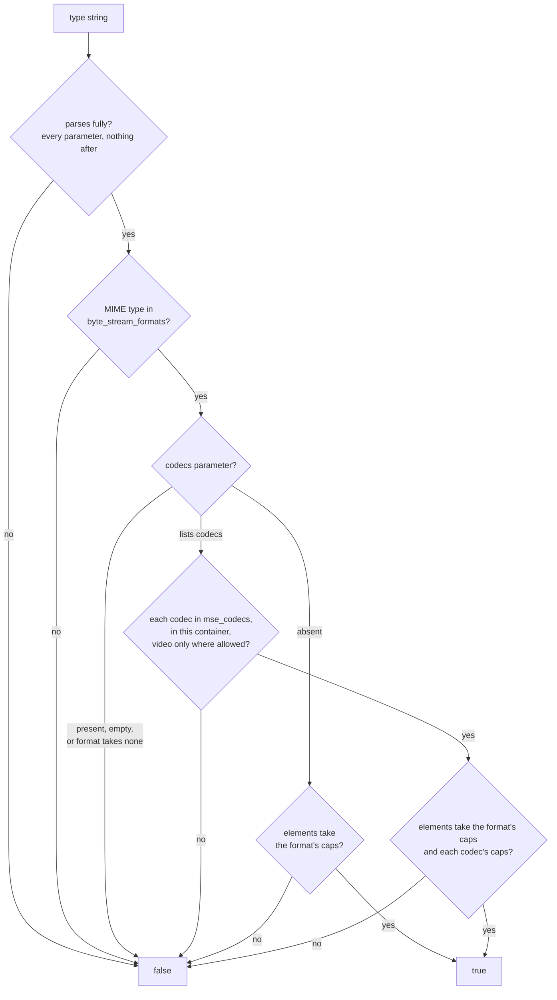

> One change of the GStreamer fork: `review/26`, 26 of 33 in the stack.
> Below it: [`review/25`](https://github.com/Airodonack/gstreamer/tree/review/25). Above it: [`review/27`](https://github.com/Airodonack/gstreamer/tree/review/27).
> The change itself: [commit 7afac90579e2dc0e43312fd49d90a7360bd7f022](https://github.com/Airodonack/gstreamer/commit/7afac90579e2dc0e43312fd49d90a7360bd7f022). This README sits in a commit on top of it and is not part of the merge request.
> The whole stack: [overview README](https://github.com/Airodonack/gstreamer/blob/mse-fixes-main/README.md).

# isTypeSupported() answers from the byte stream format registry

`gst_media_source_is_type_supported()` said yes to many types MSE must
refuse: codecs in the wrong container, raw caps names, MPEG audio with a
codecs parameter, codec ids with no profile. Players pick a format from
these answers, so a wrong yes sends them down a path that cannot play.
This change answers from two tables, one of the registry's byte stream
formats and one of codec strings.

## The problem

The old code
([main, `patch_media_type` to `is_supported`](https://github.com/Airodonack/gstreamer/blob/74f679f8de/subprojects/gst-plugins-bad/gst-libs/gst/mse/gstmsemediatype.c#L376-L509))
did three things by hand:

- **MIME type to caps:** `video/mp4` became `video/quicktime`, `audio/mp4`
  and `audio/aac` became `audio/x-m4a`, and any other `audio/` or `video/`
  type was used as caps as it was. So `video/x-raw` or `video/quicktime`
  were "supported" whenever some element took those caps.
- **Codecs by prefix, whatever the container:** `audio/webm;codecs="vp8"`,
  `video/mp4;codecs="vorbis"` and `audio/mpeg;codecs="mp3"` passed. `mp4v`
  (MPEG-4 Part 2) counted as H.264; `avc1` or `mp4a` with no profile
  passed.
- **A forgiving parser:** a parameter that did not parse
  (`video/webm;codecs`, a trailing `;`) left a valid type, and
  `codecs=""` listed no codec and so passed.

Probed for the earlier README, on stock GStreamer 1.28.7 through PyGObject: of the 50 types of this
commit's unit test, 30 were answered differently from the test's expected
answer, all 30 accepted where they must be refused (the list includes every
example above).

## The change

[`gstmsemediatype.c`](https://github.com/Airodonack/gstreamer/blob/7afac90579e2dc0e43312fd49d90a7360bd7f022/subprojects/gst-plugins-bad/gst-libs/gst/mse/gstmsemediatype.c#L373-L467)
now holds two tables.

**`byte_stream_formats`**, the registry's formats, each with the caps of
its bytes, its container, whether it may carry video, whether it generates
timestamps, and whether the append pipeline is given its caps instead of
typefinding:

| MIME type | Caps | Codecs from | Video | Generates timestamps | Caps skip typefinding |
|---|---|---|---|---|---|
| `video/mp4` | `video/quicktime, variant=iso` | MP4 | yes | no | yes |
| `audio/mp4` | same | MP4 | no | no | yes |
| `video/webm` | `video/webm` | WebM | yes | no | no |
| `audio/webm` | `audio/webm` | WebM | no | no | no |
| `audio/mpeg` | `audio/mpeg, mpegversion=1` | none allowed | no | yes | no |
| `audio/aac` | ADTS AAC | none allowed | no | yes | no |

**`mse_codecs`**, each codec string with the caps of its stream and its
containers
([lines 395 to 433](https://github.com/Airodonack/gstreamer/blob/7afac90579e2dc0e43312fd49d90a7360bd7f022/subprojects/gst-plugins-bad/gst-libs/gst/mse/gstmsemediatype.c#L395-L433)):
`avc1`/`avc3` with six hex digits of profile and level (RFC 6381), `hev1`/
`hvc1`, `av01` and `vp09` with at least three fields, `vp8` and `vp9` in
WebM, `mp4a.40.2`/`.5`/`.29` (MPEG-4 AAC), `mp4a.66`/`.67`/`.68` (MPEG-2
AAC), `mp4a.69`/`.6b` (MP3), `opus`, `flac` in MP4, `vorbis` in WebM. The
set and the field counts follow Chrome's answers for the media-source
web-platform-tests' cases.

The functions:
[`find_codec`](https://github.com/Airodonack/gstreamer/blob/7afac90579e2dc0e43312fd49d90a7360bd7f022/subprojects/gst-plugins-bad/gst-libs/gst/mse/gstmsemediatype.c#L515-L538),
[`is_codec_supported`](https://github.com/Airodonack/gstreamer/blob/7afac90579e2dc0e43312fd49d90a7360bd7f022/subprojects/gst-plugins-bad/gst-libs/gst/mse/gstmsemediatype.c#L559-L574),
[`gst_media_source_media_type_is_supported`](https://github.com/Airodonack/gstreamer/blob/7afac90579e2dc0e43312fd49d90a7360bd7f022/subprojects/gst-plugins-bad/gst-libs/gst/mse/gstmsemediatype.c#L594-L625).
The parser,
[`media_type_codecs`](https://github.com/Airodonack/gstreamer/blob/7afac90579e2dc0e43312fd49d90a7360bd7f022/subprojects/gst-plugins-bad/gst-libs/gst/mse/gstmsemediatype.c#L284-L334),
now reads every parameter, where it stopped at the first that was not
`codecs`, and refuses one that does not parse or anything after them.

A type without a codecs parameter is still accepted: `addSourceBuffer()`
callers use bare types. The element check is the one from before: some
demuxer, parser, decoder or sink takes the caps.

[`gst_source_buffer_new`](https://github.com/Airodonack/gstreamer/blob/7afac90579e2dc0e43312fd49d90a7360bd7f022/subprojects/gst-plugins-bad/gst-libs/gst/mse/gstsourcebuffer.c#L326-L368)
takes the append pipeline's caps from the same table
([`gst_media_source_media_type_get_caps`](https://github.com/Airodonack/gstreamer/blob/7afac90579e2dc0e43312fd49d90a7360bd7f022/subprojects/gst-plugins-bad/gst-libs/gst/mse/gstmsemediatype.c#L627-L637)),
replacing the MP4 special case of `review/23`, and the "generates timestamps"
answer from the same entry.

## Options considered

| Option | Why not chosen |
|---|---|
| **Tables of the registry's formats and of codec strings** (this change) | Chosen: one place says which format takes which codec, and it is where the append pipeline's caps live too. |
| Patch the prefix list | Prefixes cannot express containers or field counts; `mp4v` versus `mp4a` versus `mp4a.40` is the kind of case that keeps breaking. |
| Ask the registry of elements alone (caps from `gst-pbutils` codec utils) | `gst_codec_utils_caps_from_mime_codec()` turns a codec string into caps but says nothing about which container may carry it. |
| Accept everything that has an element, refuse later at append | Players choose formats from `isTypeSupported()`; a yes that fails later costs them a fallback they would have taken at once. |

## The cost

- The tables are a list to maintain: a codec mselib could play but that is
  missing (AC-3, E-AC-3, for example) is now refused.
- An unquoted codec list (`codecs=avc1.42E01E,mp4a.40.2`) is refused: the
  comma ends the token and the parser then refuses what follows. The MIME
  Sniffing standard would accept it.
- WebM's "caps skip typefinding" is off, so WebM tracks still wait for the
  first Cluster (`review/23`). Setting it is one flag; left for a decision.

## Spec

[MSE, `isTypeSupported()`](https://w3c.github.io/media-source/#dom-mediasource-istypesupported):

> If type contains a media type or media subtype that the MediaSource does
> not support, then return false.
> If type contains a codec that the MediaSource does not support, then
> return false.
> If the MediaSource does not support the specified combination of media
> type, media subtype, and codecs then return false.

The formats are those of the
[Media Source Extensions Byte Stream Format Registry](https://www.w3.org/TR/mse-byte-stream-format-registry/).
Its MPEG audio entry takes no codecs parameter, as the commit message
reads it.

## How it was checked

Unit test
[`test_media_source_content_type_support`](https://github.com/Airodonack/gstreamer/blob/7afac90579e2dc0e43312fd49d90a7360bd7f022/subprojects/gst-plugins-bad/tests/check/libs/mse.c#L3219-L3290),
a loop over 50 types: the web-platform-tests' invalid and mismatched cases,
MPEG audio with codecs, incomplete codec ids, empty codec lists, caps names
that are not formats, and the codecs of each format. It fails before this
change (30 of 50 accepted that must be refused), per the commit message,
and the stock probe gave the same 30.

The loop counts each type as a check, which is why the suite grows by 50
here. The existing loops `test_media_source_supported_mp4_content_type` and
`_webm_content_type` still pass.

At this commit, the gate on GStreamer main (2026-11-05) ran the whole unit
test suite: `100%: Checks: 145, Failures: 0, Errors: 0`, as on the 1.28 series.

## Questions a reviewer may ask

- **Why follow Chrome?** The web-platform-tests encode its answers, and
  sites test against it. The spec leaves "supports" to the user agent.
- **Why is `opus` allowed in MP4 and `vp09` in WebM?** Chrome accepts
  both, and players use both.
- **Is the whole type lowercased?** Yes, as before, so `mp4a.6B` and
  `MP4A.6b` match the table's `mp4a.6b`.
