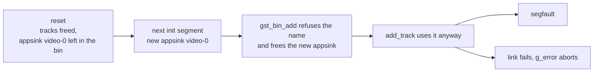

> One change of the GStreamer fork: `review/06`, 6 of 33 in the stack.
> Below it: [`review/05`](https://github.com/Airodonack/gstreamer/tree/review/05). Above it: [`review/07`](https://github.com/Airodonack/gstreamer/tree/review/07).
> The change itself: [commit 868ad76ab363112e4ee591c571a16a3443cc5a8b](https://github.com/Airodonack/gstreamer/commit/868ad76ab363112e4ee591c571a16a3443cc5a8b). This README sits in a commit on top of it and is not part of the merge request.
> The whole stack: [overview README](https://github.com/Airodonack/gstreamer/blob/mse-fixes-main/README.md).

# A reset append pipeline accepts an initialization segment again

After an append pipeline was reset, the next initialization segment crashed
the whole application. Upstream, a reset follows every parse error. Later in
this stack `abort()` resets too, so every abort followed by a new
initialization segment would crash. The fix removes the old tracks' appsinks
during the reset.

## The problem

An append pipeline is `appsrc ! parsebin`, with one `appsink` per track that
parsebin exposes. Each appsink is named after its stream type and index,
`video-0`, `audio-1` and so on
([`new_appsink()`](https://github.com/Airodonack/gstreamer/blob/868ad76ab363112e4ee591c571a16a3443cc5a8b/subprojects/gst-plugins-bad/gst-libs/gst/mse/gstappendpipeline.c#L380-L393)).

[`gst_append_pipeline_reset()` on main](https://github.com/Airodonack/gstreamer/blob/74f679f8de/subprojects/gst-plugins-bad/gst-libs/gst/mse/gstappendpipeline.c#L861-L902)
frees the tracks array but leaves the old appsinks in the bin. The next
initialization segment's tracks get the same names again. In
[`add_track()`](https://github.com/Airodonack/gstreamer/blob/868ad76ab363112e4ee591c571a16a3443cc5a8b/subprojects/gst-plugins-bad/gst-libs/gst/mse/gstappendpipeline.c#L466-L477):

1. `gst_bin_add()` refuses an element whose name is taken. It also sinks and
   unrefs the element it refuses
   ([gstbin.c on main, lines 1378 to 1387](https://github.com/Airodonack/gstreamer/blob/74f679f8de/subprojects/gstreamer/gst/gstbin.c#L1378-L1387)),
   so the new appsink is freed right there.
2. `add_track()` ignores the result and goes on using the freed appsink: it
   syncs its state, takes its pad and links it.
3. Either that use of freed memory crashes, or the link fails, since the
   appsink has no parent, and `add_track()` calls `g_error()`, which aborts the
   process.

## The change

Before the reset frees the tracks array, it takes each old appsink out of the
pipeline
([gstappendpipeline.c, lines 878 to 895](https://github.com/Airodonack/gstreamer/blob/868ad76ab363112e4ee591c571a16a3443cc5a8b/subprojects/gst-plugins-bad/gst-libs/gst/mse/gstappendpipeline.c#L878-L895)):
unlink it from its source pad if linked, set it to `NULL`, and remove it from
the bin. The pipeline is already in `READY` and its background task stopped at
this point, so no sample is in flight.

Each `Track` holds its own references to its appsink and pad, which
[`clear_track()`](https://github.com/Airodonack/gstreamer/blob/868ad76ab363112e4ee591c571a16a3443cc5a8b/subprojects/gst-plugins-bad/gst-libs/gst/mse/gstappendpipeline.c#L498-L505)
drops when the array is freed, so removing the sink from the bin leaves the
reference counts balanced.

## Options considered

| Option | What it would take | Why not chosen |
|---|---|---|
| **Remove the old appsinks in the reset** (this change) | 19 lines in the reset | Chosen: the reset already drops everything else of the old tracks. The pipeline after a reset then looks like a new one. |
| Unique appsink names, with a counter | Change `new_appsink()` | The old sinks would pile up in the pipeline, one set per reset. Track ids, which are the appsink names, would also change on every reset, and later changes in this stack rely on them repeating. |
| Check `gst_bin_add()`'s result and report a parse error | A few lines in `add_track()` | Turns the crash into an error, but the reset pipeline still could not take a new initialization segment. Worth doing as well. Not done here. |
| Build a whole new append pipeline on reset | Larger change | More state to rebuild and hand over: callbacks, bus task, appsrc. |

## How it was checked

Unit test
[`test_append_pipeline_reset_after_init_segment`](https://github.com/Airodonack/gstreamer/blob/868ad76ab363112e4ee591c571a16a3443cc5a8b/subprojects/gst-plugins-bad/tests/check/libs/mse.c#L822-L848)
appends an MP4 with three tracks, waits for its EOS, resets, and does it a
second time. It checks that the pipeline did not fail and has three tracks
after each round.

- Before the change (run of 2026-10-23, the same test text): "Received signal
  11 (Segmentation fault)" in this test.
- After: passes. Re-run for this README on a build of the stack's top of that day
  (2026-11-03): 5 of 5 runs pass.
- It was first seen as a browser crash in that `g_error()` during a
  web-platform-tests media-source run.

The parse error path that triggers the reset upstream has other problems:
errors reported twice, a reset run on the thread it joins. They are fixed in
`review/12` and `review/14`.

At this commit, the gate on GStreamer main (2026-11-05) ran the whole unit
test suite: `100%: Checks: 71, Failures: 0, Errors: 0`, as on the 1.28 series.

## Questions a reviewer may ask

- **Why can `track->sink` be `NULL`?** It cannot for a track `add_track()`
  added. The check costs nothing and keeps the loop safe if a track is ever
  stored half-built.
- **Why unlink before removing?** `gst_bin_remove()` unlinks the element's pads
  too. The explicit unlink makes the order clear and is harmless when already
  unlinked.
