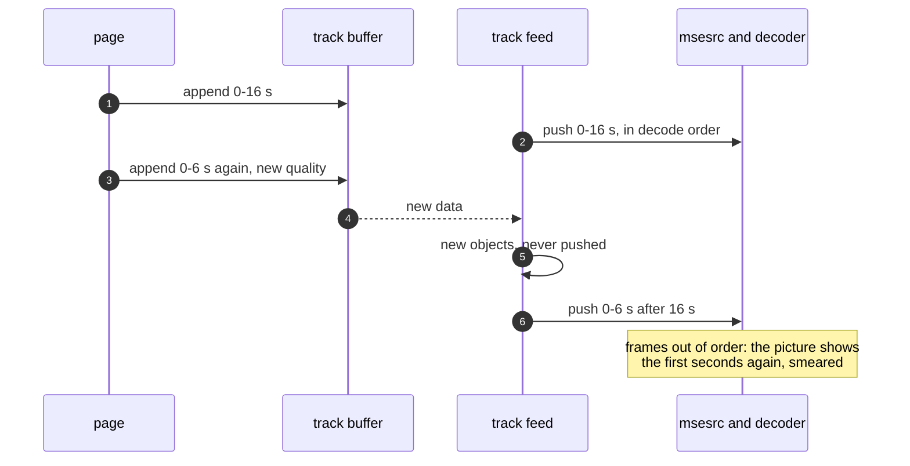
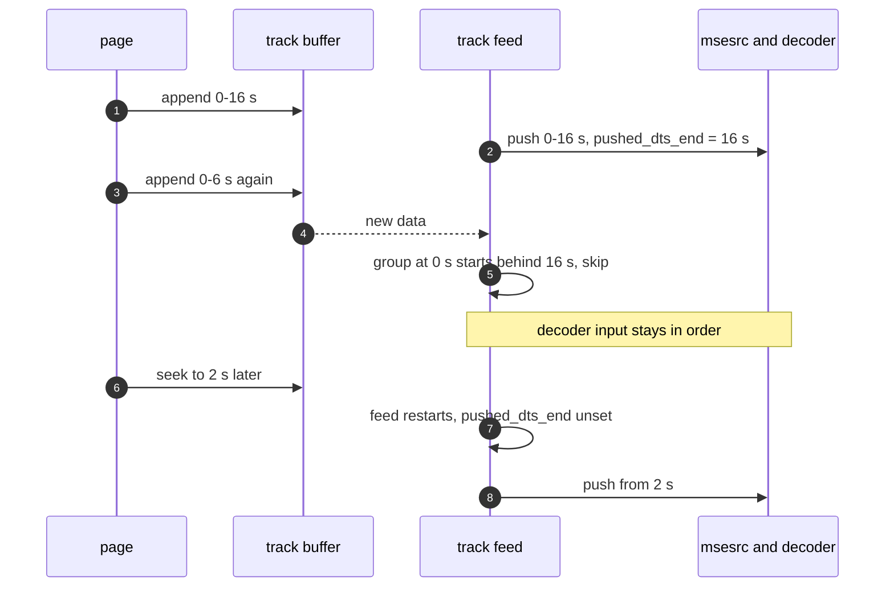

> One change of the GStreamer fork: `review/20`, 20 of 33 in the stack.
> Below it: [`review/19`](https://github.com/Airodonack/gstreamer/tree/review/19). Above it: [`review/21`](https://github.com/Airodonack/gstreamer/tree/review/21).
> The change itself: [commit 4b1432f229f5ee2502308c9604b08bb7bee11985](https://github.com/Airodonack/gstreamer/commit/4b1432f229f5ee2502308c9604b08bb7bee11985). This README sits in a commit on top of it and is not part of the merge request.
> The whole stack: [overview README](https://github.com/Airodonack/gstreamer/blob/mse-fixes-main/README.md).

# Re-appending media already played no longer replays it

When a page appended media over a time range the decoder had already
received, mselib pushed the new frames to the decoder after everything
else. On YouTube the picture jumped back to the first seconds, smeared,
while the clock went on. With this change the track feed skips such
frames and leaves them buffered for a later seek.

## The problem

Each track has a feed task that walks the track buffer from the seek
position and pushes every sample it has not pushed yet to msesrc. "Not
pushed yet" is judged by object identity
([`track_feed_fold`](https://github.com/Airodonack/gstreamer/blob/4b1432f229f5ee2502308c9604b08bb7bee11985/subprojects/gst-plugins-bad/gst-libs/gst/mse/gstsourcebuffer.c#L1903-L1973)
keeps a set of pushed samples). The feed wakes on every append.

YouTube re-appends the opening fragment, decode time 0 again, a few seconds
into playback, likely in a better quality. Those are new sample objects, so
the feed pushed them, behind frames up to 16 s or more:

mselib does not take the replaced frames out of the track buffer (the
spec's "remove existing coded frames" step is not implemented). Both copies
of 0-6 s are kept, sorted by decode time, and that is not what this change
is about: it is about what the feed sends to the decoder.

## The change

The feed remembers how far the decoder's input has reached,
`pushed_dts_end`: the highest decode time plus duration it has pushed
([accumulator, lines 117 to 125](https://github.com/Airodonack/gstreamer/blob/4b1432f229f5ee2502308c9604b08bb7bee11985/subprojects/gst-plugins-bad/gst-libs/gst/mse/gstsourcebuffer.c#L117-L125);
updated at
[lines 1960 to 1969](https://github.com/Airodonack/gstreamer/blob/4b1432f229f5ee2502308c9604b08bb7bee11985/subprojects/gst-plugins-bad/gst-libs/gst/mse/gstsourcebuffer.c#L1960-L1969)).
A coded frame group that starts behind it is skipped
([lines 1918 to 1940](https://github.com/Airodonack/gstreamer/blob/4b1432f229f5ee2502308c9604b08bb7bee11985/subprojects/gst-plugins-bad/gst-libs/gst/mse/gstsourcebuffer.c#L1918-L1940)),
with two exceptions:

- a group the feed has already started (its first sample was pushed), which
  is a group still being appended;
- an overlap of less than half the group's first frame, which fragments
  have from rounding or audio priming. Each audio frame is its own group,
  so without this allowance the first audio frame of such a fragment would
  be skipped.

The accumulator lives as long as one run of the feed task: a seek restarts
the feed
([`track_feed_task`](https://github.com/Airodonack/gstreamer/blob/4b1432f229f5ee2502308c9604b08bb7bee11985/subprojects/gst-plugins-bad/gst-libs/gst/mse/gstsourcebuffer.c#L1984-L2047)),
so after a seek the skipped frames can be played.

## Options considered

| Option | Why not chosen |
|---|---|
| **Skip groups behind what the decoder has received** (this change) | Chosen: 44 lines in the feed, nothing else changes, and the skipped media stays for a later seek. |
| Implement the spec's removal of overlapped frames in the track buffer | Needed some day for buffered ranges and seeks, but it does not stop this bug: the new frames are still new objects behind the feed's position, and would still be pushed. |
| Flush the feed and decoder and replay from the playhead | A visible glitch for every re-append, and the spec does not ask the decoder to be fed again for media already played. |
| Rely on downstream to drop late frames | A sink drops late frames, which is why local tests looked fine, but the decoder has already decoded them out of order: YouTube's smear. |

## The cost

The decoder's input runs ahead of the playhead by a track queue, up to
1024 samples
([`DEFAULT_QUEUE_SIZE`](https://github.com/Airodonack/gstreamer/blob/4b1432f229f5ee2502308c9604b08bb7bee11985/subprojects/gst-plugins-bad/gst-libs/gst/mse/gstmediasourcetrack.c#L50)),
about 34 s of 30 fps video, plus what the playback pipeline queues. A page that replaces frames that are queued
but not yet shown, for example to upgrade the quality just ahead of the
playhead, keeps the old frames on screen up to that far. The spec would
show the new ones. This is computed from the code, not measured.

## Spec

[MSE, coded frame processing](https://w3c.github.io/media-source/#sourcebuffer-coded-frame-processing),
"Remove existing coded frames in track buffer": a new frame replaces the
buffered frames whose presentation interval it overlaps, and the frames
that depend on them up to the next random access point. That changes what
is buffered, for the next seek; the spec does not ask for media already
decoded to be decoded again.

## How it was checked

No unit test: the behaviour needs a feed pushing into msesrc while an
append lands behind it.

From the commit message, not re-run here:

- YouTube in a browser built on this library: the replay at about 18 s
  without the change, none with it.
- A page that appends one quality of a stream, switches to another and
  re-appends the first three segments: with `GST_DEBUG=gst-mse:6`, the
  groups for 0-6 s are pushed again after 16 s without the change, and the
  log shows "skipping group" with it. Locally the sink drops the late
  frames, so the corruption itself shows only with YouTube's stream.

Not yet done: a unit test with a fake msesrc consumer that appends 0-4 s,
lets the feed push it, appends 0-2 s again and checks that no pushed decode
time goes backwards.

At this commit, the gate on GStreamer main (2026-11-05) ran the whole unit
test suite: `100%: Checks: 79, Failures: 0, Errors: 0`, as on the 1.28 series.

## Questions a reviewer may ask

- **Why judge by decode time?** The feed pushes in decode order, and the
  decoder needs non-decreasing decode times. Presentation times reorder
  within a group.
- **Which copy plays after a seek into the replaced range?** Both are in the
  track buffer, sorted by decode time. The feed pushes the first group it
  meets and skips the other as behind; which copy comes first is not chosen
  by this change. The spec's overlap removal would settle it.
- **Why half a frame of slack?** Fragments that join exactly still overlap
  by rounding, and AAC priming makes an audio fragment start a few
  milliseconds early. Half a frame is far less than any real re-append.
