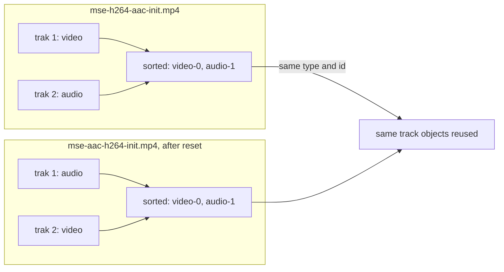

> One change of the GStreamer fork: `review/29`, 29 of 33 in the stack.
> Below it: [`review/28`](https://github.com/Airodonack/gstreamer/tree/review/28). Above it: [`review/30`](https://github.com/Airodonack/gstreamer/tree/review/30).
> The change itself: [commit 489dbe4dabeac093b5fb141706678e547339383e](https://github.com/Airodonack/gstreamer/commit/489dbe4dabeac093b5fb141706678e547339383e). This README sits in a commit on top of it and is not part of the merge request.
> The whole stack: [overview README](https://github.com/Airodonack/gstreamer/blob/mse-fixes-main/README.md).

# tests: A reset keeps the tracks when an init segment reorders them

This commit adds a unit test and a test file, and changes no library code.
It pins down a property that `review/11` and `review/23` rely on: after a parser
reset, an initialization segment that lists its tracks in another order
still gets the same track objects.

## Why a test only

After a reset, the append pipeline reuses a track object for the same type
and track id
([`reuse_or_new_track`](https://github.com/Airodonack/gstreamer/blob/489dbe4dabeac093b5fb141706678e547339383e/subprojects/gst-plugins-bad/gst-libs/gst/mse/gstappendpipeline.c#L437-L450),
from `review/11`). The id is `<type>-<n>`, with `n` the track's position
among all the tracks
([`new_appsink`](https://github.com/Airodonack/gstreamer/blob/489dbe4dabeac093b5fb141706678e547339383e/subprojects/gst-plugins-bad/gst-libs/gst/mse/gstappendpipeline.c#L452-L465)).
The source buffer keys its track buffers and feeds by those objects, so a
new object would cut a track off from its media.

A quality switch could bring an initialization segment that lists audio
before video. If tracks were made in the container's order, the ids would
change (`audio-0` instead of `audio-1`) and nothing would be reused. They
are not: `review/23` makes an initialization segment's tracks at once, sorted
video, audio, text, then stream-id
([`compare_demuxer_streams`](https://github.com/Airodonack/gstreamer/blob/489dbe4dabeac093b5fb141706678e547339383e/subprojects/gst-plugins-bad/gst-libs/gst/mse/gstappendpipeline.c#L879-L894)).
A position then depends only on how many tracks of each type come before,
and MSE requires every later initialization segment to have the same number
of each.

So no bug was found; the test keeps one from appearing.

## The change

Test
[`test_append_pipeline_reset_keeps_tracks`](https://github.com/Airodonack/gstreamer/blob/489dbe4dabeac093b5fb141706678e547339383e/subprojects/gst-plugins-bad/tests/check/libs/mse.c#L1430-L1491):
appends `tests/files/mse-h264-aac-init.mp4`, resets, appends
`tests/files/mse-aac-h264-init.mp4` (the same initialization segment with
its two `trak` boxes, and `trex` boxes, in the other order and their track
ids swapped), and checks that the audio and the video track are the same
objects after the reset. It fails, rather than crashes, when no
initialization segment was reported: the track getters return `NULL`
before one.

## Options considered

| Option | Why not chosen |
|---|---|
| **A test of the current behaviour** (this change) | Chosen: the behaviour is right, and a test guards the ordering `review/23` introduced. |
| Key reused tracks by a per-type index (`audio-0`, `video-0`) instead of a global position | Drafted and not applied: nothing reproduces a miss while the per-type counts are fixed, and a fix needs a failing case first. |

## How it was checked

The test passes before and after this commit, as a test of existing
behaviour does. On GStreamer main before
`review/23` was redesigned, this test crashed (signal 11) because it read the
track arrays when no initialization segment had been reported; the `NULL`
check was added for that.

At this commit, the gate on GStreamer main (2026-11-05) ran the whole unit
test suite four times: `100%: Checks: 148, Failures: 0, Errors: 0` three
times, and once `99%: Checks: 148, Failures: 1, Errors: 0`, this test failing
on "Unexpected critical/warning: loop detected in the graph of bin
'append-pipeline'". The 1.28 series' gate gave 148 with no failure, once.

Not yet done: the cause of that warning. It was seen once in 14 runs of this
test on main (the four here, four at `review/30`, and the gates above it),
and not reproduced since.

## Questions a reviewer may ask

- **Two tracks of the same type swapped?** They are ordered by stream-id,
  which for qtdemux follows the track id. Swapping the ids of two audio
  tracks would swap which object each gets. The test does not cover it;
  the spec does not say how tracks of one type are matched across
  initialization segments either.
- **Why a 1,372-byte binary file?** It is the existing
  `mse-h264-aac-init.mp4` with its boxes reordered; building it in the test
  would need an MP4 writer.
