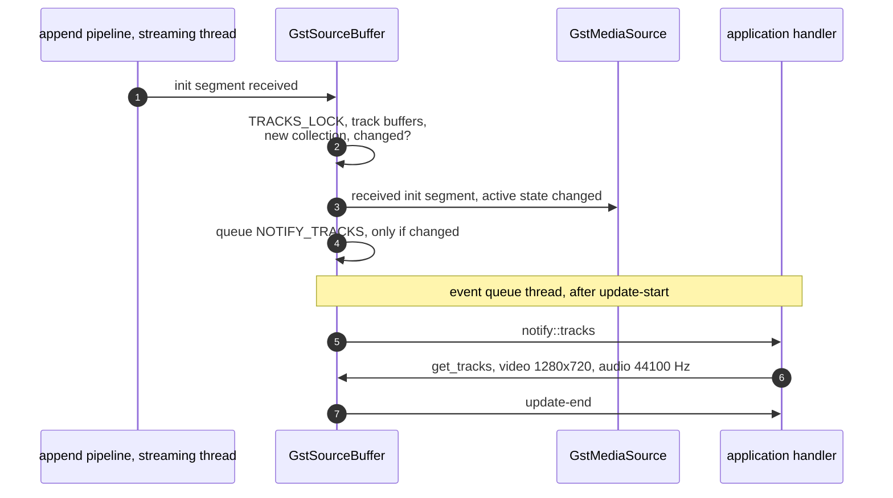

> One change of the GStreamer fork: `review/30`, 30 of 33 in the stack.
> Below it: [`review/29`](https://github.com/Airodonack/gstreamer/tree/review/29). Above it: [`review/31`](https://github.com/Airodonack/gstreamer/tree/review/31).
> The change itself: [commit 05d2345dcc2c3d9a1921886b8afacf8ce3a0bf75](https://github.com/Airodonack/gstreamer/commit/05d2345dcc2c3d9a1921886b8afacf8ce3a0bf75). This README sits in a commit on top of it and is not part of the merge request.
> The whole stack: [overview README](https://github.com/Airodonack/gstreamer/blob/mse-fixes-main/README.md).

# Source buffers list their tracks with the caps of the init segment

MSE gives each `SourceBuffer` its own audio and video tracks, made from
its initialization segment. mselib kept tracks private and exposed only
msesrc's counts over all buffers. A browser had to guess which buffer a
track came from, and it learnt the video size only from the first decoded
frame. This change adds new API: a read-only `tracks` property on
`GstSourceBuffer`.

## The problem

MSE's Initialization Segment Received makes an `AudioTrack` or `VideoTrack`
for each track and adds it both to the media element and to the
`SourceBuffer` that received it. The element's metadata, its video size
among it, is set once every buffer has had its first initialization
segment. On mselib an application could do neither:

- the tracks are private; only msesrc's `n-audio`, `n-video` and `n-text`
  are public, summed over all buffers;
- so removing one buffer could not tell which tracks to remove;
- and the width and height were unknown until a frame was decoded.

Probed for the earlier README, on stock GStreamer 1.28.7 through PyGObject: `GstSourceBuffer` has
no `tracks` property and no `get_tracks()`.

## The change

- [`gst_source_buffer_get_tracks`](https://github.com/Airodonack/gstreamer/blob/05d2345dcc2c3d9a1921886b8afacf8ce3a0bf75/subprojects/gst-plugins-bad/gst-libs/gst/mse/gstsourcebuffer.c#L1571-L1594)
  and the `tracks` property
  ([doc and spec, lines 624 to 649](https://github.com/Airodonack/gstreamer/blob/05d2345dcc2c3d9a1921886b8afacf8ce3a0bf75/subprojects/gst-plugins-bad/gst-libs/gst/mse/gstsourcebuffer.c#L624-L649)),
  `Since: 1.30`: a `GstStreamCollection` with one `GstStream` per track of
  the last initialization segment processed, with its stream type, the caps
  parsed from the segment that first gave the track, and
  `GST_STREAM_FLAG_SELECT` when the track is active. A track that a later
  segment shares, after a parser reset or a content type change, keeps its
  first caps.
- The stream ids are the ones msesrc gives the same tracks. Both now come
  from
  [`gst_media_source_track_get_stream_id`](https://github.com/Airodonack/gstreamer/blob/05d2345dcc2c3d9a1921886b8afacf8ce3a0bf75/subprojects/gst-plugins-bad/gst-libs/gst/mse/gstmediasourcetrack.c#L278-L288)
  (msesrc's use, [line 789](https://github.com/Airodonack/gstreamer/blob/05d2345dcc2c3d9a1921886b8afacf8ce3a0bf75/subprojects/gst-plugins-bad/gst-libs/gst/mse/gstmsesrc.c#L787-L791)),
  so an application can match a buffer's tracks with the streams it selects.
- [`on_received_init_segment`](https://github.com/Airodonack/gstreamer/blob/05d2345dcc2c3d9a1921886b8afacf8ce3a0bf75/subprojects/gst-plugins-bad/gst-libs/gst/mse/gstsourcebuffer.c#L1065-L1114)
  rebuilds the collection under `TRACKS_LOCK`
  ([`new_track_collection`](https://github.com/Airodonack/gstreamer/blob/05d2345dcc2c3d9a1921886b8afacf8ce3a0bf75/subprojects/gst-plugins-bad/gst-libs/gst/mse/gstsourcebuffer.c#L1011-L1031)),
  keeps it only when it differs
  ([`track_collections_equal`](https://github.com/Airodonack/gstreamer/blob/05d2345dcc2c3d9a1921886b8afacf8ce3a0bf75/subprojects/gst-plugins-bad/gst-libs/gst/mse/gstsourcebuffer.c#L1033-L1063)),
  and then notifies, after the media source's own callbacks, so a handler
  that reads the tracks finds the active buffers already updated.
- The notification goes through the source buffer's event queue
  ([lines 1105 to 1113](https://github.com/Airodonack/gstreamer/blob/05d2345dcc2c3d9a1921886b8afacf8ce3a0bf75/subprojects/gst-plugins-bad/gst-libs/gst/mse/gstsourcebuffer.c#L1105-L1113),
  [`dispatch_event`](https://github.com/Airodonack/gstreamer/blob/05d2345dcc2c3d9a1921886b8afacf8ce3a0bf75/subprojects/gst-plugins-bad/gst-libs/gst/mse/gstsourcebuffer.c#L2279-L2287)),
  as a `NOTIFY_TRACKS` item after the signals. So it comes from the thread
  of the buffer's other events, after the append's update-start and before
  its update-end, and not from the streaming thread with the append
  pipeline's lock held, where a handler that resets the parser would
  deadlock.
- A parser reset leaves the list as it is: the tracks and their media
  outlive the reset, and the next initialization segment reuses the same
  track objects (`review/11`, and `review/23` for the demuxer path), so the list and its ids do not change.

## Options considered

| Option | Why not chosen |
|---|---|
| **A `GstStreamCollection` property on the source buffer** (this change) | Chosen: it is GStreamer's type for "these streams", carries type, caps and selection, and an application already knows it from msesrc. |
| Make `GstMediaSourceTrack` public API | A larger surface: its queue and feed internals would become API. |
| Notify from the streaming thread, as the first version did | The handler runs with the append pipeline's lock held, so a handler that resets the parser, through `abort()` for example, deadlocks; the documentation had to forbid it. |
| A signal per track added | An application wants the list for one segment at once; a signal per track has no "segment done" without another signal. |
| Let the application read msesrc's collection and guess the buffer | The guess is what failed: removing one buffer removed both tracks or neither. |

## The cost

New public API, `gst_source_buffer_get_tracks()` and the property, marked
`Since: 1.30`. A track keeps the caps of its first initialization segment
(see `review/33`).

## Spec

[MSE, Initialization Segment Received](https://w3c.github.io/media-source/#sourcebuffer-init-segment-received):
for each track, the user agent creates an `AudioTrack` or `VideoTrack`,
adds it to the `SourceBuffer`'s track list and to the media element's.

## How it was checked

Unit test
[`test_source_buffer_tracks_from_init_segment`](https://github.com/Airodonack/gstreamer/blob/05d2345dcc2c3d9a1921886b8afacf8ce3a0bf75/subprojects/gst-plugins-bad/tests/check/libs/mse.c#L2162-L2232):
the list is empty first; after `mse-h264-aac-init.mp4` it has a
`video/x-h264` stream 1280 by 720 and an `audio/mpeg` stream at 44100 Hz,
1 channel, both selected, with different ids, notified once; after
`abort()` and the same segment again, the same ids and no second
notification.

[`test_source_buffer_tracks_notified_with_events`](https://github.com/Airodonack/gstreamer/blob/05d2345dcc2c3d9a1921886b8afacf8ce3a0bf75/subprojects/gst-plugins-bad/tests/check/libs/mse.c#L2247-L2280)
records the thread of `notify::tracks` and of update-end and expects the
same one.

The commit message gives the suite as `100%: Checks: 150, Failures: 0,
Errors: 0`; the gates on GStreamer main and on the 1.28 series (2026-11-05)
gave the same at this commit.

From the commit message, not re-run: in a browser whose backend reads the
new list, a page with a `video/mp4` and an `audio/mp4` buffer, whose
initialization segments are appended back to back, gets `videoWidth` 1280
and `videoHeight` 720 at `loadedmetadata` (was 0 by 0), and removing the
audio buffer removes only the audio track, 8 of 8 runs (before, 8 of 8
removed both tracks or neither).

## Questions a reviewer may ask

- **Why is the order audio, text, video?** It is
  [`gst_source_buffer_get_all_tracks`](https://github.com/Airodonack/gstreamer/blob/05d2345dcc2c3d9a1921886b8afacf8ce3a0bf75/subprojects/gst-plugins-bad/gst-libs/gst/mse/gstsourcebuffer.c#L2609-L2637)'s
  order. The documentation promises no order; applications match by id and
  type.
- **Why `Since: 1.30`?** It is new API, for the next release of GStreamer
  main. The fork's 1.28 branch, `mse-fixes-1.28`, carries it too.
