# GStreamer with Media Source Extensions fixes

This is a fork of GStreamer.
It carries fixes to mselib, the library behind Media Source Extensions (MSE) in gst-plugins-bad, in `subprojects/gst-plugins-bad/gst-libs/gst/mse`.
The [Servo fork](https://github.com/Airodonack/servo) used by the VODscribe desktop app plays MSE video through it.

- Branch `mse-fixes-main` holds the series on GStreamer main, 33 commits; the merge requests are opened from it.
- Branch `mse-fixes-1.28` holds the same fixes on the 1.28.6 release, which the app ships, in 34 commits: commit 23 is two there.
- Each commit fixes one thing and is meant to go upstream as its own merge request.
- Commits 01, 02 and 04 fix stock bugs and apply to GStreamer main on their own; commit 01 is in GStreamer core's `queue` element, the rest in mselib.
- This README is one more commit on top of the series, left out of the merge requests.

What does not work yet:

- A codec change through `changeType()` on a buffer that already has tracks fails for most codec pairs (commit 33).
- A media segment appended after `abort()` needs the initialization segment sent again (commit 13).
- WebM tracks appear only with the first Cluster, not from the initialization segment alone ([Tracks from the demuxer](#tracks-from-the-demuxer)).
- A track keeps the caps of its first initialization segment in the `tracks` list (commit 30).
- `isTypeSupported()` refuses an unquoted codec list such as `codecs=avc1.42E01E,mp4a.40.2`, which the MIME Sniffing standard accepts.
- `queue2` has the bug commit 01 fixes in `queue`.
- Buffered ranges of an MP4 with an edit list start later than in Chrome: 0.067 s instead of 0 for the test media.

## Build the library

GStreamer main needs core 1.29.2 or newer, so `mse-fixes-main` builds as a monorepo.
Turn on only what the tests use:

```sh
git clone -b mse-fixes-main https://github.com/Airodonack/gstreamer
cd gstreamer
meson setup build -Dauto_features=disabled -Dtests=enabled \
  -Dbase=enabled -Dgood=enabled -Dbad=enabled -Dgstreamer:check=enabled \
  -Dgst-plugins-base:app=enabled -Dgst-plugins-base:playback=enabled \
  -Dgst-plugins-base:typefind=enabled -Dgst-plugins-good:isomp4=enabled \
  -Dgst-plugins-good:audioparsers=enabled -Dgst-plugins-good:matroska=enabled \
  -Dgst-plugins-bad:mse=enabled -Dgst-plugins-bad:videoparsers=enabled
ninja -C build
GST_PLUGIN_SYSTEM_PATH_1_0= meson devenv -C build ./subprojects/gst-plugins-bad/tests/check/libs_mse
GST_PLUGIN_SYSTEM_PATH_1_0= meson devenv -C build ./subprojects/gstreamer/tests/check/elements_queue
```

The mselib tests end with `100%: Checks: 159, Failures: 0, Errors: 0`, the queue tests with `100%: Checks: 15, Failures: 0, Errors: 0`.

On 1.28.6, build gst-plugins-bad from `mse-fixes-1.28` alone against an installed GStreamer 1.28.6.
You need the development files of GStreamer core and gst-plugins-base 1.28.6.
The unit tests also need gst-plugins-good (qtdemux, matroskademux, the audio parsers) and gst-plugins-bad's video parsers installed.

```sh
git clone -b mse-fixes-1.28 https://github.com/Airodonack/gstreamer
cd gstreamer/subprojects/gst-plugins-bad
meson setup build -Dauto_features=disabled -Dmse=enabled -Dtests=enabled
ninja -C build gst-libs/gst/mse/libgstmse-1.0.so.0.2806.0 tests/check/libs_mse
LD_LIBRARY_PATH=build/gst-libs/gst/mse build/tests/check/libs_mse
```

It gives the same 159 checks.
Run the test binary directly: meson's test environment hides the installed plugins.

To use that library, copy `build/gst-libs/gst/mse/libgstmse-1.0.so.0.2806.0` into a directory of its own as `libgstmse-1.0.so.0`.
Put that directory first in `LD_LIBRARY_PATH`.
Existing functions keep their ABI, so programs built against 1.28.6 run unchanged.
New API (`gst_source_buffer_get_tracks()`) and the signed timestamp offset need the headers of this tree.

## How mselib works

A page's `MediaSource` is a `GstMediaSource`.
Each `SourceBuffer` is a `GstSourceBuffer`.
The media source holds two lists of source buffers: all of them, and the active ones.
It attaches to `msesrc`, the source element of the playback pipeline.

Each source buffer has an append pipeline: `appsrc ! parsebin`, then one `appsink` per track.
The application's bytes go in at `appsrc`.
Parsed samples come out of the appsinks into the source buffer's track buffers, one per track, ordered by time.
A track feed per track pushes those samples to the matching `msesrc` pad.

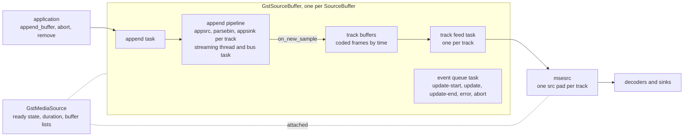

The threads:

- The application thread calls the API: append, abort, remove, the setters, adding and removing buffers.
- The append task, one per source buffer, waits for pending bytes and runs each append.
- The append pipeline's streaming thread runs parsebin and the demuxer, reports the initialization segment and delivers samples.
- The append pipeline's bus task handles end-of-append markers and errors.
- A track feed task per track pushes samples to msesrc.
- An event queue task per source buffer and per media source emits the signals, so the application sees each event later, on that thread.
- msesrc runs one pad task per track; it holds a track's EOS on the element's clock until playback nears the end.

The locks, outermost first, as the series leaves them:

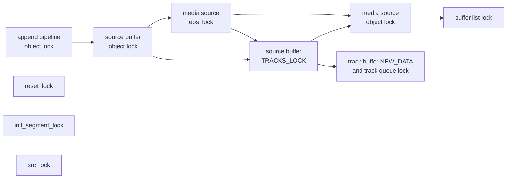

- The append pipeline's object lock is held by its streaming thread across the whole initialization segment path.
- A source buffer's object lock guards `updating`, the pending data, the append window and the mode.
- `TRACKS_LOCK` guards the track buffers and feeds.
- The media source's object lock guards the ready state, the duration and the attachment.
- `reset_lock` (source buffer), `init_segment_lock` and `src_lock` (append pipeline) are leaves, never held while calling out.
- The media source's `eos_lock` orders a reopen against the end of stream's marking: it is taken under a source buffer's object lock, before the media source's object lock and the buffers' `TRACKS_LOCK`.
- msesrc has locks of its own: `MEDIA_SOURCE_LOCK` for its view of the media source, `STREAMS_LOCK` for its streams table, and per pad the lock of its EOS wait.

Commits 07, 12 and 15 restore this order where it was broken.

## The commits

### 01. queue: Restart after EOS when a new stream is queued behind it

**Severity:** medium, in GStreamer core. A `queue` stops for good when a new stream follows an EOS still in it.

**Symptom:** after an EOS, the new stream's events and buffers stay in the queue, and upstream gets `GST_FLOW_EOS`.

**Cause:** a STREAM_START or SEGMENT behind a queued EOS clears the EOS state and restarts the task, which is still running, so the restart does nothing.
The task then pushes the EOS, returns `GST_FLOW_EOS` and pauses.
Once that is fixed, a second bug shows: dequeuing the EOS cleared the levels while the new stream's buffers were counted, so the count underflowed and the sink pad waited for space forever.

**Change:** after pushing an EOS, the task keeps running if a STREAM_START or SEGMENT is queued; dequeuing an EOS clears the levels only when no buffers are counted.

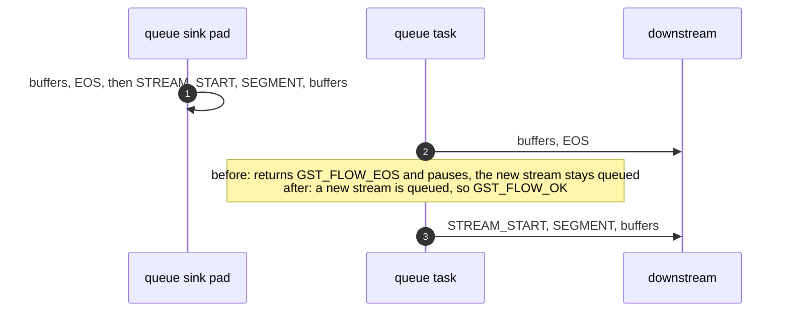

**Unit test:** `test_stream_start_after_queued_eos` in `subprojects/gstreamer/tests/check/elements/queue.c`: `93%: Checks: 15, Failures: 1` with main's gstqueue.c, `100%: Checks: 15, Failures: 0, Errors: 0` with the fix, three runs.

**Not done:** `queue2` has the same bug.

### 02. Seeking msesrc no longer crashes with debug output on

**Severity:** medium. A use after free whenever the `gst-mse` category is at debug level, and for an unsupported seek whenever errors are shown.

**Cause:** `gst_mse_src_send_event()` unreffed the seek event right after parsing it, then printed it with `GST_PTR_FORMAT` in its "handling" debug line and its "Rejecting unsupported seek event" error.

**Change:** the unref moves after the last print on each path.

**Unit test:** `test_media_source_element_seeks_with_debug_output` formats every message and sends msesrc a supported and an unsupported seek.
Before: "(after this point) Received signal 11 (Segmentation fault)".

### 03. Pages with two source buffers no longer hang after an init segment

**Severity:** high. Every DASH player has separate audio and video buffers.

**Symptom:** appends still report update-end, but nothing plays and `readyState` stays `HAVE_NOTHING`.

**Cause:** `update_ready_state_for_init_segment()` in gstmsesrc.c takes `MEDIA_SOURCE_LOCK` and checks whether every source buffer has had an initialization segment.
When one has not, it returned without releasing the lock.
The next caller blocked for good.
With one buffer the check passes the first time, so only pages with two buffers hit it.
It also leaked the list reference on every call.

**Change:** jump to the unlock instead of returning, and drop the list reference after the loop.

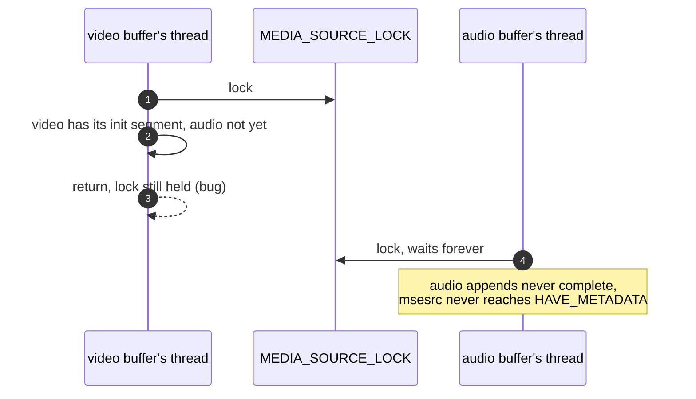

**Checked:** a page appends an fMP4 video initialization segment and a WebM audio one to two buffers.
Before, gdb shows a streaming thread blocked on the lock and the other buffer's append task behind it.
After, both buffers' appends go on and the media plays.

### 04. Media played through msesrc is freed after playback

**Severity:** high for long sessions. Every sample played stayed in memory until the process ended.

**Cause:** `gst_media_source_track_pop()` hands msesrc's pad task the track's reference to the sample.
The task pushed a copy of the sample's buffer, which shares the memory, and never dropped the sample.
The failed-push exits before it leaked the popped object too.

**Change:** `pad_task()` holds the popped object from the start and clears it on both of its exits.

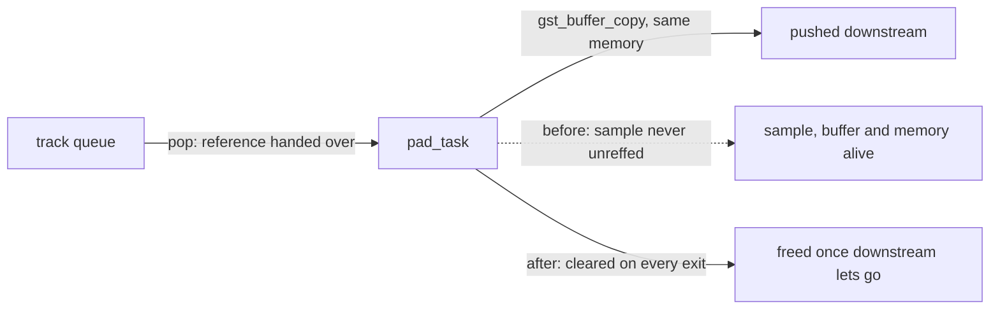

**Checked:** with `mse.mp4` appended 20 times (1:53.7 of media), all 18023 pushed memories (9412107 bytes) were alive after teardown before, none after.

**Unit test:** `test_media_source_element_frees_played_media`, with weak references on every pushed memory.
Before: "'await_played (&played, &played.freed, &played.pushed)' (0) is not equal to 'played.pushed' (904)".
The fix applies to GStreamer main alone; the test needs commit 03, since the list that commit stops leaking keeps the test's task cleanup from returning.

### 05. Removing a source buffer mid-event no longer crashes

**Severity:** high. A use after free.

**Symptom:** the process crashes in `gst_data_queue_pop()` when the application removes a source buffer, or detaches, while one of its events is being delivered.

**Cause:** a `GstMseEventQueue` emits each event from its own task.
`g_signal_emit()` holds a reference to the emitter, so the queue's last reference can drop on the task's own thread.
`finalize` then could not join its task, cleared the `GRecMutex` the running task holds, and freed the data queue.

**Change:** `finalize` joins the task only from another thread; `task_func` records its thread.
The task's lock moves to the heap and is owned by the `GstTask` object, through `g_object_set_data_full()`.
`task_func` no longer touches the queue after the callback returns.

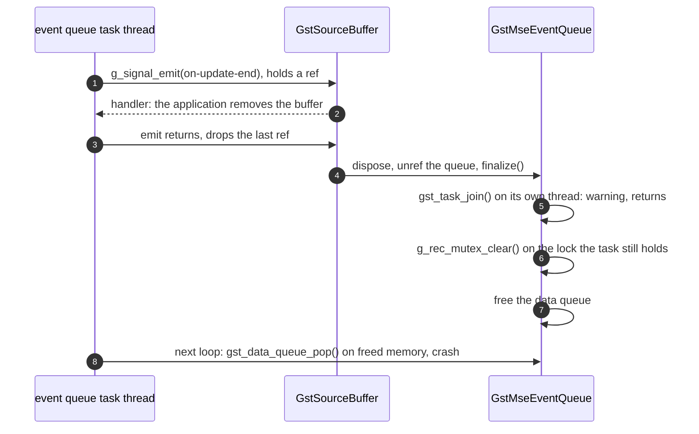

**Checked:** web-platform-tests `media-source/mediasource-append-buffer` crashed the browser in `gst_data_queue_pop()` once commit 03 let it run.
After, the whole directory runs without a crash.

**Unit test:** `test_source_buffer_removed_in_event_handler`, failing before.

### 06. A reset append pipeline accepts an initialization segment again

**Severity:** high. `g_error()` aborts the whole application.

**Symptom:** the next initialization segment after a reset kills the process.
Upstream, a parse error resets the pipeline; after commit 13, so does `abort()`.

**Cause:** `gst_append_pipeline_reset()` rebuilt the tracks but left the old appsinks in the bin.
The next initialization segment adds an appsink with the same name, one per stream type and index.
The bin refuses it, the pad link fails, and `add_track()` calls `g_error()`.

**Change:** before freeing the tracks, unlink each old appsink, set it to `NULL` and remove it from the bin.

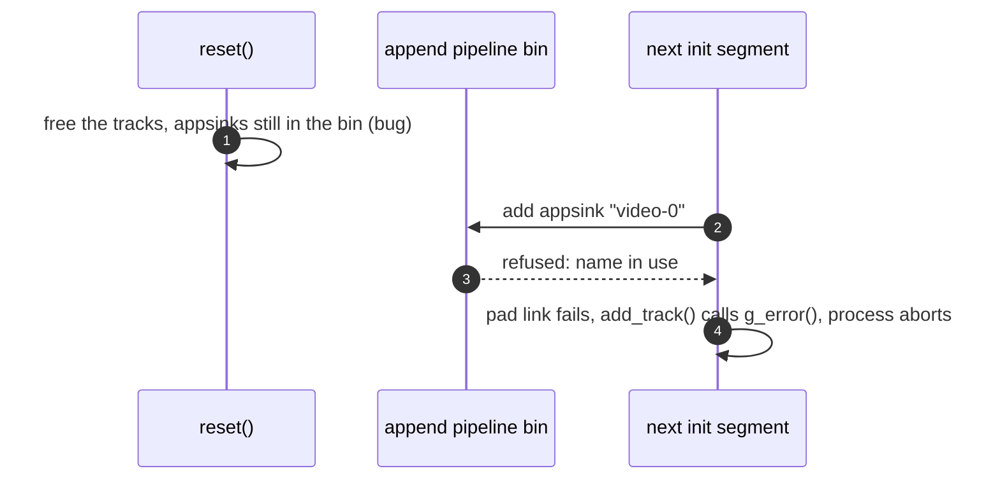

**Checked:** found as a crash in a web-platform-tests media-source run.
After, the reset pipeline links the next initialization segment's tracks.

**Unit test:** `test_append_pipeline_reset_after_init_segment`, failing before.

### 07. Two source buffers no longer deadlock on an init segment

**Severity:** high. A hang in about 1 of 40 runs of a two-buffer page.

**Symptom:** the page hangs in `appendBuffer()`.

**Cause:** a source buffer takes its own locks, then the media source's, for example to read the ready state during an append.
Two media source paths took them the other way round.
`on_active_state_changed()` held the media source's lock while it asked every buffer whether it is active, which takes each buffer's `TRACKS_LOCK`.
`gst_media_source_seek()` held it while seeking each buffer, which takes `TRACKS_LOCK` too.

**Change:** the active-list rebuild reads every buffer's state without the media source's lock and commits the result under it.
Two buffers' initialization segments can rebuild at once, so each rebuild takes a generation number first and starts over if a newer one began.
`gst_media_source_seek()` walks the list without the media source's lock; the list has its own lock.

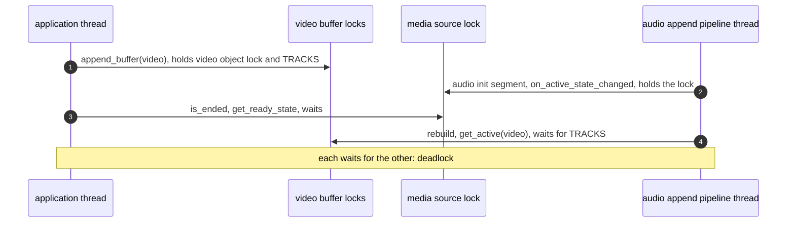

**Checked:** a page appends video and audio to two buffers in small slices.
Before, 1 of 40 runs hung; gdb showed the two threads above.
After, 40 of 40 completed, then 20 more, and 30 runs removing or detaching a buffer mid-append.
The hang was rare, so these runs show the change breaks nothing; the lock order is the argument.

### 08. Source buffer lists and stream counts are read under their locks

**Severity:** low to medium. Two data races, found by review and shown with delays.

**Symptom:** GLib criticals, and in the worst case a read of a table being resized.

**Cause:** `gst_source_buffer_list_remove()` and `remove_all()` changed the list's array without its lock, while commit 07's rebuild walks the list from other threads.
In msesrc, `n_streams_by_type()`, behind the `n-audio`, `n-video` and `n-text` properties, walked the streams table without `STREAMS_LOCK`.
An initialization segment inserts into that table on a pipeline thread.

**Change:** `remove()` and `remove_all()` take the list's lock and emit their signal after releasing it.
`n_streams_by_type()` takes `STREAMS_LOCK`.

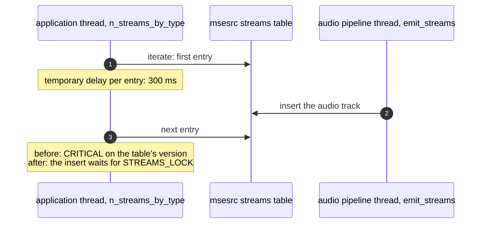

**Checked:** with the delay, the streams table gave `g_hash_table_iter_next: assertion 'ri->version == ri->hash_table->version' failed` in 12 of 12 runs before and 0 of 6 after.
The buffer list, with a delay inside `index()` and `G_DEBUG=gc-friendly`, gave `gst_object_ref: assertion 'object != NULL' failed` in 4 of 4 before and 0 of 4 after.
A removal between two `index()` calls still makes one rebuild skip a buffer; commit 09 closes that.

### 09. Removing a source buffer no longer hides another active buffer

**Severity:** medium. An active buffer can be missing from `activeSourceBuffers`.

**Symptom:** after one buffer is removed, the other drops out of `activeSourceBuffers` until some unrelated later event puts it back.

**Cause:** the rebuild reads the list one `index()` call at a time.
With buffers `[A, B]`, `index(0)` gives A, A is removed, `index(1)` is past the end, and B is never looked at.
The rebuild commits a list without B.
Its generation check does not notice, because removal did not change the generation.

**Change:** `gst_media_source_remove_source_buffer()` bumps the generation under the object lock, so an overlapping rebuild starts over.

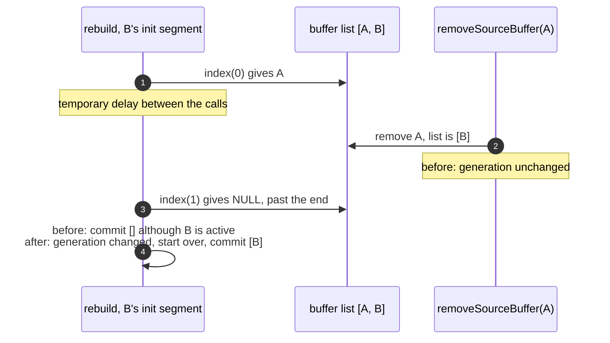

**Checked:** with an 800 ms delay before each `index(i >= 1)`, B was missing 3 of 3 runs before and present 3 of 3 after.

### 10. A source buffer's buffered ranges are current at update-end

**Severity:** high for players. YouTube's and Twitch's players read `buffered` in their update-end handler to decide what to fetch next.

**Symptom:** `buffered` read at update-end is one append behind.

**Cause:** `gst_append_pipeline_append()` pushes the bytes and returns.
The source buffer then cleared `updating` and scheduled update and update-end.
The samples reached the track buffers only later, when the bus task handled the end-of-append marker.

[MSE](https://w3c.github.io/media-source/#sourcebuffer-buffer-append), buffer append algorithm: the coded frame processing runs before "update" and "updateend" are queued.

**Change:** the append pipeline counts appends in flight.
The bus task signals a condition when it has consumed an end-of-append, and when it stops, fails or is reset.
The append task waits there with the source buffer's lock released, since `on_new_sample()` needs that lock.
It then checks again whether the buffer was removed or the append failed.

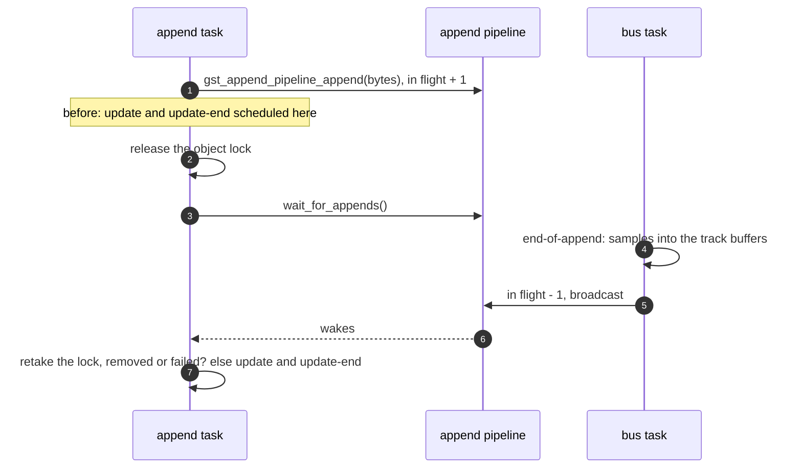

**Checked:** a program appends a fragmented MP4 one segment at a time and reads `buffered` at each update-end and 300 ms later.
Before, the first reading lagged by one segment on every append; after, both readings match.

**Unit test:** `test_source_buffer_buffered_at_update_end`, failing before.

### 11. Appending after a parser reset keeps feeding the same tracks

**Severity:** medium. Criticals on every sample after an abort, and a stopped feed could not restart.

**Symptom:** every sample appended after a reset logs `get_track_feed_unlocked: assertion 'g_hash_table_contains (self->track_feeds, track)' failed`, and msesrc grows one pad per track at each reset.

**Cause:** after a reset the next initialization segment made new `GstMediaSourceTrack` objects with the old ids.
The track buffers are keyed by id and still matched.
The track feeds and msesrc's streams are keyed by object and did not.

**Change:** the reset keeps the previous tracks in `retired_tracks`, and `add_track()` takes back the one with the same type and id (`reuse_or_new_track()`).
Retired tracks stay until an initialization segment takes them back, so two resets in a row keep them too.
The ids are the appsink names, such as `video-0`, so a re-sent initialization segment of the same stream gets the same objects.
It comes before commit 13, which makes `abort()` reset too.

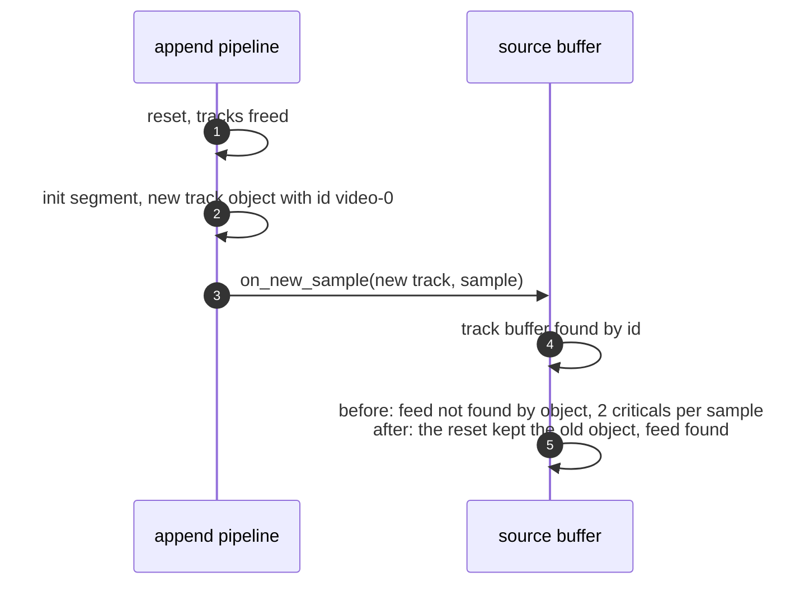

**Checked:** a page appends, aborts, appends the initialization segment and the next media segment, and plays.
584 criticals before, none after.

**Unit test:** `test_source_buffer_append_after_abort` (it needs commit 13); with the reuse turned off it fails.

### 12. The parser is reset without the source buffer's lock

**Severity:** high. A use after free in two places once `abort()` resets the parser.

**Cause:** the reset ran under the source buffer's object lock.
Stopping the append pipeline joins its bus task, which may need that lock to deliver a sample.
Commit 13 puts the reset on the application's thread too, so the rule is settled here first.

**Change:** `reset_parser_state()` runs with no lock held.
A new `append_generation`, bumped under the lock before the reset, tells a waiting append task that its append was discarded.
Running without the lock opens two windows, both closed here:

- Two threads could reset one pipeline at once, the error path and `abort()` or teardown, so a `reset_lock` makes them take turns.
- Another buffer's reset could free the track arrays an initialization segment was reading, so an `init_segment_lock` now guards them and the getters return copies holding references.

The pipeline's object lock could not serve: the streaming thread holds it across the callback chain that calls the other buffer's getters.

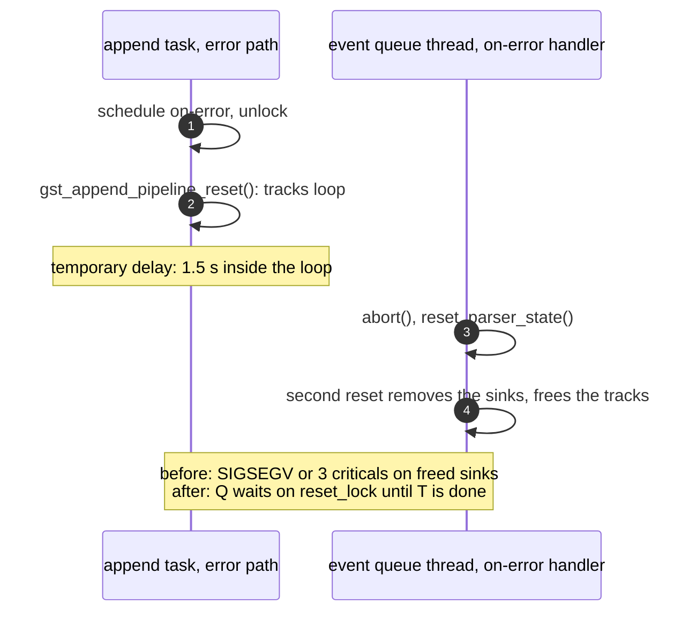

**Checked**, with C programs against the library, because a browser refuses `abort()` once the source has ended:

| Window | Before | After |
|---|---|---|
| double reset, 1.5 s delay in the tracks loop | SIGSEGV in `gst_element_get_static_pad()` 1 of 3, three criticals 2 of 3 | no criticals, 3 of 3 |
| track arrays, 1.5 s delay in `gst_source_buffer_get_all_tracks()` | SIGSEGV in `g_ptr_array_extend()` 1 of 3, stuck there 2 of 3 | one audio and one video track, 3 of 3 |

### 13. Aborting a source buffer drops the append in progress

**Severity:** high. Players abort on every seek, and `abort()` broke the source buffer for good.

**Symptom:** after `abort()`, `updating` stays set, no abort event comes, and later appends are never parsed.

**Cause:** `gst_source_buffer_abort()` only sent EOS into the append pipeline, which shut its task down.

[MSE](https://w3c.github.io/media-source/#dom-sourcebuffer-abort), `abort()`: abort the buffer append algorithm, set updating to false, queue abort and updateend, run the reset parser state algorithm, then "Set appendWindowStart to the presentation start time. Set appendWindowEnd to positive Infinity."

**Change:** under the object lock, `abort()` refuses a removed buffer, bumps `append_generation`, drops the pending data, and if an append was running clears `updating` and schedules abort and update-end.
It resets the append window.
Then it resets the parser without the lock (commit 12).
`gst_media_source_end_of_stream()` used to abort every buffer to get EOS into the track buffers; it now calls the new `gst_source_buffer_mark_eos()`.

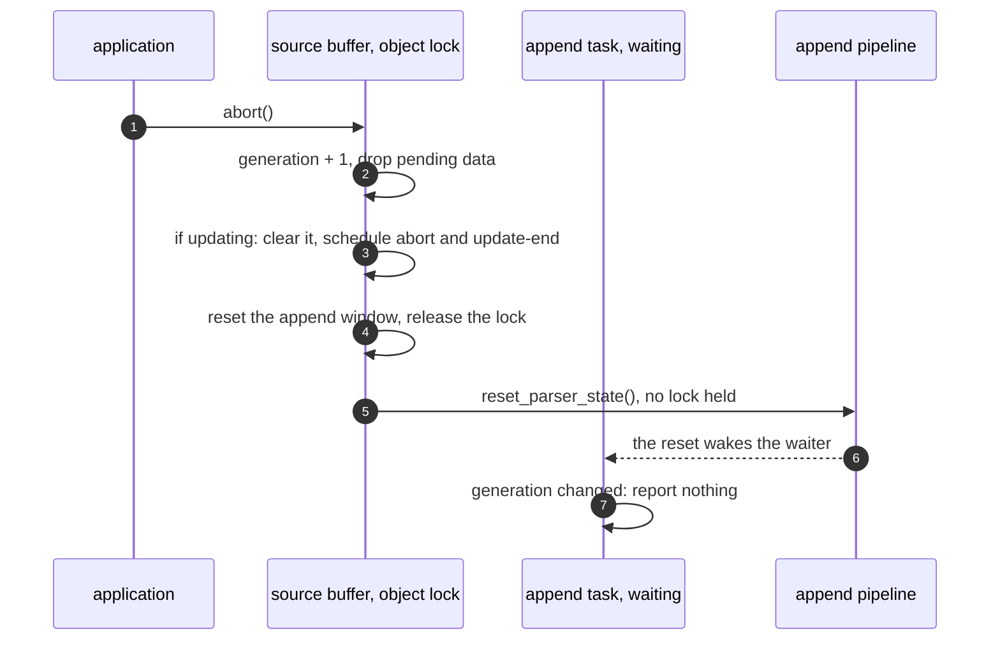

**Checked:** pages that append, abort and append again, seeks that abort, and `endOfStream()` played to the end.
The window: a C program sets the window start to 2 s, appends 0-6 s, aborts and appends again.
Before, the buffer held 2.000-6.067; after, 0.067-6.067, 3 of 3.

**Unit test:** `test_source_buffer_append_after_abort`, failing before.

**Not done:** the reset rebuilds the demuxer, which forgets the initialization segment.
The spec keeps it, so a media segment appended after `abort()` without a new initialization segment is not parsed.
Players send it again. Flushing instead of resetting was tried: qtdemux drops its tracks on the flush.

### 14. A parse error is reported once, by the append in progress

**Severity:** medium. Contradictory events, a thread joining itself, and later appends reported as done without being parsed.

**Cause:** `on_error()` ran the append error algorithm on the pipeline's own thread.
Its reset joined the bus task, which was itself.
It scheduled error and update-end, and the waiting append task, finding the failure flag cleared by that reset, scheduled update and update-end on top.
The bus task's shutdown then marked the pipeline abandoned, so later appends returned at once.

**Change:** `on_error()` only sets an atomic `append_failed` flag.
The append task sees it once its append has ended and runs the error algorithm itself, resetting without the lock.

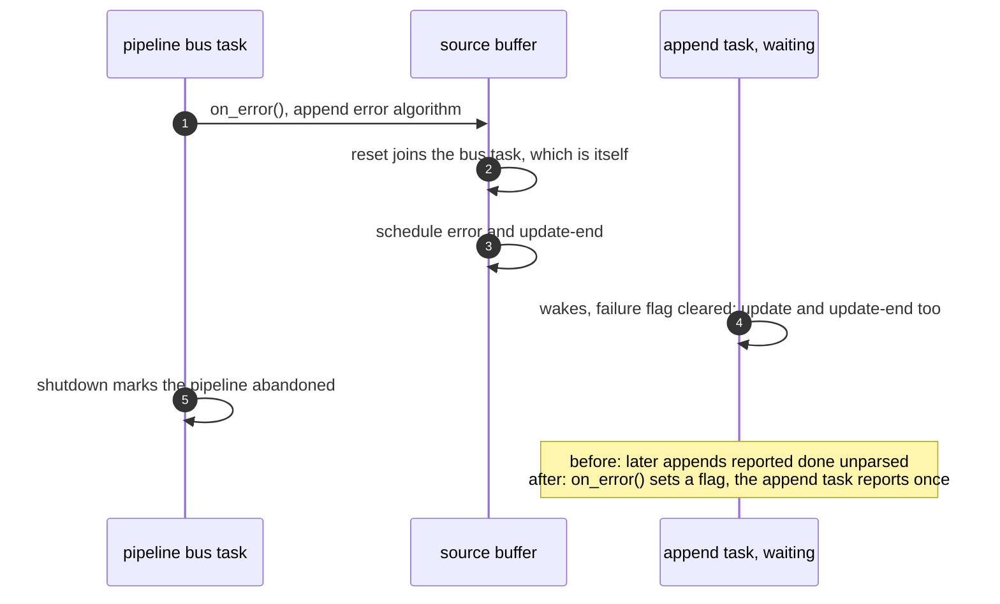

**Checked:** a page appends bytes that are not media and gets one error and one update-end; the media source ends with a decode error.

**Unit test:** `test_source_buffer_parse_error_reported_once`, failing before.

### 15. Removing or detaching a source buffer mid-append no longer hangs

**Severity:** medium to high in principle. The same inverted lock order as commit 07, on the removal paths.

**Cause:** removing a buffer and detaching held the media source's lock while they unparented each buffer and tore down a buffer that was updating.
Both take the buffer's lock, and teardown joins the pipeline's task.
An append task holds the buffer's lock and wants the media source's.

**Change:** under the media source's lock, buffers are only taken out of the lists.
Teardown and unparenting happen after the lock is released.
A buffer out of the list already counts as removed for its own append task.

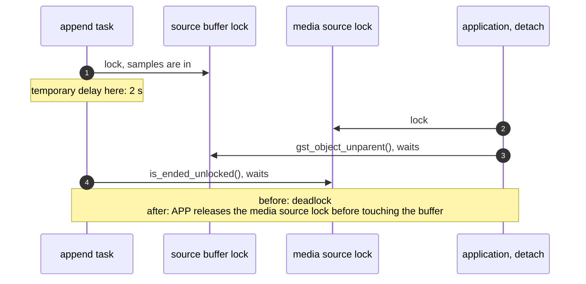

**Checked:** with the delay, detaching 500 ms after an append hung in 6 of 6 runs before and completed 6 of 6 after.
Removal did not hang in the browser used, which aborts first; the inversion is the same.
Without the delay, removing or detaching at 30 timings from 100 to 770 ms completes.

### 16. An idle source buffer no longer reports finished appends

**Severity:** medium to high. Applications get `InvalidStateError` at random.

**Cause:** the append task waits for data with a one-second deadline.
On timeout with nothing appended it still signalled update and update-end.
An application appending right after such a tick took the tick's update-end for its own, appended the next chunk, and got `InvalidStateError`.

**Change:** on timeout, report nothing and wait again.

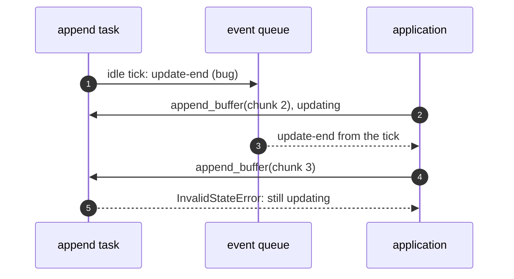

**Checked:** a page appending video and audio in 32 KiB slices failed on the second video append in 2 of 5 runs.
The mselib log shows "no pending data" at 2.045 s and the page's append at about 2.06 s.
The browser gained its own guard at the same time, so later clean runs do not test this change alone.

### 17. Source buffers without media no longer count as active

**Severity:** medium. A wrong `activeSourceBuffers`.

**Cause:** the rebuild's branch for an inactive buffer also added it to the list, so every buffer was listed as soon as any changed state.

**Change:** the inactive branch only records that a previously active buffer was removed.

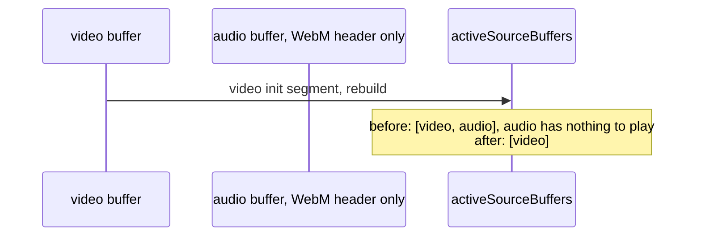

**Checked:** a page appends an fMP4 initialization segment and media to a video buffer, then only a WebM header, with no Cluster, to an audio buffer.
`activeSourceBuffers` listed the audio buffer in 4 of 4 runs before and in none of 4 after.

### 18. Setting a source buffer's append window start works again

**Severity:** low to medium. The setter was unusable.

**Cause:** `gst_source_buffer_set_append_window_start()` refused a start less than or equal to the end, the opposite of the spec's check.
The end defaults to `GST_CLOCK_TIME_NONE`, so every valid start was refused.

[MSE](https://w3c.github.io/media-source/#dom-sourcebuffer-appendwindowstart), `appendWindowStart` setter: "If the new value is less than 0 or greater than or equal to appendWindowEnd then throw a TypeError exception".

**Change:** the check is now `start >= append_window_end`.

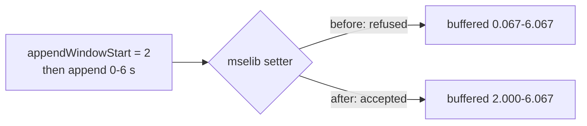

**Checked:** in a browser, 3 of 3 runs each way.

**Unit test:** `test_source_buffer_set_append_window_start`, failing before.

### 19. Removing a range from a source buffer removes the media

**Severity:** high for players. An application waiting for update-end after `remove()` waited forever.

**Cause:** `gst_source_buffer_remove()` was a stub that returned `TRUE` and did nothing.
The sample map's removal, shared with eviction, also removed only the coded frame groups lying wholly inside the range.

[MSE](https://w3c.github.io/media-source/#sourcebuffer-range-removal), range removal: set updating, queue updatestart, run the coded frame removal algorithm, clear updating, queue update and updateend.
`remove()` on an ended source sets it back to "open".
Coded frame removal takes the frames whose start is in the range, and those after them up to the next random access point.

**Change:** `remove()` refuses a removed or updating buffer and an empty range, reopens an ended source, and runs those steps over every track buffer.
A group whose start is in `[start, end)` goes whole; removal stops at the first group starting at or after `end`.

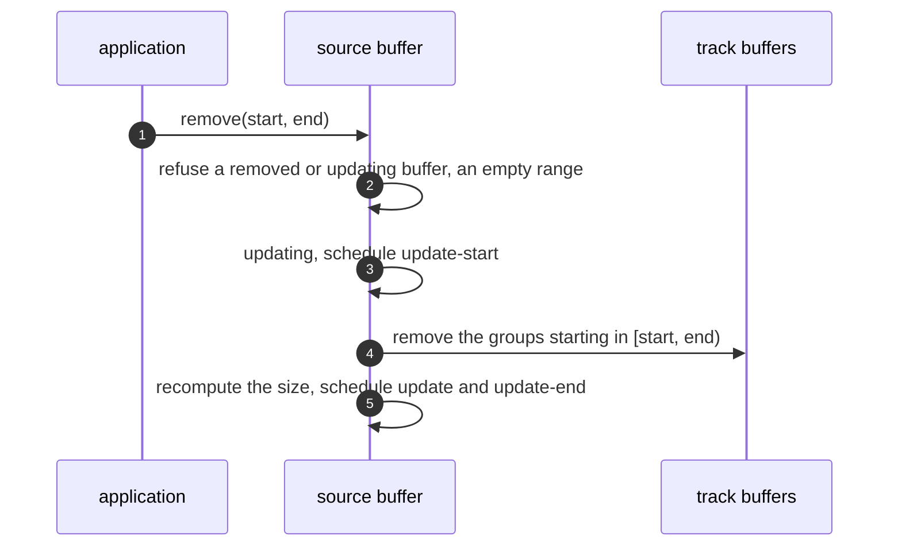

**Checked:** web-platform-tests `mediasource-remove` and `mediasource-duration` now complete their `remove()` calls.
Some still fail on the first range's start, which mselib puts at 0.
Groups of 2 s: `remove(0, 5)` left 4.067-6.067 before and nothing after; `remove(6, 7)` over four groups left 0.067-8.067 before and 0.067-6.067 after (3 of 3 each).

**Unit tests:** `test_source_buffer_remove_range`, `test_source_buffer_remove_reopens_ended_source` and `test_sample_map_remove_range_group_boundaries`, failing before.

### 20. Re-appending media already played no longer replays it

**Severity:** high on YouTube. From about 18 s the picture showed the first seconds again, smeared, while the clock went on.

**Cause:** a track feed pushes every sample it has not pushed before.
YouTube re-appends the opening fragment a few seconds into playback, likely in a better quality.
The new samples were pushed after everything queued so far, out of order.

[MSE](https://w3c.github.io/media-source/#sourcebuffer-coded-frame-processing), coded frame processing: a new frame replaces the buffered frames it overlaps.
That changes what is buffered for a later seek. It does not ask to feed the decoder again.

**Change:** the feed remembers how far the decoder's input has reached (`pushed_dts_end`) and skips a group that starts behind it, unless it has already started that group.
A skipped group stays buffered.
Half of the group's first frame is allowed for the small overlap of rounding and audio priming.

```mermaid
sequenceDiagram
    participant TB as track buffer
    participant F as track feed
    participant D as decoder
    F->>D: 0-2 s, 2-4 s, up to 14-16 s
    TB->>TB: the page re-appends 0-6 s
    F->>D: before: 16-18 s, then 0-2, 2-4, 4-6 s out of order
    Note over F: after: groups behind pushed_dts_end are skipped
```

**Checked:** with YouTube, and a page that switches quality and re-appends the first three segments.
`GST_DEBUG=gst-mse:6` shows the 0-6 s groups pushed again after 16 s before, and "skipping group" after.
Locally the sink drops the late frames, so the corruption itself shows only with YouTube's stream.

### 21. A source buffer with media is freed when the application lets go

**Severity:** high. A leak with two polling threads, and a crash at end of stream.

**Cause:** each track feed held a reference to its source buffer until the stream ended or a push failed.
A removed buffer lived on, its feeds waking every second.
When the feed's unref was the last, dispose ran on the feed's own thread and cleared the `GRecMutex` that `gst_task_func()` still held.

**Change:** a feed holds a plain pointer, as the append task does.
`gst_source_buffer_dispose()` stops and joins every feed first; the new `gst_media_source_track_buffer_wake()` spares the join the one-second deadline.

```mermaid
sequenceDiagram
    autonumber
    participant App as application thread
    participant F as track feed
    App->>App: end_of_stream(), unref the media source and the buffer
    F->>F: push the last samples and EOS, unref the buffer, refcount 0
    F->>F: dispose: unref the task, clear its lock, free the feed
    F->>F: return into gst_task_func(), unlock freed memory
    Note over F: before: SIGSEGV<br/>after: no feed reference, dispose joins the feeds first
```

**Checked:** before, "the removed source buffer was not freed" after 5 s and "Received signal 11 (Segmentation fault)"; after, both tests pass 3 of 3 and the suite gives `100%: Checks: 81, Failures: 0, Errors: 0`.

**Unit tests:** `test_source_buffer_freed_when_removed` and `test_source_buffer_freed_at_end_of_stream`.

### 22. An init segment is reported once when its pads come late

**Severity:** low. A second report re-ran the track buffer modes and the active-buffer rebuild.

**Cause:** the report runs from parsebin's `pad-added` on the streaming thread and from the stream-collection message on the bus task.
parsebin posts the collection before it adds the pads; when the bus task runs between `pad-added`'s two locked steps, both find every track and both report.

**Change:** the append pipeline keeps a reference to the collection it reported for, `reported_streams`, and reports once per collection; the reset clears it.

```mermaid
sequenceDiagram
    autonumber
    participant S as streaming thread
    participant B as bus task
    S->>B: post STREAM_COLLECTION
    S->>S: pad-added, last track added
    B->>B: every track present, report
    S->>S: every track present
    Note over S,B: before: reports again<br/>after: streams is reported_streams, skip
```

**Unit test:** `test_append_pipeline_init_segment_reported_once`, ADTS AAC into an append pipeline.
With a temporary 200 ms delay inside `on_pad_added()`, it got two reports in 3 of 3 runs before and one in 3 of 3 after.

### 23. An MP4 initialization segment alone now exposes its tracks

**Severity:** medium. Players and web-platform-tests that wait for `loadedmetadata` before appending media got stuck.

**Symptom:** an MP4 buffer's tracks, the buffer becoming active and `HAVE_METADATA` waited for the first media segment.

**Cause:** parsebin typefinds before it plugs a demuxer, and an `ftyp` and `moov` alone are too short for it to decide.
Once the demuxer is plugged, parsebin exposes a stream's pad only when the parser behind it has caps, and on main also a stream-id.
`mpegaudioparse`, and on main `h264parse`, get those from their first frame.

[MSE](https://w3c.github.io/media-source/#sourcebuffer-init-segment-received), Initialization Segment Received: the tracks are those the initialization segment describes, and `HAVE_METADATA` follows once every buffer has had one.

**Change:** `video/mp4` and `audio/mp4` buffers give appsrc `video/quicktime, variant=iso` caps through the new `gst_append_pipeline_set_caps()`, so parsebin plugs qtdemux at once.
WebM buffers are still typefound.
The tracks then come from [the demuxer](#tracks-from-the-demuxer), at its `no-more-pads`, with the caps and stream-id of its pads.
parsebin's pads, whenever they come, are matched to their tracks by stream-id and only carry the samples.
A later initialization segment whose lone track of a type has a new id keeps that track.
On `mse-fixes-1.28` the caps and the tracks are two commits; on main the caps alone fail the test, so they are one.

**Unit tests:** `test_source_buffer_init_segment_alone_activates` with an H.264 and AAC initialization segment and with `mse.mp4`'s H.264, MPEG audio and text, `test_append_pipeline_init_segment_alone_has_tracks` and `test_append_pipeline_media_segment_feeds_init_segment_tracks`, failing before; with them `_init_segment_new_track_id`, `_init_segment_webvtt_track` and `_stream_type_from_caps`.

### 24. A source reopened after its end of stream plays again

**Symptom:** a page that ends the stream and appends more, such as a VOD player extending the media, never plays the new media.

**Cause:** mselib reopened the source, but the track buffers kept their EOS, the feeds had stopped, and msesrc's pads were EOS.
The next sample restarted the feed from the seek time and the pads refused it.
And a GStreamer EOS is final: downstream acts on it at once, while MSE's end of stream can be taken back by the next append.

[MSE](https://w3c.github.io/media-source/#sourcebuffer-prepare-append), prepare append step 5: an append to an "ended" source sets it back to "open".

**Change:**

- `gst_media_source_open()` clears the track buffers' EOS when it reopens an ended source; an `eos_lock` orders it against the end of stream's marking.
- The feeds keep running after their EOS and push one EOS each time the track buffer becomes EOS, only if it held for the whole walk.
- An msesrc pad holds its EOS until running time is within a margin of the end of what it pushed: 4 frames for video, 0 for other tracks.
  New media during the wait drops the EOS, with no flush.
- A pad that already sent its EOS flushes on its next sample without resetting the running time, and sends its segment again.

```mermaid
sequenceDiagram
    autonumber
    participant APP as application
    participant F as track feed
    participant P as msesrc pad
    participant D as downstream
    APP->>F: end_of_stream()
    F->>P: last samples, then EOS
    P->>P: holds EOS until running time nears the end
    APP->>F: append: source reopens, EOS cleared
    F->>P: new samples
    P->>D: EOS dropped, new samples follow the old, nothing lost
```

**Checked:** in a GstPlay pipeline with real sinks, a reopen 2 s before the old end lost 833 ms of video and 1625 ms of audio with a flush, and nothing with the hold; at a real end no frame was more than 2 ms late.

**Unit tests:** `test_media_source_element_plays_after_reopen`, `_ends_after_append_during_feed`, `_keeps_queued_media_on_reopen`, `_holds_eos_until_end`, `_seeks_while_resuming` and `test_media_source_end_of_stream_races_reopen`.

**Not done:** a reopen within the last 4 video frames of the old end still flushes, and in the measured pipeline video stopped there.

### 25. Media removed from a source buffer is freed while it plays

**Severity:** high for long sessions. `remove()` and eviction freed none of the media they took out until the next seek.

**Cause:** the track feed keeps every sample it has pushed in `processed_samples`, so that it pushes none twice, and the table lives until the feed returns.
Since commit 24 the feed runs until the source buffer goes.

**Change:** `track_feed_fold()` empties the table when it starts a new coded frame group.
Every earlier group starts behind `pushed_dts_end`, and commit 20's rule skips it.

**Checked:** with `mse.mp4` appended 20 times, `remove(0, inf)` left 18023 memories (9412107 bytes) alive before and 184 (91847 bytes) after, the last group of each track.

**Unit test:** `test_track_feed_frees_removed_media`.
Before: "'n_freed' (0) is not equal to 'n_pushed' (313)".

### 26. isTypeSupported() answers from the byte stream format registry

**Symptom:** `isTypeSupported()` said yes to types no browser plays, such as `audio/webm;codecs="vp8"`, `video/mp4;codecs="vorbis"`, `audio/mpeg;codecs="mp3"`, `video/x-raw` and `codecs=""`.

**Cause:** the MIME type was turned into caps by hand, and any other audio or video type was passed through as caps.
Codecs were matched by prefix without their container: `mp4v` passed as H.264, and `avc1` with no profile passed.

[MSE](https://w3c.github.io/media-source/#dom-mediasource-istypesupported), `isTypeSupported()`, with the [byte stream format registry](https://w3c.github.io/mse-byte-stream-format-registry/): ISO BMFF, WebM and MPEG audio, each with its codecs.

**Change:** gstmsemediatype.c holds two tables.
One maps each registered type to its caps, its container, and whether it generates timestamps or skips typefinding.
The other maps each codec string to its caps and containers, following Chrome's answers for the web-platform-tests cases.
A type without a codecs parameter is still accepted; an empty list is not.

**Unit test:** `test_media_source_content_type_support` checks 50 types; 30 that must be refused were accepted before.

### 27. A negative timestamp offset moves the media earlier

**Symptom:** a page that trims a leading gap sets a negative `timestampOffset`; in sequence mode the buffer then had no buffered range at all.

**Cause:** mselib held the offset as an unsigned `GstClockTime`, so a negative offset wrapped to a huge value.

**Change:** `gst_source_buffer_set_timestamp_offset()` and its getter take a `GstClockTimeDiff`.
This changes their signatures in a library marked as unstable API; the introspection data changes too.
A frame the offset would place before zero is dropped, as the append window would drop it.

**Unit test:** `test_source_buffer_negative_timestamp_offset_sequence`: with -1 s, the range starts within 100 ms of zero and ends 1 s earlier.

### 28. The timestamp offset applies in segments mode too

**Symptom:** with `timestampOffset` set to 10 before a 0-4 s segment, `buffered` read 0.07-3.97 and playback from 11 s never moved.

**Cause:** mselib applied the offset only in sequence mode. Segments mode is the default for MP4 and WebM.

[MSE](https://w3c.github.io/media-source/#sourcebuffer-coded-frame-processing), coded frame processing: "If timestampOffset is not 0", add it to the presentation and decode timestamps, in either mode, before the append window check.

**Change:** `on_new_sample()` adds the offset in segments mode and drops a frame it moves before zero.
A reordered frame's decode time that would fall below zero is set to zero.

**Checked:** after, `buffered` reads 10.07-13.97 and playback passes 12 s.
The web-platform-test "Truncating the duration throws an InvalidStateError exception when new duration is less than a buffered coded frame presentation time" goes from FAIL to PASS.

**Unit test:** `test_source_buffer_timestamp_offset_segments`, with offsets of 0, 2 s and -1 s.

### 29. tests: A reset keeps the tracks when an init segment reorders them

A test, no change to the library.
After a reset, tracks are matched by type and id, the id being the track's position.
An initialization segment listing its tracks in another order keeps the same objects, because the tracks are made in parsebin's order: by type, then by stream-id.

**Unit test:** `test_append_pipeline_reset_keeps_tracks` appends `mse-h264-aac-init.mp4`, resets, and appends `mse-aac-h264-init.mp4`, the same segment with its tracks swapped.
It passes before and after.

### 30. Source buffers list their tracks with the caps of the init segment

**Symptom:** a browser could not tell which buffer a track came from, and learnt the video size only from the first decoded frame.

[MSE](https://w3c.github.io/media-source/#sourcebuffer-init-segment-received), Initialization Segment Received: each track is added to the media element and to the SourceBuffer that received it.

**Change:** a read-only `tracks` property and `gst_source_buffer_get_tracks()` give a `GstStreamCollection`, one `GstStream` per track.
Each carries the stream type, the caps from the initialization segment that first gave the track, and `GST_STREAM_FLAG_SELECT` when active.
The stream ids are those msesrc gives the same tracks.
A reset leaves the list as it is.
The notification comes through the source buffer's event queue, between the append's update-start and update-end, not from the streaming thread.

**Checked:** in a browser reading the list, `videoWidth` and `videoHeight` are 1280x720 at `loadedmetadata` (was 0x0), and removing the audio buffer removes only the audio track, 8 of 8 runs.

**Unit tests:** `test_source_buffer_tracks_from_init_segment` and `test_source_buffer_tracks_notified_with_events`.

**Not done:** a later initialization segment's caps do not replace a track's first caps in the list.

### 31. An init segment with other tracks fails the append

**Cause:** a later initialization segment with fewer or other tracks than the first was taken as it was, and a track without a track buffer reached a `NULL` one.

[MSE](https://w3c.github.io/media-source/#sourcebuffer-init-segment-received), Initialization Segment Received step 3: the number of audio, video and text tracks must match the first initialization segment, or the append error algorithm runs.

**Change:** `on_received_init_segment()` checks that a later segment's tracks are exactly those with a track buffer; the append pipeline hands back the same objects for the same tracks.
If not, the append fails as on a parse error. Samples of a track without a track buffer are dropped.

**Unit test:** `test_source_buffer_init_segment_other_tracks`; before, "timed out waiting for error 1, have 0".
With it, `test_source_buffer_append_after_two_aborts` and `test_source_buffer_init_segment_new_track_id`.

### 32. A parser reset takes new caps with a new appsrc

**Cause:** appsrc cannot go back to no caps, and after a restart it announces the caps it last pushed before any queued ones.
So new caps for a parser, such as none after an MP4 type, would keep the old demuxer.

**Change:** the append pipeline keeps the caps last set.
A source with no caps yet takes them at once; otherwise the next reset puts a new appsrc in front of parsebin when the caps differ.
A `src_lock` guards the source and the caps, and every user works on a reference to the source.

```mermaid
sequenceDiagram
    autonumber
    participant SB as source buffer
    participant AP as append pipeline
    participant PB as parsebin
    SB->>AP: set_caps(NULL), kept
    SB->>AP: reset
    AP->>AP: caps differ: new appsrc, no caps
    SB->>AP: WebM bytes
    AP->>PB: typefind finds WebM, matroskademux
    Note over AP,PB: before: the old appsrc said video/quicktime,<br/>qtdemux dropped the WebM bytes without an error
```

**Unit test:** none of its own; commit 33's tests cover it.

### 33. Source buffers can change their content type

**Symptom:** a player that switches a buffer's type before its first append, as YouTube does from WebM VP9 to MP4 AV1, got NotSupportedError from every `changeType()`.

**Cause:** `gst_source_buffer_change_content_type()` refused every change.

**Change:** it runs [`changeType()`](https://w3c.github.io/media-source/#dom-sourcebuffer-changetype) steps 4 to 9.
It refuses only unsupported types, reopens an ended source, takes the generate timestamps flag and the mode from the new type, gives the parser the new type's caps, and resets the parser, which puts a new appsrc in place (commit 32).

**Checked:** YouTube failed to play before and played in 3 of 3 runs after; web-platform-tests `mediasource-changetype*` went from 37 to 44 passes of 111.

**Unit tests:** `test_source_buffer_change_content_type` and six more cases: unsupported, while updating, generate timestamps, append after a change, MP4 then WebM, and a change from the update-end of a failed append.

**Not done:** a codec change on a buffer that already has tracks plays only where downstream needs no new parser.
VP8 to VP9 plays; VP9 to VP8, VP9 to H.264, H.264 to VP9 and H.264 to VP8 end in `not-negotiated`.
A fix needs a new stream or decoder-side reconfiguration.

## Tracks from the demuxer

Commit 23 takes a buffer's tracks from the demuxer inside parsebin, not from the pads parsebin exposes, and gives MP4 buffers the caps that plug the demuxer without typefinding.
The demuxer parses the container's header, so it knows the tracks from the initialization segment alone.

```mermaid
flowchart TB
    SRC["appsrc<br/>video/quicktime, variant=iso"] --> QT
    subgraph PB["parsebin"]
      QT["qtdemux"] -- "video_0, stream-id S1,<br/>avc caps with codec_data" --> HP["h264parse"]
      QT -- "audio_0, stream-id S2,<br/>aac caps with codec_data" --> AP["aacparse"]
    end
    QT -. "deep-element-added, then no-more-pads" .-> TR["append pipeline makes the tracks<br/>video-0 for S1, audio-1 for S2<br/>appsinks not linked yet<br/>reports the init segment and the duration"]
    HP -- "pad exposed later, stream-id S1" --> M["matched to its track by stream-id"]
    AP -- "pad exposed later, stream-id S2" --> M
    M --> SINK["linked to the track's appsink: samples flow"]
```

- The append pipeline watches parsebin for the container demuxer with `deep-element-added`, which fires before parsebin exposes anything, and skips tag demuxers such as id3demux.
- At the demuxer's `no-more-pads`, it makes one track per audio, video or text pad, from the pad's stream-id and caps.
- It asks the demuxer for the duration; a query on parsebin reaches no demuxer before a pad is exposed.
- When parsebin exposes a parser's pad, its stream-id, which baseparse passes on unchanged from the demuxer, finds its track.
- Tracks are made in parsebin's order, video, audio, text, then stream-id, so their names and the reuse after a reset (commit 11) do not depend on the container's track order.
- A track's first caps are the demuxer's, and the parser's caps reach msesrc with the first sample as a caps change.
- Bytes with no demuxer, such as ADTS AAC or MPEG audio, keep the old path: a track per exposed pad, reported once per stream collection (commit 22).

What it means for GStreamer main:

- parsebin on main now waits for a parser's stream-id before it exposes the parser's pad ("parsebin: wait for the parser to publish its stream-id before exposing").
- h264parse makes that id with its first frame and a moov has none, so the old approach, tracks from exposed pads, failed four tests on main.
- Tracks from the demuxer do not depend on exposure, so the whole series runs on main.
- The two branches' mselib differ only by main's own change to two `gst_pad_start_task()` calls in gstmsesrc.c.
- After a change to parsebin, qtdemux or baseparse, the init-segment tests are the first to read.

Not done for WebM: matroskademux also says `no-more-pads` after its Tracks element, so this path covers it.
But WebM buffers get no caps and are still typefound, which waits for the first Cluster.
With `video/webm` caps, an append pipeline reports both tracks of a WebM initialization segment alone, on main and on 1.28.6.
Turning that on is one entry in commit 26's table.

## Glossary

- **MSE**, [Media Source Extensions](https://w3c.github.io/media-source/): the web API that lets a page feed media bytes to a `<video>` element itself, as streaming players do.
- **SourceBuffer**: the page's handle for one stream of bytes, often one for video and one for audio, `GstSourceBuffer` in mselib.
- **Initialization segment**: the header that describes the tracks and codecs, an MP4 `ftyp` and `moov` or a WebM EBML header and Tracks, with no media.
- **Media segment**: a run of coded frames for those tracks, an MP4 `moof` and `mdat` or a WebM Cluster.
- **Append pipeline**: the small private pipeline each source buffer runs to parse its bytes: `appsrc`, `parsebin`, one `appsink` per track.
- **parsebin**: the GStreamer bin that finds the format, plugs a demuxer and parsers, and exposes one pad per stream.
- **msesrc**: `GstMseSrc`, the source element of the playback pipeline, with one src pad per track, playing what the track feeds push.
- **appsink**: the element through which an application, here the append pipeline, takes samples out of a pipeline.
- **EOS**: end of stream. In MSE a page's `endOfStream()` can be taken back by the next append; in GStreamer an EOS event is final for the stream.
- **stream-id**: the string naming a stream in its stream-start event, set by demuxers and passed on by parsers.
- **WPT**, [web-platform-tests](https://web-platform-tests.org/): the shared browser test suite, whose `media-source` directory tests MSE.

## Problems and licence

Report problems as issues on this GitHub repository.
GStreamer, and with it this series, is under the LGPL, version 2.1 or later.
