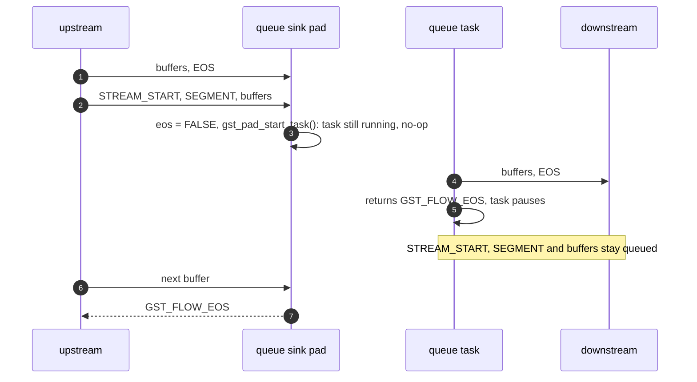
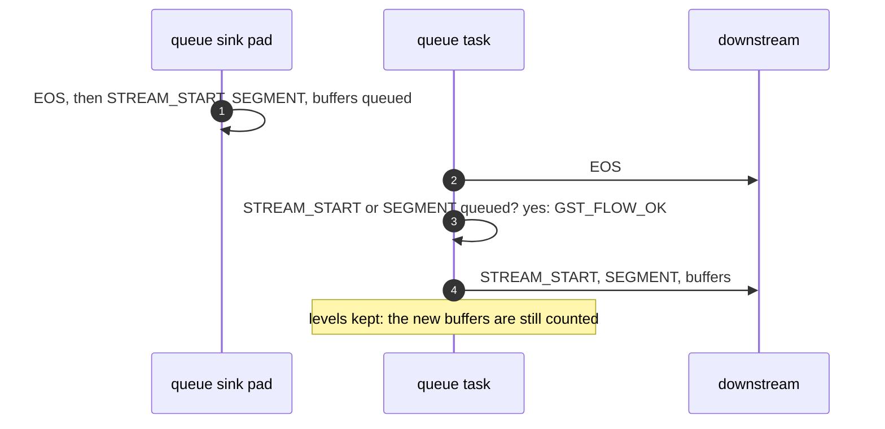

> One change of the GStreamer fork: `review/01`, 1 of 33 in the stack.
> Below it: the upstream base, [GStreamer main at 74f679f8de](https://github.com/Airodonack/gstreamer/tree/74f679f8de). Above it: [`review/02`](https://github.com/Airodonack/gstreamer/tree/review/02).
> The change itself: [commit b500d46a11d79a29890ff78154d42588b9d7c3cd](https://github.com/Airodonack/gstreamer/commit/b500d46a11d79a29890ff78154d42588b9d7c3cd). This README sits in a commit on top of it and is not part of the merge request.
> The whole stack: [overview README](https://github.com/Airodonack/gstreamer/blob/mse-fixes-main/README.md).

# queue: Restart after EOS when a new stream is queued behind it

GStreamer core's `queue` element stopped for good when a new stream reached
it while an EOS was still queued: it pushed the EOS, paused its task, and
never sent the new stream. Upstream then got `GST_FLOW_EOS` for every buffer.
The change keeps the task running when a new stream waits behind the EOS,
and fixes a level count that the first fix exposed.

It is core only (`plugins/elements/gstqueue.c`), with no mselib change, and
it applies to stock GStreamer main alone, as to 1.28.6. It was found while
making msesrc resume after an end of stream; msesrc no longer relies on it,
and it stays as a fix of its own.

## The problem

When an EOS is in the queue, the sink pad refuses most events, but a
STREAM_START or SEGMENT "unsets the EOS status": the sink side clears
`queue->eos` and calls `gst_pad_start_task()` to restart the loop
([gstqueue.c on main, lines 1093 to 1114](https://github.com/Airodonack/gstreamer/blob/74f679f8de/subprojects/gstreamer/plugins/elements/gstqueue.c#L1093-L1114)).
The task is still running, since it has not pushed the EOS yet, so the start
does nothing. The task then pushes the EOS and returns `GST_FLOW_EOS`
([lines 1549 to 1553](https://github.com/Airodonack/gstreamer/blob/74f679f8de/subprojects/gstreamer/plugins/elements/gstqueue.c#L1549-L1553)),
and `gst_queue_loop()` pauses. Nothing starts it again: the new stream's
events and buffers stay in the queue, and the next `chain` call returns the
paused task's `GST_FLOW_EOS` upstream.

A second bug sits in the same path and shows once the first is fixed.
Dequeuing the EOS cleared the levels ("queue is empty now that we dequeued
the EOS"). With the new stream's buffers already counted behind it, the next
dequeue took the buffer count below zero: it wrapped to 4294967295, the
queue counted as full, and the sink pad waited for space forever.

## The change

- After pushing an EOS, the task keeps running if a STREAM_START or SEGMENT
  is queued
  ([lines 1572 to 1586](https://github.com/Airodonack/gstreamer/blob/b500d46a11d79a29890ff78154d42588b9d7c3cd/subprojects/gstreamer/plugins/elements/gstqueue.c#L1572-L1586)).
  A new helper,
  [`gst_queue_has_stream_start_or_segment()`](https://github.com/Airodonack/gstreamer/blob/b500d46a11d79a29890ff78154d42588b9d7c3cd/subprojects/gstreamer/plugins/elements/gstqueue.c#L1445-L1464),
  walks the queue under its lock.
- Dequeuing an EOS clears the levels only when no buffers are counted
  ([lines 961 to 966](https://github.com/Airodonack/gstreamer/blob/b500d46a11d79a29890ff78154d42588b9d7c3cd/subprojects/gstreamer/plugins/elements/gstqueue.c#L961-L966)).

## Options considered

| Option | Why not chosen |
|---|---|
| **Keep the task running when a STREAM_START or SEGMENT is queued** (this change) | Chosen: the sink side already decided the EOS is over; the task only has to honour it. |
| Return `GST_FLOW_EOS` only while `queue->eos` is still set | Strands a second stream: after EOS1, STREAM_START, EOS2, `eos` is set again by EOS2 and the stream between them is lost. |
| Look only at the item right after the EOS | Misses a new stream behind a serialized query or another event. |
| Never pause on EOS, as `multiqueue` does | The task would then answer serialized queries after EOS, a larger change in behaviour. |

## How it was checked

Unit test
[`test_stream_start_after_queued_eos`](https://github.com/Airodonack/gstreamer/blob/b500d46a11d79a29890ff78154d42588b9d7c3cd/subprojects/gstreamer/tests/check/elements/queue.c#L1386-L1465)
blocks the src pad, queues STREAM_START, SEGMENT, a buffer, EOS, then a new
STREAM_START, SEGMENT and buffer, unblocks, and expects both buffers and all
five events downstream, then a third buffer accepted and pushed. No sleeps.

From the gate on GStreamer main (2026-11-05, `elements_queue`):

- With main's gstqueue.c and the new test:
  `93%: Checks: 15, Failures: 1, Errors: 0`, with
  "'g_list_length (buffers)' (1) is not equal to '2' (2)".
- With this change, three runs: `100%: Checks: 15, Failures: 0, Errors: 0`.

The 1.28 series' gate gave the same on 1.28.6.

From the change's own runs (2026-11-04, not repeated here): the queue,
queue2, multiqueue, tee and pipeline tests with `--repeat 3`, 30 runs, no
failure.

The mselib suite at this commit on main, which this change does not touch:
`100%: Checks: 67, Failures: 0, Errors: 0`.

Not yet done: `queue2` has the same bug (a probe test hung on 1.28.6). Its
locking and ring-buffer modes differ, so it is left for its own change.

## Questions a reviewer may ask

- **Why look through the whole queue?** The new stream can sit behind other
  serialized items. The walk only runs once per EOS pushed.
- **Why test only `buffers` before clearing the levels?** The clear resets
  the levels of a queue left empty by the EOS. Buffers counted behind the
  EOS mean it is not empty; with none, the clear does what it did before.
- **What about the "got EOS from downstream" path?** It may have a similar
  gap. It was read, not changed, and no test covers a new stream there.
