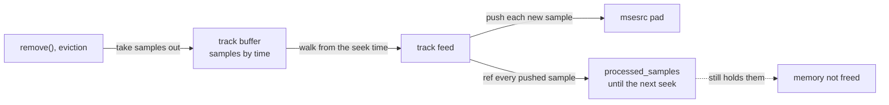

> One change of the GStreamer fork: `review/25`, 25 of 33 in the stack.
> Below it: [`review/24`](https://github.com/Airodonack/gstreamer/tree/review/24). Above it: [`review/26`](https://github.com/Airodonack/gstreamer/tree/review/26).
> The change itself: [commit 8ea2df3da806c16569eb647f49e163d70cc1123a](https://github.com/Airodonack/gstreamer/commit/8ea2df3da806c16569eb647f49e163d70cc1123a). This README sits in a commit on top of it and is not part of the merge request.
> The whole stack: [overview README](https://github.com/Airodonack/gstreamer/blob/mse-fixes-main/README.md).

# Media removed from a source buffer is freed while it plays

`remove()` and coded frame eviction took media out of a source buffer but
freed none of it while the page played: the track feed still held every
sample it had pushed since the last seek. All the media played stayed
resident, and the feed's table of pushed samples grew by one entry per
sample. The change empties that table each time the feed starts a new coded
frame group. It is one call in one function.

The table is upstream's, so the leak is in stock main and 1.28 too, but there it
ended at the end of stream, when the feed returned. Since `review/24` the
feed keeps running after its EOS, so the leak lasted for the life of the
source buffer; and the fix relies on `review/20`'s skip of groups behind
what was pushed. So it sits above both rather than at the bottom.

## The problem

A source buffer's
[`track_feed_task()`](https://github.com/Airodonack/gstreamer/blob/8ea2df3da806c16569eb647f49e163d70cc1123a/subprojects/gst-plugins-bad/gst-libs/gst/mse/gstsourcebuffer.c#L2027-L2104)
walks its track buffer from the seek position each time new data arrives,
and remembers the samples it has pushed in `processed_samples`, so that it
pushes none twice. The table holds a reference to each sample, and it is
freed only when the feed function returns: a seek, a cancel or a failed push.

## The change

Only the group being pushed can still grow, so only its samples need
remembering. `review/20` made the feed skip a group that starts behind how
far the decoder's input has reached (`pushed_dts_end`) unless the feed has
started it. Every earlier group starts behind `pushed_dts_end`, so once a new
group starts, the earlier groups' entries are never needed again.
[`track_feed_fold()`](https://github.com/Airodonack/gstreamer/blob/8ea2df3da806c16569eb647f49e163d70cc1123a/subprojects/gst-plugins-bad/gst-libs/gst/mse/gstsourcebuffer.c#L1979-L1989)
now empties the table when it starts a new group. The table is touched only
by the feed task's own thread, so no lock is needed; `remove()` and eviction
run on the application's thread and change only the track buffer, under its
lock, as before.

## Options considered

| Option | Why not chosen |
|---|---|
| **Empty the table when a new group starts** (this change) | Chosen: one call, and the skip of `review/20` already guarantees the earlier groups are not pushed again. |
| Drop each sample from the table when `remove()` or eviction takes it out | Needs the application thread to reach into the feed's table, with a lock, for no gain over this. |

## How it was checked

Unit test
[`test_track_feed_frees_removed_media`](https://github.com/Airodonack/gstreamer/blob/8ea2df3da806c16569eb647f49e163d70cc1123a/subprojects/gst-plugins-bad/tests/check/libs/mse.c#L3087-L3156)
plays `mse.mp4` through msesrc into fakesinks to the end of stream, holds a
weak reference to the memory of every buffer pushed with a timestamp before
2 s, removes `[0, 2 s)` with no seek, and expects all that memory freed. From
the 1.28 series' gate (2026-11-05, on 1.28.6):

- the test with the previous change's gstsourcebuffer.c: "'n_freed' (0) is
  not equal to 'n_pushed' (313)";
- with this change, the whole suite: `100%: Checks: 95, Failures: 0,
  Errors: 0`.

On GStreamer main (2026-11-05), the whole suite at this commit gave the same.

From the commit message, not re-run here: with `mse.mp4` appended 20 times
in sequence mode (1:53.7 of media), played to the end, every byte removed, a
seek, then teardown, counting the live memory pushed through msesrc:

| Stage | Before | After |
|---|---|---|
| played to the end | 18023 memories, 9412107 bytes | 18023, 9412107 bytes |
| `remove(0, inf)` | 18023, 9412107 bytes | 184, 91847 bytes |
| seek | 4, 651 bytes | 4, 651 bytes |
| teardown | 0 | 0 |

The 184 left after the removal are the last video group, 91 samples, and the
last audio frame, which the table keeps until the next group or seek.

## Questions a reviewer may ask

- **What if a group is re-appended while it is being pushed?** The feed has
  started it, so it is not skipped, and its samples are in the table until the
  next group starts: none is pushed twice.
- **What about the samples of the current group after a `remove()`?** They
  stay until the next group or seek, as the table above shows: at most one
  group per track.
