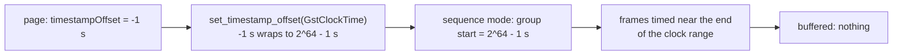
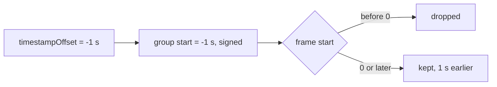

> One change of the GStreamer fork: `review/27`, 27 of 33 in the stack.
> Below it: [`review/26`](https://github.com/Airodonack/gstreamer/tree/review/26). Above it: [`review/28`](https://github.com/Airodonack/gstreamer/tree/review/28).
> The change itself: [commit 5317f370cde684be22f46665e0d69da01c92dd1a](https://github.com/Airodonack/gstreamer/commit/5317f370cde684be22f46665e0d69da01c92dd1a). This README sits in a commit on top of it and is not part of the merge request.
> The whole stack: [overview README](https://github.com/Airodonack/gstreamer/blob/mse-fixes-main/README.md).

# A negative timestamp offset moves the media earlier

MSE's `timestampOffset` is a signed number: a page sets it negative to trim
a leading gap, and a live player sets it negative to map a stream's clock
onto the media timeline. mselib held it as an unsigned `GstClockTime`.
This change makes the offset signed through the API and the track
buffers, and drops what would land before zero.

This commit covers sequence mode, where mselib applied the offset at all;
`review/28` applies it in segments mode too.

## The problem

- The `timestamp-offset` property was an `int64` limited to 0 and above.
  Probed for the earlier README, on stock GStreamer 1.28.7: the property's minimum is 0.
- `gst_source_buffer_set_timestamp_offset()` took a `GstClockTime`. A
  negative value passed through it wrapped to a huge one.
- In sequence mode, the track buffer starts each group at the offset. With
  the wrapped value, the first frames' times went to the end of the clock
  range, and the source buffer reported no buffered range at all.

## The change

- **API:** `gst_source_buffer_set_timestamp_offset()` and
  `gst_source_buffer_get_timestamp_offset()` take and return a
  `GstClockTimeDiff`
  ([setter](https://github.com/Airodonack/gstreamer/blob/5317f370cde684be22f46665e0d69da01c92dd1a/subprojects/gst-plugins-bad/gst-libs/gst/mse/gstsourcebuffer.c#L1640-L1685),
  [getter](https://github.com/Airodonack/gstreamer/blob/5317f370cde684be22f46665e0d69da01c92dd1a/subprojects/gst-plugins-bad/gst-libs/gst/mse/gstsourcebuffer.c#L1613-L1623)).
  This changes their signatures, in a library marked as unstable API; the
  introspection data changes from unsigned to signed, and bindings with it.
- **Property:** the range now starts at `G_MININT64`
  ([line 610](https://github.com/Airodonack/gstreamer/blob/5317f370cde684be22f46665e0d69da01c92dd1a/subprojects/gst-plugins-bad/gst-libs/gst/mse/gstsourcebuffer.c#L606-L610)).
- **Track buffer:** the group start and end of sequence mode are signed,
  with `GST_CLOCK_STIME_NONE` for unset
  ([struct](https://github.com/Airodonack/gstreamer/blob/5317f370cde684be22f46665e0d69da01c92dd1a/subprojects/gst-plugins-bad/gst-libs/gst/mse/gstmediasourcetrackbuffer.c#L32-L44)),
  and
  [`timestamps_process`](https://github.com/Airodonack/gstreamer/blob/5317f370cde684be22f46665e0d69da01c92dd1a/subprojects/gst-plugins-bad/gst-libs/gst/mse/gstmediasourcetrackbuffer.c#L354-L399)
  computes the times signed and returns `FALSE` for a frame that would start
  before zero.
  [`gst_media_source_track_buffer_add`](https://github.com/Airodonack/gstreamer/blob/5317f370cde684be22f46665e0d69da01c92dd1a/subprojects/gst-plugins-bad/gst-libs/gst/mse/gstmediasourcetrackbuffer.c#L143-L163)
  then drops it, as the append window would.

## Options considered

| Option | Why not chosen |
|---|---|
| **Signed offset in the API, the property and the track buffer** (this change) | Chosen: the spec's type is a signed double, and an unsigned API cannot carry it. |
| Keep the API, refuse negative offsets with an error | Pages that set a negative offset, which the spec allows, would fail. |
| Clamp a negative offset to 0 in the caller | Silently places the media at the wrong time. The browser this fork serves did that until now, as a stopgap. |
| A new pair of signed functions, deprecating the old | Not decided: it keeps the existing signatures, at the cost of a second pair of functions. Left for the review. |

## Spec

[MSE, `timestampOffset`](https://w3c.github.io/media-source/#dom-sourcebuffer-timestampoffset)
is a `double` with no range restriction in its setter.
[Coded frame processing](https://w3c.github.io/media-source/#sourcebuffer-coded-frame-processing)
adds it to each frame's timestamps and then:

> If presentation timestamp is less than appendWindowStart, then set the
> need random access point flag to true, drop the coded frame, and jump to
> the top of the loop to start processing the next coded frame.

`appendWindowStart` is never below zero.

## How it was checked

Unit test
[`test_source_buffer_negative_timestamp_offset_sequence`](https://github.com/Airodonack/gstreamer/blob/5317f370cde684be22f46665e0d69da01c92dd1a/subprojects/gst-plugins-bad/tests/check/libs/mse.c#L1829-L1845)
with its helper
[`buffered_with_offset`](https://github.com/Airodonack/gstreamer/blob/5317f370cde684be22f46665e0d69da01c92dd1a/subprojects/gst-plugins-bad/tests/check/libs/mse.c#L1791-L1827):
`mse.mp4` in sequence mode with no offset and with -1 s. With the offset,
the property reads back -1 s, the buffered range starts within 100 ms of
zero and ends exactly 1 s earlier. It fails before this change (no
buffered range), per the commit message.

At this commit, the gate on GStreamer main (2026-11-05) ran the whole unit
test suite: `100%: Checks: 146, Failures: 0, Errors: 0`, as on the 1.28 series.

## Questions a reviewer may ask

- **The frames after a dropped key frame.** The spec sets the "need random
  access point" flag when it drops a frame, and then drops every frame up
  to the next key frame. mselib drops only the frames before zero, here
  and at the append window start. Probed for the earlier README, on stock 1.28.7: `mse.mp4`'s
  video key frames are at 0.033 and 4.2 s, so with -1 s the delta frames
  from 1 to 4.2 s are kept without their key frame. The test's "starts
  within 100 ms of zero" depends on that; by the spec, the video track
  would start at 3.2 s. Open: fix it here, or as a separate change to the
  append window.
- **Sequence mode ignores the frames' own times.** `timestamps_process`
  lays each frame after the previous one by duration. That is upstream's
  and not changed here.
- **Does the signature change break callers?** `GstClockTime` is
  `guint64` and `GstClockTimeDiff` is `gint64`: same size and passing
  convention, so C callers that pass a positive value see no difference.
  The declared signatures still change, in a library marked as unstable
  API.
