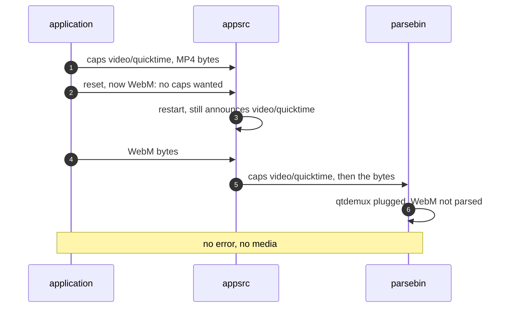
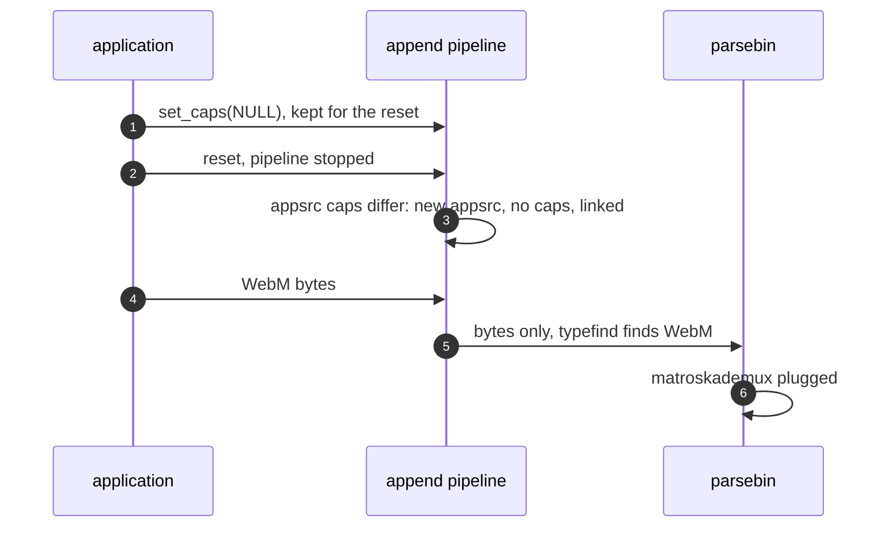

> One change of the GStreamer fork: `review/32`, 32 of 33 in the stack.
> Below it: [`review/31`](https://github.com/Airodonack/gstreamer/tree/review/31). Above it: [`review/33`](https://github.com/Airodonack/gstreamer/tree/review/33).
> The change itself: [commit 359939d7d2f61a1b9ba1f96be39e5646c8f2b1bd](https://github.com/Airodonack/gstreamer/commit/359939d7d2f61a1b9ba1f96be39e5646c8f2b1bd). This README sits in a commit on top of it and is not part of the merge request.
> The whole stack: [overview README](https://github.com/Airodonack/gstreamer/blob/mse-fixes-main/README.md).

# A parser reset takes new caps with a new appsrc

`review/23` gives an MP4 buffer's `appsrc` caps so that `parsebin` skips
typefinding. Caps set later do not work on `appsrc`: it cannot go back to no
caps, and after a restart it announces the caps it last pushed before any
queued ones. A buffer changed from MP4 to WebM would keep qtdemux and drop the
WebM bytes without an error. The change keeps the caps last set, and the next
parser reset puts a new `appsrc` in front of `parsebin` when they differ. It
is about 100 lines in the append pipeline.

Nothing sets other caps yet: `review/33`, the content type change, does, and
its tests cover this one.

## The problem

Two behaviours of `appsrc` itself stand in the way:

- `NULL` caps after real ones abort its streaming thread, so it cannot go back
  to "typefind this";
- after a restart it sends the caps it last pushed before any queued ones, so
  new caps set before the restart are announced after the old.

## The change

- The append pipeline keeps the caps last set
  ([`gst_append_pipeline_set_caps()`](https://github.com/Airodonack/gstreamer/blob/359939d7d2f61a1b9ba1f96be39e5646c8f2b1bd/subprojects/gst-plugins-bad/gst-libs/gst/mse/gstappendpipeline.c#L1267-L1287)).
  A source with no caps yet takes them at once; otherwise they wait for the
  next reset.
- The reset, with the pipeline stopped, calls
  [`renew_appsrc_if_needed()`](https://github.com/Airodonack/gstreamer/blob/359939d7d2f61a1b9ba1f96be39e5646c8f2b1bd/subprojects/gst-plugins-bad/gst-libs/gst/mse/gstappendpipeline.c#L1289-L1328)
  ([line 1419](https://github.com/Airodonack/gstreamer/blob/359939d7d2f61a1b9ba1f96be39e5646c8f2b1bd/subprojects/gst-plugins-bad/gst-libs/gst/mse/gstappendpipeline.c#L1419)):
  when the source's caps are not the ones last set, it removes the old
  `appsrc`, adds a new one made by
  [`new_appsrc()`](https://github.com/Airodonack/gstreamer/blob/359939d7d2f61a1b9ba1f96be39e5646c8f2b1bd/subprojects/gst-plugins-bad/gst-libs/gst/mse/gstappendpipeline.c#L1135-L1144),
  links it to `parsebin` and gives it the caps, if any.
- The source and the caps are guarded by a new `src_lock`
  ([the fields](https://github.com/Airodonack/gstreamer/blob/359939d7d2f61a1b9ba1f96be39e5646c8f2b1bd/subprojects/gst-plugins-bad/gst-libs/gst/mse/gstappendpipeline.c#L94-L102)).
  The caps can be set from the application's thread while the append task
  pushes and another thread resets, so every user takes a reference to the
  source under the lock and uses it after
  ([`get_src()`](https://github.com/Airodonack/gstreamer/blob/359939d7d2f61a1b9ba1f96be39e5646c8f2b1bd/subprojects/gst-plugins-bad/gst-libs/gst/mse/gstappendpipeline.c#L1126-L1133),
  [`gst_append_pipeline_append()`](https://github.com/Airodonack/gstreamer/blob/359939d7d2f61a1b9ba1f96be39e5646c8f2b1bd/subprojects/gst-plugins-bad/gst-libs/gst/mse/gstappendpipeline.c#L1330-L1353)).
  The lock is never held while calling out.

## Options considered

| Option | Why not chosen |
|---|---|
| **A new appsrc at the reset when the caps changed** (this change) | Chosen: the reset already stops the pipeline, and a fresh `appsrc` has no caps history. |
| Clear appsrc's caps on reset | `NULL` caps after real ones abort its streaming thread. |
| Set the new caps on the old appsrc before the restart | It announces the old caps first, so `parsebin` keeps the old demuxer. |
| A new append pipeline per type change | Loses the retired tracks that let the next initialization segment reuse the track objects (`review/11`), and with them the track buffers. |

## How it was checked

No test of its own: nothing sets other caps until `review/33`, whose tests
cover it, an MP4 buffer changed to WebM and a change from the update-end of a
failed append. The lock was added after a review found the swap unguarded:
with temporary delays of 200 to 300 ms around the reset, the renewal and
`set_caps()`, a change from the update-end of a failed append segfaulted
without it and passed with it (runs of 2026-11-04, not repeated here).

The gate on GStreamer main (2026-11-05), the whole suite at this commit, as on
the 1.28 series:
`100%: Checks: 153, Failures: 0, Errors: 0`, as at the change before, since
it adds no test.

## Questions a reviewer may ask

- **Could the new appsrc lose queued bytes?** It is replaced only inside the
  reset, after the pipeline has stopped, and a reset discards the bytes in
  flight anyway.
- **What does a holder of the old source see?** Until the new source is in
  place, a push into the old, stopped one returns `GST_FLOW_FLUSHING`, as the
  code's comment says.
