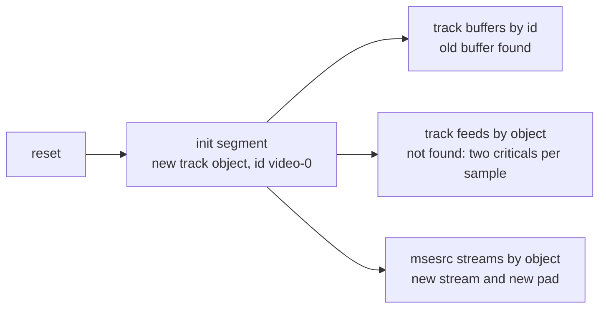
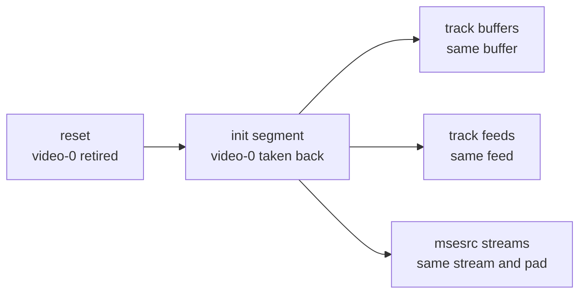

> One change of the GStreamer fork: `review/11`, 11 of 33 in the stack.
> Below it: [`review/10`](https://github.com/Airodonack/gstreamer/tree/review/10). Above it: [`review/12`](https://github.com/Airodonack/gstreamer/tree/review/12).
> The change itself: [commit e7c846dc8a9108c4fe4243ce06cc041780531925](https://github.com/Airodonack/gstreamer/commit/e7c846dc8a9108c4fe4243ce06cc041780531925). This README sits in a commit on top of it and is not part of the merge request.
> The whole stack: [overview README](https://github.com/Airodonack/gstreamer/blob/mse-fixes-main/README.md).

# Appending after a parser reset keeps feeding the same tracks

After the append pipeline was reset, the next initialization segment made new
track objects with the same ids as the old ones. Two tables are keyed by the
object, not the id, so every reset added pads to msesrc and every later
sample logged two GLib criticals. The fix hands the old track objects back
to the initialization segment that follows a reset.

Upstream, only the parse error path resets the parser. The next two changes
make `abort()` reset it too, which is why this change comes first.

## The problem

A track's id is its appsink's name, one per stream type and index, `video-0`
and so on. After a reset the same stream gets the same id, but
[`add_track()` on main](https://github.com/Airodonack/gstreamer/blob/74f679f8de/subprojects/gst-plugins-bad/gst-libs/gst/mse/gstappendpipeline.c#L479-L487)
always made a new `GstMediaSourceTrack`. What the source buffer and msesrc
keep per track is keyed in three ways:

| Table | Keyed by | After a reset |
|---|---|---|
| Source buffer's track buffers ([init](https://github.com/Airodonack/gstreamer/blob/e7c846dc8a9108c4fe4243ce06cc041780531925/subprojects/gst-plugins-bad/gst-libs/gst/mse/gstsourcebuffer.c#L946-L947)) | track id | old buffer found, kept |
| Source buffer's track feeds ([init](https://github.com/Airodonack/gstreamer/blob/e7c846dc8a9108c4fe4243ce06cc041780531925/subprojects/gst-plugins-bad/gst-libs/gst/mse/gstsourcebuffer.c#L950-L951)) | track object | new object not found |
| msesrc's streams ([`append_stream()`](https://github.com/Airodonack/gstreamer/blob/e7c846dc8a9108c4fe4243ce06cc041780531925/subprojects/gst-plugins-bad/gst-libs/gst/mse/gstmsesrc.c#L1199-L1204)) | track object | new object is a new stream |

So:

- msesrc treated each new object as a new stream and added a source pad for
  it: one more pad per track on every reset.
- Each sample appended after a reset found its track buffer by id but no feed
  for the new object, and logged
  `get_track_feed_unlocked: assertion 'g_hash_table_contains (self->track_feeds, track)' failed`
  and `start_track_feed: assertion 'feed != NULL' failed`. The old feed task,
  still waiting on the same track buffer, kept pushing, so playback went on.
  But a feed that had stopped (end of stream, a failed push) could not be
  restarted for the new data.

## The change

- The reset keeps a reference to each track before it frees the tracks array,
  in a new `retired_tracks` array
  ([gstappendpipeline.c, lines 973 to 982](https://github.com/Airodonack/gstreamer/blob/e7c846dc8a9108c4fe4243ce06cc041780531925/subprojects/gst-plugins-bad/gst-libs/gst/mse/gstappendpipeline.c#L973-L982)).
  Retired tracks that no initialization segment has taken back stay in the
  array: after two resets in a row the second finds no tracks, and the next
  initialization segment must still get the first one's.
- `add_track()` calls a new
  [`reuse_or_new_track()`](https://github.com/Airodonack/gstreamer/blob/e7c846dc8a9108c4fe4243ce06cc041780531925/subprojects/gst-plugins-bad/gst-libs/gst/mse/gstappendpipeline.c#L410-L423),
  which takes back a retired track of the same type and id and only makes a
  new one when there is none
  ([line 529](https://github.com/Airodonack/gstreamer/blob/e7c846dc8a9108c4fe4243ce06cc041780531925/subprojects/gst-plugins-bad/gst-libs/gst/mse/gstappendpipeline.c#L524-L533)).

The ids repeat as long as the demuxer exposes the pads in the same order,
which a re-sent initialization segment of the same stream does. A reset
followed by a stream with a different layout gets new tracks, as before.

## Options considered

| Option | What it would take | Why not chosen |
|---|---|---|
| **Give the old track objects back after a reset** (this change) | 30 lines in the append pipeline | Chosen: the source buffer and msesrc keep everything they have per track, with no change on their side. |
| Key the track feeds and msesrc's streams by id | Change both tables and their lookups | Two components to change, and msesrc's streams span several source buffers, whose ids are not unique across buffers (`video-0` in each). |
| Rebuild the feeds and msesrc's pads after a reset | Tear down and recreate on every reset | Playback would see pads go and come back on every abort, which a player does on each seek. |

## What it costs

A reused track keeps its first caps. If the initialization segment after a
reset carries different caps for the same id, the track object does not
show them.

## How it was checked

There is no unit test in this change. The unit test
`test_source_buffer_append_after_abort` comes with `review/13`, since it
needs `abort()` to reset the parser.

- A browser page appends an initialization segment and a media segment,
  aborts, appends the initialization segment and the next media segment,
  and plays: 584 criticals before, none after. These runs are from when the
  change was made. With the reuse disabled
  again, and `abort()` resetting the parser, the criticals come back while playback still crosses
  into the new segment.
- On top of `review/13`, with the reuse disabled, the unit test
  `test_source_buffer_append_after_abort` fails with "Unexpected
  critical/warning: get_track_feed_unlocked: assertion 'g_hash_table_contains
  (self->track_feeds, track)' failed" (run of 2026-10-23, same test text).
  With the reuse it passes. Re-run for this README on a build of the stack's
  top (2026-11-03): 5 of 5 runs pass.

- Keeping retired tracks across two resets came from a later review: with
  the set dropped at each reset, two resets in a row ended in the same
  `get_track_feed_unlocked` assertion, and in a SIGSEGV with GLib's checks
  off (run of 2026-11-04, not repeated here).

At this commit, the gate on GStreamer main (2026-11-05) ran the whole unit
test suite: `100%: Checks: 72, Failures: 0, Errors: 0`, as on the 1.28 series.

## Questions a reviewer may ask

- **Why match on type as well as id?** The id already starts with the type
  name. Matching both keeps the lookup right if the naming ever changes.
- **Why keep retired tracks across resets?** A source buffer can be reset
  twice before the next initialization segment, by two `abort()` calls or
  an abort after a parse error. The second reset finds no tracks, so dropping the retired set
  there would lose the first segment's tracks and with them the track
  buffers and feeds. `reuse_or_new_track()` steals a track out of the array
  when it takes it back, so a type and id is never in it twice.
  `test_source_buffer_append_after_two_aborts`, which comes with `review/31`,
  covers it.
