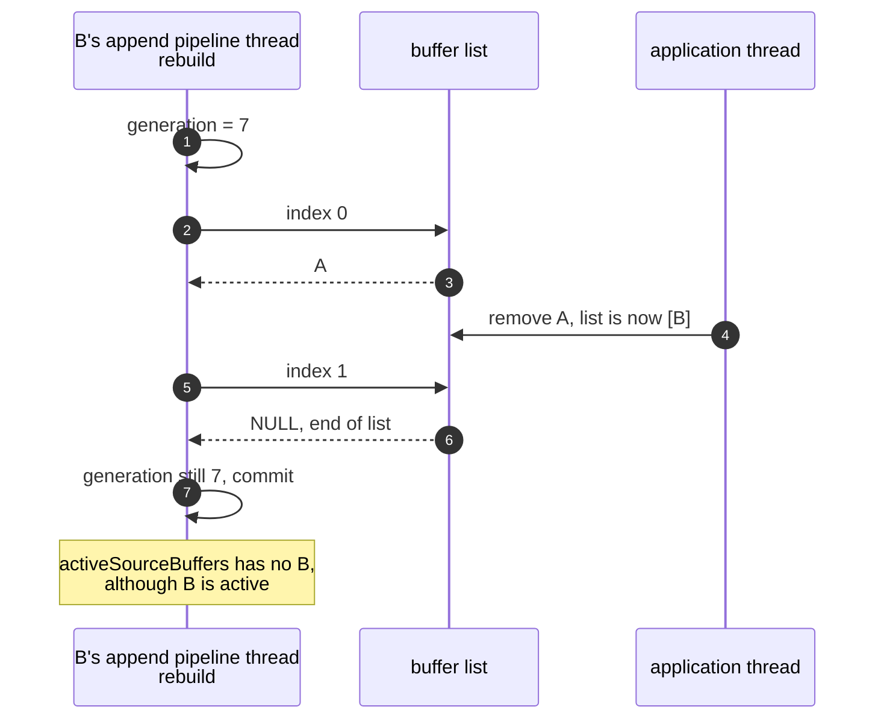
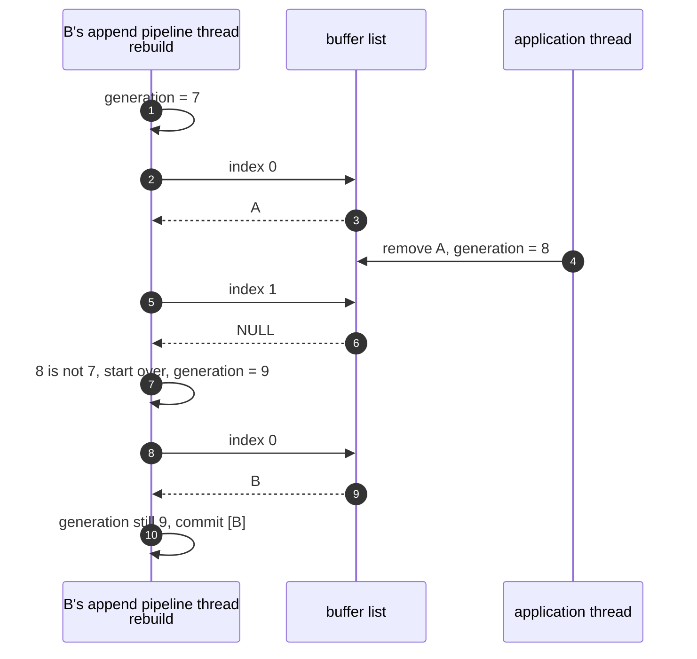

> One change of the GStreamer fork: `review/09`, 9 of 33 in the stack.
> Below it: [`review/08`](https://github.com/Airodonack/gstreamer/tree/review/08). Above it: [`review/10`](https://github.com/Airodonack/gstreamer/tree/review/10).
> The change itself: [commit e38d2eae5dc711417636cdc8fa3a49f6ca9e5bc2](https://github.com/Airodonack/gstreamer/commit/e38d2eae5dc711417636cdc8fa3a49f6ca9e5bc2). This README sits in a commit on top of it and is not part of the merge request.
> The whole stack: [overview README](https://github.com/Airodonack/gstreamer/blob/mse-fixes-main/README.md).

# Removing a source buffer no longer hides another active buffer

Removing one source buffer while the active list was being rebuilt could
leave another, active buffer out of `activeSourceBuffers` until some later
initialization segment put it back. The fix is four lines: a removal now
moves the rebuild's generation counter, so a rebuild that overlapped it
starts over.

## The problem

Since `review/07`,
[`rebuild_active_source_buffers()`](https://github.com/Airodonack/gstreamer/blob/e38d2eae5dc711417636cdc8fa3a49f6ca9e5bc2/subprojects/gst-plugins-bad/gst-libs/gst/mse/gstmediasource.c#L789-L861)
takes its snapshot one `gst_source_buffer_list_index()` call at a time, each
under the list's lock but not across calls. When the application removes a
buffer between two calls, the array shifts under the walk. With buffers
`[A, B]`, `index(0)` gives A, A is removed, `index(1)` is past the end, and B
is never looked at.

The rebuild's generation check exists to catch a newer view, but in
`review/07` only rebuilds moved the counter, not removals. So the rebuild
commits a list without B, although B is active.

## The change

[`gst_media_source_remove_source_buffer()`](https://github.com/Airodonack/gstreamer/blob/e38d2eae5dc711417636cdc8fa3a49f6ca9e5bc2/subprojects/gst-plugins-bad/gst-libs/gst/mse/gstmediasource.c#L979-L986)
bumps `active_buffers_generation` under the media source's object lock, right
after taking the buffer out of the lists. A rebuild whose walk overlapped the
removal finds the counter moved at its
[commit check](https://github.com/Airodonack/gstreamer/blob/e38d2eae5dc711417636cdc8fa3a49f6ca9e5bc2/subprojects/gst-plugins-bad/gst-libs/gst/mse/gstmediasource.c#L808-L815)
and walks the list again. The check and the retry are the ones `review/07`
added.

Detaching the media source and adding a buffer do not bump the counter. A
rebuild that snapshotted across a detach finds no buffer left and commits an
empty list, which is what detaching wants. A buffer just added has no tracks
and is inactive either way.

## Options considered

| Option | What it would take | Why not chosen |
|---|---|---|
| **Bump the generation on removal** (this change) | 4 lines | Chosen: reuses the check and retry already there. |
| Take the snapshot in one call, under the list's lock | A list function returning a copy of the array | Fixes this gap too, and is arguably cleaner. It adds API to the list for one caller, while the counter already handles the other case of a stale snapshot. |
| Hold the media source's lock across the walk | Revert `review/07` | Brings back the deadlock `review/07` removed. |

## Spec

[MSE, removeSourceBuffer()](https://www.w3.org/TR/media-source-2/#dom-mediasource-removesourcebuffer)
takes only the removed buffer out of `activeSourceBuffers`. Any other buffer
providing an enabled track stays in it
([activeSourceBuffers](https://www.w3.org/TR/media-source-2/#dom-mediasource-activesourcebuffers)):

> Contains the subset of sourceBuffers that are providing the selected video
> track, the enabled audio track(s), and the "showing" or "hidden" text
> track(s).

## How it was checked

There is no unit test. The race was made deterministic with a temporary
delay of 800 ms before each `index(i >= 1)` in the rebuild's walk only, in a
copy of the sources. A browser page has a video buffer A with its
initialization segment and an audio buffer B. It appends B's initialization
segment, removes A while the rebuild that started is between two `index()`
calls, then reads `activeSourceBuffers` 1.8 s after the removal and again
3 s after B's update-end. The page's log lines, from the runs made on
2026-10-23:

| Library | Runs | Both readings |
|---|---|---|
| Before | 3 | `active=0 bActive=false buffers=1`, 3 of 3 |
| After | 3 | `active=1 bActive=true buffers=1`, 3 of 3 |

After the change, the delay log shows the rebuild's second walk. A run of the
`review/08` race, with a removal while `index()` holds the list's lock and
`G_DEBUG=gc-friendly`, still prints no critical.

At this commit, the gate on GStreamer main (2026-11-05) ran the whole unit
test suite: `100%: Checks: 71, Failures: 0, Errors: 0`, as on the 1.28 series.

## Questions a reviewer may ask

- **Why bump it after the removal and not before?** Both happen under the
  media source's lock, and the rebuild compares the counter under that lock,
  so a rebuild sees either both or neither.
