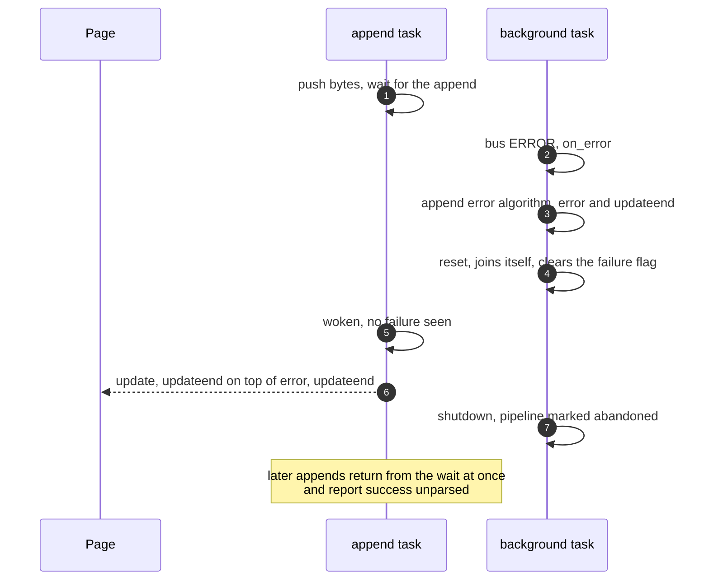
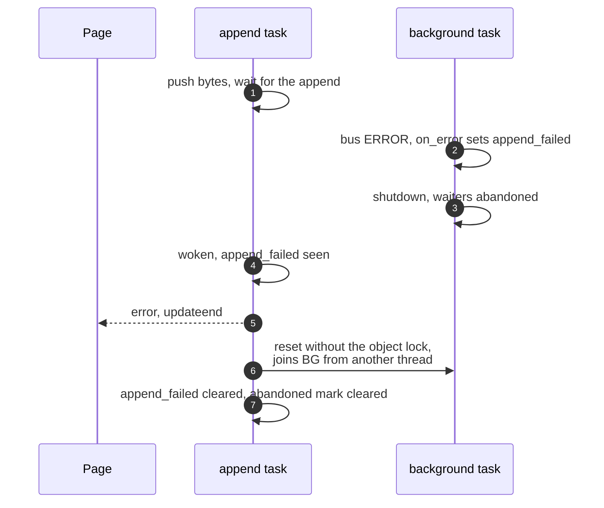

> One change of the GStreamer fork: `review/14`, 14 of 33 in the stack.
> Below it: [`review/13`](https://github.com/Airodonack/gstreamer/tree/review/13). Above it: [`review/15`](https://github.com/Airodonack/gstreamer/tree/review/15).
> The change itself: [commit 7c30c1bd7f51533e5507fd235b81087ffe379bf4](https://github.com/Airodonack/gstreamer/commit/7c30c1bd7f51533e5507fd235b81087ffe379bf4). This README sits in a commit on top of it and is not part of the merge request.
> The whole stack: [overview README](https://github.com/Airodonack/gstreamer/blob/mse-fixes-main/README.md).

# A parse error is reported once, by the append in progress

When the parser rejected an append, the error was handled on one of the
append pipeline's own threads. That thread tried to join itself, the error
was reported along with a success for the same append, and later appends were
reported as successful without being parsed. The change leaves only a flag on
that thread and lets the append task run the append error algorithm.

## The problem

The append pipeline reports a parse error through its `on_error` callback,
on one of its own threads: the background task for a bus `ERROR` message
([gstappendpipeline.c, lines 402 to 406](https://github.com/Airodonack/gstreamer/blob/7c30c1bd7f51533e5507fd235b81087ffe379bf4/subprojects/gst-plugins-bad/gst-libs/gst/mse/gstappendpipeline.c#L402-L406)),
or the streaming thread for a pad it cannot handle.
[`on_error()` on main](https://github.com/Airodonack/gstreamer/blob/74f679f8de/subprojects/gst-plugins-bad/gst-libs/gst/mse/gstsourcebuffer.c#L699-L707)
ran the append error algorithm right there. With `review/10` and `review/12`
in place, that went wrong three ways:

1. The algorithm resets the append pipeline. The reset joins the background
   task, so on that thread it tried to join itself.
2. It scheduled error and update-end. Meanwhile the append task, waiting in
   `gst_append_pipeline_wait_for_appends()`, woke up, found the failure flag
   already cleared by that reset, and scheduled update and update-end on top.
3. After `on_error` returned, the background task's shutdown marked the
   pipeline abandoned, after the reset had cleared that mark. Later appends
   then returned from the wait at once and were reported as successful
   without being parsed.

## The change

[`on_error()`](https://github.com/Airodonack/gstreamer/blob/7c30c1bd7f51533e5507fd235b81087ffe379bf4/subprojects/gst-plugins-bad/gst-libs/gst/mse/gstsourcebuffer.c#L709-L719)
now only sets an atomic `append_failed` flag.
[`encountered_bad_bytes_unlocked()`](https://github.com/Airodonack/gstreamer/blob/7c30c1bd7f51533e5507fd235b81087ffe379bf4/subprojects/gst-plugins-bad/gst-libs/gst/mse/gstsourcebuffer.c#L1715-L1720)
reads it along with the pipeline's own failure state. The append task checks
it once its append has ended
([line 1832](https://github.com/Airodonack/gstreamer/blob/7c30c1bd7f51533e5507fd235b81087ffe379bf4/subprojects/gst-plugins-bad/gst-libs/gst/mse/gstsourcebuffer.c#L1832-L1835)),
or when the next append starts
([line 1793](https://github.com/Airodonack/gstreamer/blob/7c30c1bd7f51533e5507fd235b81087ffe379bf4/subprojects/gst-plugins-bad/gst-libs/gst/mse/gstsourcebuffer.c#L1793-L1796)),
and runs the append error algorithm itself, which resets the parser without
the object lock. The reset clears the flag
([line 1672](https://github.com/Airodonack/gstreamer/blob/7c30c1bd7f51533e5507fd235b81087ffe379bf4/subprojects/gst-plugins-bad/gst-libs/gst/mse/gstsourcebuffer.c#L1670-L1672)).

The append task's wait still ends at the error: the background task's
shutdown marks the waiters abandoned, as before.

## Options considered

| Option | What it would take | Why not chosen |
|---|---|---|
| **A flag on the pipeline's thread, the error algorithm on the append task** (this change) | 15 lines | Chosen: one thread finishes an append, success or failure, and the reset runs where it can join. |
| Keep the algorithm in `on_error()` and skip the reset there | Split the algorithm | The spec's append error algorithm starts with the reset. The append task would still race it to report the append. |
| Post the error to another thread with a main loop or idle source | A dispatch mechanism | mselib has no main loop of its own. The append task already waits for this append. |

## Spec

[MSE, Append Error](https://www.w3.org/TR/media-source-2/#sourcebuffer-append-error):

> Run the reset parser state algorithm.
> Set the updating attribute to false.
> Queue a task to fire an event named error at this SourceBuffer object.
> Queue a task to fire an event named updateend at this SourceBuffer object.
> Run the end of stream algorithm with the error parameter set to "decode".

One error and one update-end per failed append, then the end of stream with a
decode error.

## How it was checked

Unit test
[`test_source_buffer_parse_error_reported_once`](https://github.com/Airodonack/gstreamer/blob/7c30c1bd7f51533e5507fd235b81087ffe379bf4/subprojects/gst-plugins-bad/tests/check/libs/mse.c#L1343-L1381)
appends bytes the parser rejects, waits for one error and one update-end,
waits 100 ms more, and checks the counts are still one each and the media
source has ended. It then appends a valid MP4, which reopens the source, and
checks that it is parsed: a second update-end, no second error, and one
buffered range.

- Before the change (run of 2026-10-23, the same test text): fails with
  "Unexpected critical/warning: Trying to join task ... from its thread would
  deadlock", from `gst_append_pipeline_reset()` called by
  `append_error_unlocked()` in `on_error()`.
- After: passes. Re-run for this README on a build of the stack's top of that day
  (2026-11-03): 5 of 5 runs pass.
- A browser page appending bytes that are not media got one error and one
  update-end, and the media source ended with a decode error. That run is
  from when the change was made.

At this commit, the gate on GStreamer main (2026-11-05) ran the whole unit
test suite: `100%: Checks: 74, Failures: 0, Errors: 0`, as on the 1.28 series.

## Questions a reviewer may ask

- **Why may the library accept an append after the error?** The append
  reopens the ended source, as the spec's prepare append algorithm says.
  Refusing an append after a decode error is the browser's job: the element
  has an error, and the spec's "recent element error" check throws.
- **Can the flag be lost?** It is cleared only by the reset that handles it,
  and that reset stops the pipeline's threads first, so no new error can be
  set during it from the old parse.
