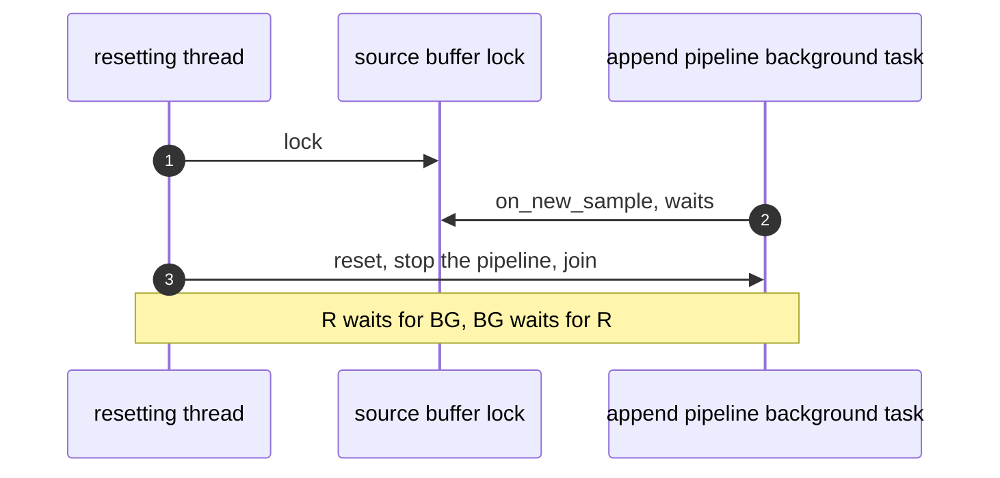
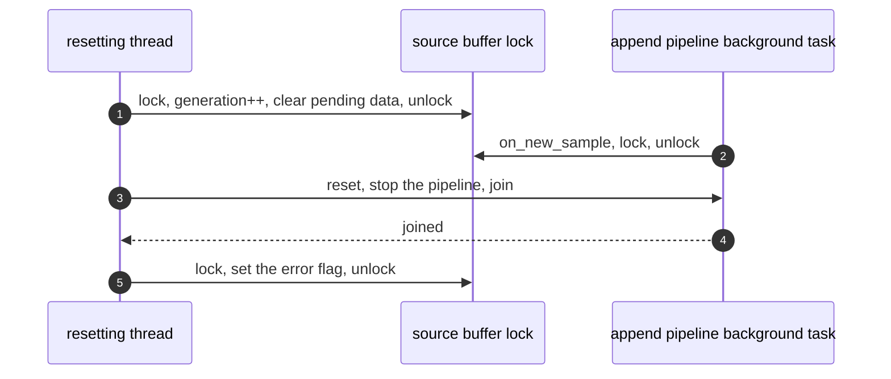
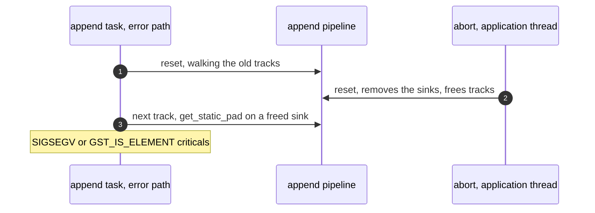
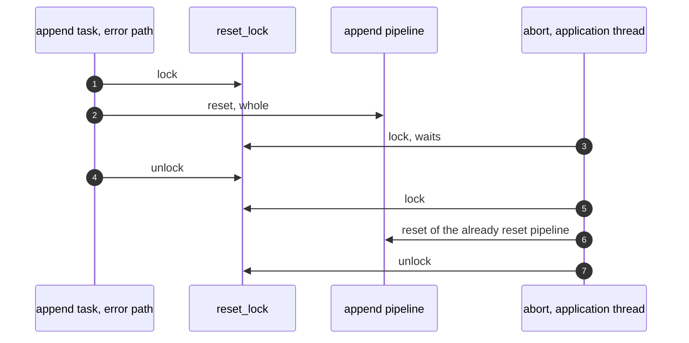
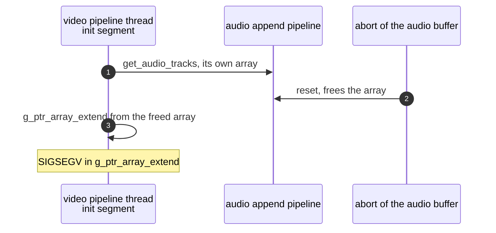
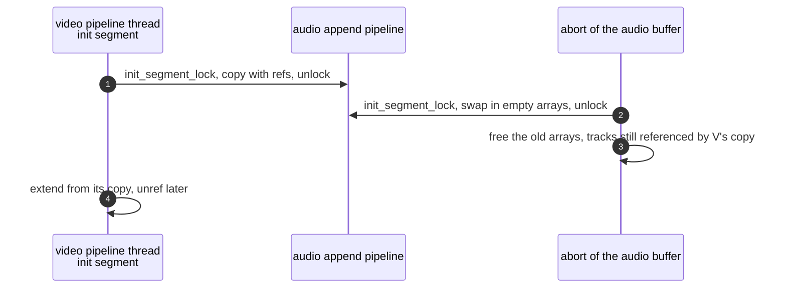

> One change of the GStreamer fork: `review/12`, 12 of 33 in the stack.
> Below it: [`review/11`](https://github.com/Airodonack/gstreamer/tree/review/11). Above it: [`review/13`](https://github.com/Airodonack/gstreamer/tree/review/13).
> The change itself: [commit 09b309e2c62cd1e38fdcfa24151d86102bb8f3b8](https://github.com/Airodonack/gstreamer/commit/09b309e2c62cd1e38fdcfa24151d86102bb8f3b8). This README sits in a commit on top of it and is not part of the merge request.
> The whole stack: [overview README](https://github.com/Airodonack/gstreamer/blob/mse-fixes-main/README.md).

# The parser is reset without the source buffer's lock

Resetting a source buffer's append pipeline ran under the source buffer's
object lock, and the reset waits for threads that need that lock. This change
moves the reset out from under the lock. Running it unlocked opens two new
races, and the change closes both: two resets of the same pipeline at once,
and a reset freeing track arrays another buffer is reading.

The next change, `review/13`, makes `abort()` reset the parser from the
application's thread. This change settles the locking first.

## The problem

**1. The reset waits on a thread that waits on it.** A reset stops the append
pipeline. That joins its streaming threads and its background task. The
background task delivers samples through `on_new_sample()`, which takes the
source buffer's object lock. Upstream, unchanged until this commit, the
append error algorithm and `gst_source_buffer_teardown()` reset with that lock
held
([`reset_parser_state_unlocked()` and `append_error_unlocked()`](https://github.com/Airodonack/gstreamer/blob/74f679f8de/subprojects/gst-plugins-bad/gst-libs/gst/mse/gstsourcebuffer.c#L1643-L1671),
[`gst_source_buffer_teardown()`](https://github.com/Airodonack/gstreamer/blob/74f679f8de/subprojects/gst-plugins-bad/gst-libs/gst/mse/gstsourcebuffer.c#L2167-L2174)).

## The change, part 1: reset without the lock

[`reset_parser_state()`](https://github.com/Airodonack/gstreamer/blob/09b309e2c62cd1e38fdcfa24151d86102bb8f3b8/subprojects/gst-plugins-bad/gst-libs/gst/mse/gstsourcebuffer.c#L1655-L1673)
now runs with no lock held, and takes the object lock only afterwards to set
or clear the error flag. Its two callers drop what they need under the lock,
then release it for the reset:

- [`append_error_unlocked()`](https://github.com/Airodonack/gstreamer/blob/09b309e2c62cd1e38fdcfa24151d86102bb8f3b8/subprojects/gst-plugins-bad/gst-libs/gst/mse/gstsourcebuffer.c#L1675-L1699)
  clears the pending data and `updating` and schedules error and update-end,
  then unlocks, resets, and locks again.
- [`gst_source_buffer_teardown()`](https://github.com/Airodonack/gstreamer/blob/09b309e2c62cd1e38fdcfa24151d86102bb8f3b8/subprojects/gst-plugins-bad/gst-libs/gst/mse/gstsourcebuffer.c#L2219-L2231)
  does the same, then resets after unlocking.

Both bump a new `append_generation` under the lock first. An append task
waiting in `gst_append_pipeline_wait_for_appends()`, from `review/10`,
records the number before it waits and reports nothing when the number has
moved
([lines 1810 to 1818](https://github.com/Airodonack/gstreamer/blob/09b309e2c62cd1e38fdcfa24151d86102bb8f3b8/subprojects/gst-plugins-bad/gst-libs/gst/mse/gstsourcebuffer.c#L1810-L1818)).
Its append was discarded by the reset.

One caller of the append error algorithm is still wrong after this change:
`on_error()` runs it on one of the append pipeline's own threads, where the
reset joins that thread. `review/14` moves it to the append task.

## The problem, part 2: two resets at once

Without the object lock, two threads can reset the same append pipeline at
once: the append task's error path and a teardown, and from `review/13` an
`abort()` on the application's thread. `gst_append_pipeline_reset()` has no
lock of its own. It walks and frees the pipeline's tracks, rebuilds
`retired_tracks` and replaces the initialization segment. A second reset
over the first removed the sinks and freed the tracks array under the other
thread's loop.

## The change, part 2: one reset at a time

A `reset_lock` in `GstSourceBuffer` is held across
`gst_append_pipeline_reset()` in `reset_parser_state()`. The callers take
turns. It is taken with no other lock held, and the reset takes only the
append pipeline's own locks, so it nests inside nothing.

## The problem, part 3: another buffer reads the track arrays

When a buffer receives an initialization segment, the media source collects
every buffer's tracks for msesrc
([`on_received_init_segment()`](https://github.com/Airodonack/gstreamer/blob/09b309e2c62cd1e38fdcfa24151d86102bb8f3b8/subprojects/gst-plugins-bad/gst-libs/gst/mse/gstmediasource.c#L705-L738)
-> `gst_source_buffer_get_all_tracks()`). That runs on the receiving buffer's
append pipeline thread, and reads the other buffers' tracks too.
`gst_append_pipeline_get_{audio,text,video}_tracks()` handed out the
pipeline's own `init_segment` arrays, with no lock and no copy. A reset of the
other buffer frees those arrays. The media source's lock does not help: the
reset takes no media source lock.

## The change, part 3: copies under a lock of their own

The append pipeline gets an `init_segment_lock` for its track arrays and its
`received_init_segment` flag:

- the streaming thread adds a track under it
  ([lines 603 to 607](https://github.com/Airodonack/gstreamer/blob/09b309e2c62cd1e38fdcfa24151d86102bb8f3b8/subprojects/gst-plugins-bad/gst-libs/gst/mse/gstappendpipeline.c#L600-L611));
- `reset()` swaps in empty arrays under it and frees the old ones after
  ([lines 997 to 1005](https://github.com/Airodonack/gstreamer/blob/09b309e2c62cd1e38fdcfa24151d86102bb8f3b8/subprojects/gst-plugins-bad/gst-libs/gst/mse/gstappendpipeline.c#L997-L1005));
- the getters copy the array under it, with a reference to each track
  ([`copy_init_segment_tracks()` and the getters](https://github.com/Airodonack/gstreamer/blob/09b309e2c62cd1e38fdcfa24151d86102bb8f3b8/subprojects/gst-plugins-bad/gst-libs/gst/mse/gstappendpipeline.c#L1061-L1098)).

It is never held while calling out. `gst_source_buffer_get_all_tracks()` and
the media source's collection hold references too, and the source buffer's
own initialization segment handler unrefs the copies.

## The lock order after this change

- A source buffer's object lock, then its `TRACKS` lock, then the media
  source's object lock.
- The append pipeline's object lock is held by its own threads outermost on
  the initialization segment path.
- `reset_lock` and `init_segment_lock` are leaves.

## Options considered

| Option | What it would take | Why not chosen |
|---|---|---|
| **Reset without the object lock, a reset lock, and copied track arrays** (this change) | About 110 lines in three files | Chosen: each lock guards one thing and nests inside nothing. |
| Reset under the lock, but have `on_new_sample()` not take it | Make the append window check lock-free | The window is read with other buffer state. `on_new_sample()` would need its own copy of it, kept in step. |
| Use the append pipeline's object lock for the track arrays | No new lock | `process_init_segment()` holds that lock on the pipeline's thread across the whole callback chain, which takes the media source's lock and then calls the other buffer's getters. Taking the other pipeline's object lock there deadlocks against that pipeline's own initialization segment. A getter called from the pipeline's own callback would deadlock on itself. |
| Hold the media source's lock in the reset | Lock across components | The reset would then take the media source's lock while a buffer takes it the other way round, the inversion `review/07` removed. |

## How it was checked

There is no unit test. Both new races were made deterministic with
temporary sleeps in a copy of the sources, never committed. These are runs
from when the change was made, not repeated for this README.

- **Two resets:** a C program against the library, since a browser's DOM
  refuses `abort()` once the source has ended, so the double reset is not
  reachable through it. It appends an MP4 initialization segment and a media
  segment, then bytes that are not media, and calls `gst_source_buffer_abort()`
  from the `on-error` handler, with a 1.5 s sleep inside the reset's tracks
  loop for the first thread through it. Before: SIGSEGV in
  `gst_element_get_static_pad()` from `gst_append_pipeline_reset()` on the
  abort thread in 1 of 3 runs, three GLib criticals
  (`'GST_IS_ELEMENT (element)' failed` in `gst_element_get_static_pad()`,
  `gst_element_set_state()` and `gst_bin_remove()`) in 2 of 3. After: no
  criticals, 3 of 3.
- **Track arrays:** a browser page adds an audio and a video buffer, appends
  the audio initialization segment, then the video one, and aborts the audio
  buffer 300 ms later, with a 1.5 s sleep in `gst_source_buffer_get_all_tracks()`
  between the getters and the copy, under `G_DEBUG=gc-friendly` and
  `MALLOC_PERTURB_`. Before: the video's streaming thread faults in
  `g_ptr_array_extend()` (SIGSEGV in 1 of 3 runs, stuck there in 2 of 3).
  After: the page completes with one audio and one video track and no
  criticals, 3 of 3.
- The first problem, the reset waiting on its own lock, was not reproduced
  on its own. The argument is the join and the lock above.

At this commit, the gate on GStreamer main (2026-11-05) ran the whole unit
test suite: `100%: Checks: 72, Failures: 0, Errors: 0`, as on the 1.28 series.

## Questions a reviewer may ask

- **Can a buffer's own thread race its own reset?** No. The reset stops the
  pipeline first, which joins its streaming threads and background task, so
  the arrays are swapped only once the buffer's own threads have stopped.
- **Why is the reported error scheduled before the reset now?** The events
  are queued under the lock with `updating` cleared, in the order the spec's
  append error algorithm gives. The reset itself has no visible effect on
  them.
- **What do comments that mention `abort()` refer to?** This commit's
  comments already name `abort()` as a caller of the reset. That becomes
  true in `review/13`.
