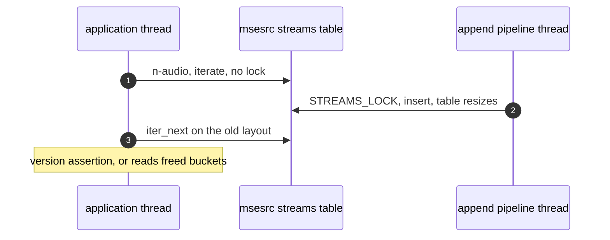
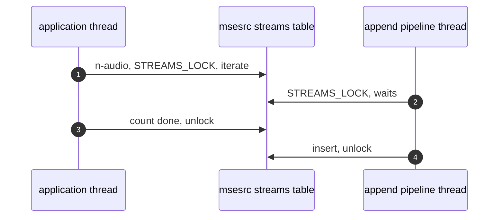

> One change of the GStreamer fork: `review/08`, 8 of 33 in the stack.
> Below it: [`review/07`](https://github.com/Airodonack/gstreamer/tree/review/07). Above it: [`review/09`](https://github.com/Airodonack/gstreamer/tree/review/09).
> The change itself: [commit 290146f338d77c270e8a6003971910c64ce4b34f](https://github.com/Airodonack/gstreamer/commit/290146f338d77c270e8a6003971910c64ce4b34f). This README sits in a commit on top of it and is not part of the merge request.
> The whole stack: [overview README](https://github.com/Airodonack/gstreamer/blob/mse-fixes-main/README.md).

# Source buffer lists and stream counts are read under their locks

Two tables were changed on one thread while another read them, with no lock
on one side. Each could make a reader walk freed or resized memory. The fix
takes the lock that already exists for each table on the side that lacked
it: 8 lines in two files.

## The problem

**1. The source buffer list.** `GstSourceBufferList` keeps its buffers in a
`GPtrArray`. `append()`, `index()`, `contains()` and `get_length()` take the
list's object lock, but
[`remove()` and `remove_all()` on main](https://github.com/Airodonack/gstreamer/blob/74f679f8de/subprojects/gst-plugins-bad/gst-libs/gst/mse/gstsourcebufferlist.c#L373-L396)
changed the array without it. Since `review/07`, the active-list rebuild and
the media source's seek walk the list with `index()` from other threads while
the application removes buffers. `g_ptr_array_remove()` shifts the array and
unrefs the removed buffer, so a concurrent `index()` can read a slot being
moved and take a reference to a buffer as it is freed.

**2. msesrc's streams table.** When an initialization segment arrives,
[`gst_mse_src_emit_streams()`](https://github.com/Airodonack/gstreamer/blob/290146f338d77c270e8a6003971910c64ce4b34f/subprojects/gst-plugins-bad/gst-libs/gst/mse/gstmsesrc.c#L1231-L1264)
inserts into `self->streams` under `STREAMS_LOCK`, on that buffer's append
pipeline thread. The `n-audio`, `n-video` and `n-text` properties count the
table in `n_streams_by_type()`, which iterated it without the lock. A browser
reads these properties to count tracks, so an initialization segment and a
count can overlap. A `GHashTable` resized during iteration is undefined
behaviour. GLib's debug check reports it as
`g_hash_table_iter_next: assertion 'ri->version == ri->hash_table->version' failed`.

## The change

- [`gst_source_buffer_list_remove()` and `remove_all()`](https://github.com/Airodonack/gstreamer/blob/290146f338d77c270e8a6003971910c64ce4b34f/subprojects/gst-plugins-bad/gst-libs/gst/mse/gstsourcebufferlist.c#L373-L401)
  change the array under the list's object lock. The "removed" notification
  is sent after the lock is released, as `append()` does for "added".
- [`n_streams_by_type()`](https://github.com/Airodonack/gstreamer/blob/290146f338d77c270e8a6003971910c64ce4b34f/subprojects/gst-plugins-bad/gst-libs/gst/mse/gstmsesrc.c#L652-L670)
  holds `STREAMS_LOCK` while it counts.

The list follows the same pattern: `remove()` waits while an `index()` holds
the list's lock, and an `index()` waits while a removal shifts the array.

msesrc's flush, resume and teardown loops walk the same streams table
without the lock and are left as they are. They push flush events, start pad
tasks and deactivate pads, which must not happen under `STREAMS_LOCK`. They
run on msesrc's own state changes and seeks.

## Options considered

| Option | What it would take | Why not chosen |
|---|---|---|
| **Take the existing locks on the unlocked side** (this change) | 8 lines | Chosen: each table already has a lock, and the other users take it. |
| Copy-on-write arrays for the list | Replace the array on every change | More code for a list of two or three entries. The lock is held for a few instructions. |
| Cache the stream counts in atomics | Keep three counters in step with the table | Duplicates the table and would need updating at every insert and removal. |
| Lock the flush and teardown loops too | Restructure them to collect pads first, then act | Not needed for the two races here. Worth a look on its own. |

## How it was checked

There is no unit test. Both races were made deterministic with temporary
delays in a copy of the sources, never committed, and run through a browser
page against the library:

- **Streams table:** a sleep per entry inside `n_streams_by_type()`'s loop,
  and the second buffer's new stream held back in `gst_mse_src_emit_streams()`
  so that its insert lands during a count. In the runs where the insert landed
  during a count, the version assertion above was printed in 12 of 12 runs
  before the change and 0 of 6 after.
- **Buffer list:** the active-list rebuild's `index()` sleeping inside the
  list's lock, a removal delayed past its `contains()` check, and
  `G_DEBUG=gc-friendly`. "gst_object_ref: assertion 'object != NULL' failed"
  was printed in 4 of 4 runs before, 0 of 4 after.

These are runs from when the change was made (2026-10-23), not repeated for
this README.

At this commit, the gate on GStreamer main (2026-11-05) ran the whole unit
test suite: `100%: Checks: 71, Failures: 0, Errors: 0`, as on the 1.28 series.

## Questions a reviewer may ask

- **Can the unref inside the lock run a buffer's dispose under the list's
  lock?** It can, when the list holds the last reference. Both removal paths
  unparent the buffer first, so its dispose finds it removed and does not
  call back into the list.
- **Does the rebuild still see a consistent list?** Each `index()` call is
  consistent, but a removal between two calls shifts the list, and the
  rebuild can skip the buffer after the removed one. That was reproduced and
  is fixed in the next change, `review/09`.
