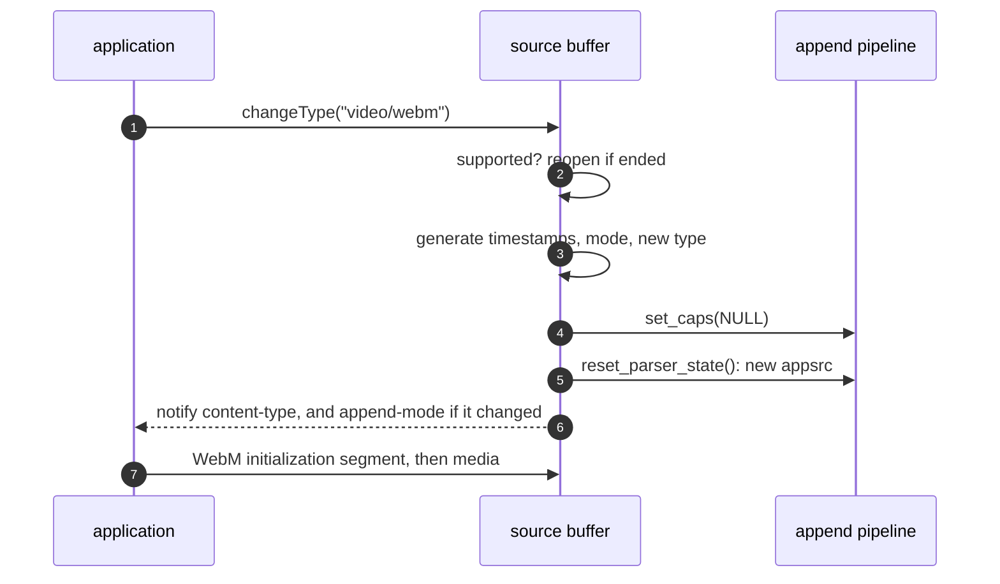

> One change of the GStreamer fork: `review/34`, 34 of 34 in the stack.
> Below it: [`review/33`](https://github.com/Airodonack/gstreamer/tree/review/33). Above it: the top of the stack, where `mse-fixes` adds the overview README.
> The change itself: [commit 73969680904f83c758775bb79514f63930582940](https://github.com/Airodonack/gstreamer/commit/73969680904f83c758775bb79514f63930582940). This README sits in a commit on top of it and is not part of the merge request.
> The whole stack: [overview README](https://github.com/Airodonack/gstreamer/blob/mse-fixes/README.md).

# Source buffers can change their content type

`gst_source_buffer_change_content_type()`, MSE's `changeType()`, refused
every change with `NOT_SUPPORTED`. YouTube creates a WebM VP9 buffer and
switches it to MP4 AV1 before its first append. So every `changeType()`
threw, and the media element stayed at `HAVE_NOTHING`. This change runs
the spec's `changeType()` steps. It is about 60 lines in one function.

Two things a type change reaches that nothing reached before come just
below it: `review/32` fails an initialization segment with other tracks,
and `review/33` gives the parser a new `appsrc` when the caps change.

## The problem

After the removed-and-updating checks, the function ended in an
unconditional error. Probed for the earlier README, on stock GStreamer 1.28.7 through PyGObject: a
fresh `video/webm; codecs="vp9"` buffer asked for
`video/mp4; codecs="av01.0.00M.08"` failed with "content type cannot be
changed".

From an earlier run in a browser built on the library: YouTube called `changeType()` about once a second, 94 to 98 times in
45 s, and appended no video.

## The change

[`gst_source_buffer_change_content_type`](https://github.com/Airodonack/gstreamer/blob/73969680904f83c758775bb79514f63930582940/subprojects/gst-plugins-bad/gst-libs/gst/mse/gstsourcebuffer.c#L1699-L1782)
now runs the steps that follow the state checks:

| Spec step | Code |
|---|---|
| 4: refuse with `NotSupportedError` a type `isTypeSupported()` refuses | `gst_media_source_is_type_supported()` (`review/27`'s tables) |
| 5: reopen an ended media source | `open_parent_unlocked()` |
| 6: run the reset parser state algorithm | `reset_parser_state()`, the reset `abort()` uses |
| 7 and 8: the generate timestamps flag follows the new byte stream format; when set, mode becomes "sequence"; otherwise the mode is kept | from the format table; `append-mode` notified when it changes |
| 9: set the pending initialization segment for changeType flag | after a reset the parser hands out no media until it has parsed an initialization segment, which is what the flag asks |

The new type is stored and notified. The parser gets the type's caps as in
`gst_source_buffer_new()`: ISO BMFF gets its caps, WebM and MPEG audio get
none and are typefound. The caps are set before the reset, so the reset of
`review/33` puts a new `appsrc` in front of `parsebin` when they changed.

## Options considered

| Option | Why not chosen |
|---|---|
| **The spec's steps 4 to 9** (this change) | Chosen: what the spec asks, reusing the reset of `abort()` and the format table of `review/27`. |
| Accept a change only while no initialization segment has arrived | Enough for YouTube's pattern, but MSE allows a change at any time; a fork-only stopgap, not taken. |

## The cost

Not done, and listed in the overview README:

- A **codec** change on a buffer that already has tracks plays only where
  nothing downstream is tied to the old codec. From an earlier run in a
  browser: VP8 to VP9 played; VP9 to VP8, VP9 to
  H.264, H.264 to VP9 and H.264 to VP8 ended in `not-negotiated` from
  msesrc's pad push. msesrc sends the new caps on the same stream; a fix
  needs a new stream or a decoder reconfiguration, its own design.
- A later initialization segment's caps do not replace a track's initial
  caps, so `GstSourceBuffer:tracks` (`review/31`) keeps the first codecs.
  msesrc already sends a sample's caps downstream when they change.

## Spec

[MSE, `changeType()`](https://w3c.github.io/media-source/#dom-sourcebuffer-changetype),
steps 4 to 9 as in the table above. Step 6:

> Run the reset parser state algorithm.

## How it was checked

Unit tests in `tests/check/libs/mse.c`:

- [`test_source_buffer_change_content_type`](https://github.com/Airodonack/gstreamer/blob/73969680904f83c758775bb79514f63930582940/subprojects/gst-plugins-bad/tests/check/libs/mse.c#L1709-L1736),
  rewritten: a fresh WebM VP9 buffer takes MP4 AV1, reads it back, and
  notifies once.
- [`_unsupported`](https://github.com/Airodonack/gstreamer/blob/73969680904f83c758775bb79514f63930582940/subprojects/gst-plugins-bad/tests/check/libs/mse.c#L1813-L1835):
  `video/webm; codecs="mp4a.40.2"` is refused and the type is kept.
- [`_while_updating`](https://github.com/Airodonack/gstreamer/blob/73969680904f83c758775bb79514f63930582940/subprojects/gst-plugins-bad/tests/check/libs/mse.c#L1837-L1863):
  `INVALID_STATE` during an append.
- [`_generate_timestamps`](https://github.com/Airodonack/gstreamer/blob/73969680904f83c758775bb79514f63930582940/subprojects/gst-plugins-bad/tests/check/libs/mse.c#L1865-L1897):
  to `audio/aac` the mode becomes sequence and segments is refused; back to
  `audio/mp4` the mode stays sequence and segments is allowed again.
- [`test_source_buffer_append_after_change_content_type`](https://github.com/Airodonack/gstreamer/blob/73969680904f83c758775bb79514f63930582940/subprojects/gst-plugins-bad/tests/check/libs/mse.c#L1899-L1921):
  a WebM buffer changed to MP4 parses `mse.mp4`.
- [`_after_media`](https://github.com/Airodonack/gstreamer/blob/73969680904f83c758775bb79514f63930582940/subprojects/gst-plugins-bad/tests/check/libs/mse.c#L1923-L1947):
  an MP4 initialization segment, then a change to WebM, then `mse.webm`
  parses: `review/33`'s new appsrc.
- [`_after_parse_error`](https://github.com/Airodonack/gstreamer/blob/73969680904f83c758775bb79514f63930582940/subprojects/gst-plugins-bad/tests/check/libs/mse.c#L1970-L2016):
  a `changeType()` to WebM from the update-end handler of a failed MP4
  append, while the append task may still be resetting the parser; the
  buffer then parses `mse.webm`.

The commit message gives `100%: Checks: 159, Failures: 0, Errors: 0`, three
runs; the restack's gate (2026-11-05, 1.28.6) gave the same at this commit,
three runs, and 159 three times on GStreamer main at the same series.
Recorded with the first version of this commit, before the series was rebuilt on 2026-11-02:
140 checks with 4 failures before, 141 with 0 after; in a browser, WPT
`mediasource-changetype*` 37 to 44 PASS of 111, none lost; YouTube played,
3 of 3 (`RESULT yt-play PASS state=1`).

## Questions a reviewer may ask

- **Why is `isTypeSupported()` asked before the object lock?** It walks the
  element registry, which is slow and takes its own locks; the answer does
  not depend on the buffer's state.
- **What if a page changes the type in the middle of a media segment?**
  The reset drops the partial data, as `abort()` does; the spec's reset
  parser state algorithm does the same.
- **Why are the caps set before the reset rather than after?** The reset is
  where `review/33` replaces `appsrc`; caps set after it would wait for the
  next reset.
