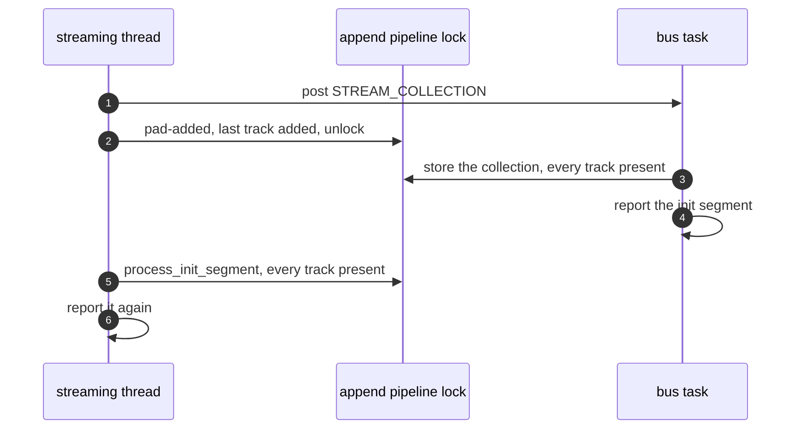
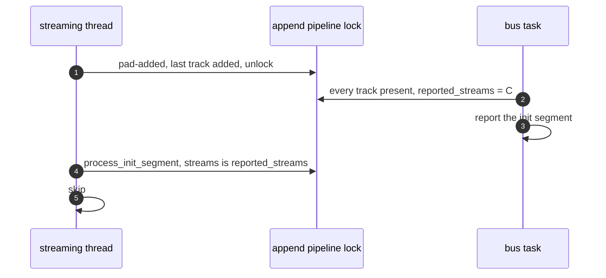

> One change of the GStreamer fork: `review/22`, 22 of 33 in the stack.
> Below it: [`review/21`](https://github.com/Airodonack/gstreamer/tree/review/21). Above it: [`review/23`](https://github.com/Airodonack/gstreamer/tree/review/23).
> The change itself: [commit 6eb870401c544793e7cb1d53e280ec5c50ab861a](https://github.com/Airodonack/gstreamer/commit/6eb870401c544793e7cb1d53e280ec5c50ab861a). This README sits in a commit on top of it and is not part of the merge request.
> The whole stack: [overview README](https://github.com/Airodonack/gstreamer/blob/mse-fixes-main/README.md).

# An init segment is reported once when its pads come late

On the path where the append pipeline learns its tracks from the pads
`parsebin` exposes, the initialization segment could be reported twice. Two
threads reach the report with no guard between them. The change makes the
pipeline remember the stream collection it reported for, and report once per
collection. The race is in stock GStreamer too.

This is the first of two changes that let an MP4 initialization segment
alone give its tracks; it is the part that also matters for bytes with no
demuxer, such as ADTS AAC.

## The problem

`process_init_segment()` reports the initialization segment once every
stream of `parsebin`'s stream collection has a track. Two places call it:

- `parsebin`'s `pad-added`, on the streaming thread, right after the new
  pad's track is made
  ([`on_pad_added`](https://github.com/Airodonack/gstreamer/blob/6eb870401c544793e7cb1d53e280ec5c50ab861a/subprojects/gst-plugins-bad/gst-libs/gst/mse/gstappendpipeline.c#L631-L637));
- the stream-collection message, on the bus task
  ([lines 390 to 398](https://github.com/Airodonack/gstreamer/blob/6eb870401c544793e7cb1d53e280ec5c50ab861a/subprojects/gst-plugins-bad/gst-libs/gst/mse/gstappendpipeline.c#L390-L398)).

`parsebin` posts the collection before it adds the pads. `on_pad_added`
adds the track and checks for completeness in two separately locked steps,
`process_init_segment_track()` then `process_init_segment()`. When the bus
task handles the collection between those two steps, after the last track was
added, both calls find every track present, and both report.

The second report ran `update_track_buffer_modes()` and the active-buffer
rebuild again. With no samples in between that is harmless, but the source
buffer expects one report per initialization segment.

## The change

The append pipeline keeps a reference to the collection it last reported
for, `reported_streams`
([the field](https://github.com/Airodonack/gstreamer/blob/6eb870401c544793e7cb1d53e280ec5c50ab861a/subprojects/gst-plugins-bad/gst-libs/gst/mse/gstappendpipeline.c#L90-L94)),
and `process_init_segment()` returns when the current collection is that one
([lines 687 to 693](https://github.com/Airodonack/gstreamer/blob/6eb870401c544793e7cb1d53e280ec5c50ab861a/subprojects/gst-plugins-bad/gst-libs/gst/mse/gstappendpipeline.c#L687-L693)).
The reset and finalize clear it
([reset, line 1022](https://github.com/Airodonack/gstreamer/blob/6eb870401c544793e7cb1d53e280ec5c50ab861a/subprojects/gst-plugins-bad/gst-libs/gst/mse/gstappendpipeline.c#L1022)).

## Options considered

| Option | Why not chosen |
|---|---|
| **Remember the reported collection, by reference** (this change) | Chosen: one report per collection, and a reset or a new collection reports again. A reference, not a bare pointer, so a freed collection's address cannot come back as the next one's. |
| A plain "already received" flag | Would also need clearing on a new collection without a reset; the collection itself carries that. |
| Add the track and check completeness under one lock hold in `on_pad_added` | The bus task can still run its check after the streaming thread's, with every track present for both. |
| Report only from one of the two places | Either can be the one that finds the last track, depending on the order of the message and the pads. |

## How it was checked

Unit test
[`test_append_pipeline_init_segment_reported_once`](https://github.com/Airodonack/gstreamer/blob/6eb870401c544793e7cb1d53e280ec5c50ab861a/subprojects/gst-plugins-bad/tests/check/libs/mse.c#L886-L912)
appends ADTS AAC (`tests/files/mse-aac.adts`, half a second of a 440 Hz
tone, new with this change) to an append pipeline and expects one report.
The race is rare unforced, so the run that shows it adds a temporary 200 ms
delay between `process_init_segment_track()` and `process_init_segment()` in
`on_pad_added()`. From the 1.28 series' gate (2026-11-05, on 1.28.6), with the
delay:

- the test with the previous change's gstappendpipeline.c, 3 runs: "'g_atomic_int_get
  (&context.init_segments)' (2) is not equal to '1' (1)";
- with this change, 3 runs: `100%: Checks: 1, Failures: 0, Errors: 0`.

Without the delay, the whole suite at this commit, on 1.28.6 and on
GStreamer main (2026-11-05): `100%: Checks: 82, Failures: 0, Errors: 0`.

Probed for the earlier README of these changes, on stock 1.28.7: one
`mse.mp4` appended to a `video/mp4` buffer logged "got init segment" twice
in 10 of 10 runs (`GST_DEBUG=gst-mse:5`).

## Questions a reviewer may ask

- **The bus task writes `self->streams` without the object lock**
  ([lines 394 and 395](https://github.com/Airodonack/gstreamer/blob/6eb870401c544793e7cb1d53e280ec5c50ab861a/subprojects/gst-plugins-bad/gst-libs/gst/mse/gstappendpipeline.c#L394-L395)),
  while `process_init_segment()` reads it under the lock. That is upstream
  code and is not changed here.
- **Does the MP4 path still go through this?** After `review/23`, MP4 and
  other demuxed bytes report from the demuxer instead; this path stays for
  bytes without a demuxer and as a fallback.
