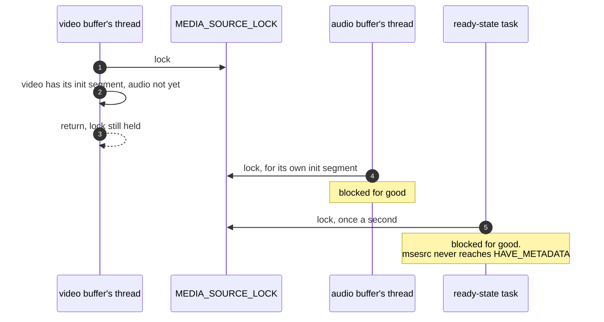
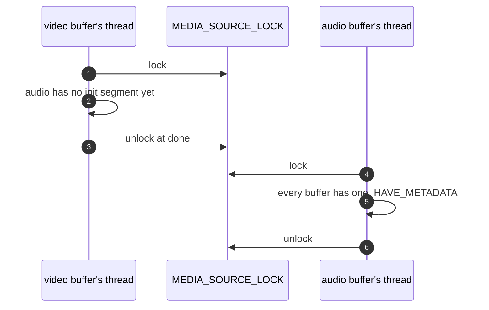

> One change of the GStreamer fork: `review/03`, 3 of 33 in the stack.
> Below it: [`review/02`](https://github.com/Airodonack/gstreamer/tree/review/02). Above it: [`review/04`](https://github.com/Airodonack/gstreamer/tree/review/04).
> The change itself: [commit f9a3b5b6fb8ac60ecc2089effd75490c5c26ee59](https://github.com/Airodonack/gstreamer/commit/f9a3b5b6fb8ac60ecc2089effd75490c5c26ee59). This README sits in a commit on top of it and is not part of the merge request.
> The whole stack: [overview README](https://github.com/Airodonack/gstreamer/blob/mse-fixes-main/README.md).

# Pages with two source buffers no longer hang after an init segment

A page with separate audio and video source buffers, as every DASH player
has, stopped at its first initialization segment: appends still reported
update-end, but nothing played and the ready state stayed `HAVE_NOTHING`.
The cause is one early `return` that leaves a mutex locked. The change is
two lines in one file.

## The problem

`update_ready_state_for_init_segment()` in msesrc runs each time a source
buffer receives an initialization segment. It takes `MEDIA_SOURCE_LOCK`, then
checks whether every source buffer has had one, and only then moves msesrc to
`HAVE_METADATA`. Upstream, when some buffer has not, it returned without
unlocking
([gstmsesrc.c on main, lines 1364 to 1366](https://github.com/Airodonack/gstreamer/blob/74f679f8de/subprojects/gst-plugins-bad/gst-libs/gst/mse/gstmsesrc.c#L1364-L1366)).

With one source buffer the check passes on the first call, so the lock is
always released. With two, the first buffer's initialization segment finds
the second one still without, and the lock stays held. `MEDIA_SOURCE_LOCK` is a
plain `GMutex`, so every later caller blocks for good:

- the second buffer's initialization segment, which calls the same function
  from [`gst_mse_src_emit_streams()`](https://github.com/Airodonack/gstreamer/blob/f9a3b5b6fb8ac60ecc2089effd75490c5c26ee59/subprojects/gst-plugins-bad/gst-libs/gst/mse/gstmsesrc.c#L1212-L1221);
- msesrc's ready-state task, which takes the lock once a second in
  [`update_ready_state()`](https://github.com/Airodonack/gstreamer/blob/f9a3b5b6fb8ac60ecc2089effd75490c5c26ee59/subprojects/gst-plugins-bad/gst-libs/gst/mse/gstmsesrc.c#L1462-L1465);
- a seek, attach or detach on msesrc.

The same path also leaked the source buffer list that
`gst_media_source_get_source_buffers()` returns with a reference, on every call.



## The change

In [`update_ready_state_for_init_segment()`](https://github.com/Airodonack/gstreamer/blob/f9a3b5b6fb8ac60ecc2089effd75490c5c26ee59/subprojects/gst-plugins-bad/gst-libs/gst/mse/gstmsesrc.c#L1342-L1373),
the early exit now jumps to the `done:` label that unlocks, as the two exits
above it already do, and the list's reference is dropped after the loop:

```c
  gst_object_unref (buffers);          // new
  if (!all_received_init_segment) {
    goto done;                         // was: return;
  }
```



## Options considered

| Option | What it would take | Why not chosen |
|---|---|---|
| **`goto done` and unref the list** (this change) | Two lines | Chosen: the function already has a single unlock at `done:`. The other early exits use it. |
| Unlock before the `return` | Two lines | Same effect, but a second unlock site in a function built around one. |
| A `g_autoptr`/`GMutexLocker` for the lock | Rework of the function | Not the style of the surrounding file, which locks and unlocks by hand. |

## Spec

[MSE, Initialization Segment Received](https://www.w3.org/TR/media-source-2/#sourcebuffer-init-segment-received):

> If each object in sourceBuffers of the parent media source has
> [[first initialization segment received flag]] equal to true, then [...]
> If the HTMLMediaElement's readyState attribute is HAVE_NOTHING, then set the
> HTMLMediaElement's readyState attribute to HAVE_METADATA.

The function implements that check. The bug was only in its exit path.

## How it was checked

- A page appending an fMP4 video initialization segment and a WebM audio one
  to two source buffers. Before: gdb showed a streaming thread blocked on the
  lock in `update_ready_state_for_init_segment()` and the other buffer's
  append task waiting behind it. After: both buffers' appends go on and the
  media plays. These are runs from when the change was made, not repeated
  for this README.
- The unit test suite at this commit, from the gate on GStreamer main on
  2026-11-05: `100%: Checks: 68, Failures: 0, Errors: 0`, as on the 1.28
  series.
- The list reference leak is what the next change's test,
  `test_media_source_element_frees_played_media` in `review/04`, trips
  over: in a gate build that had `review/04` below this change, the leaked
  list's event queue task kept `gst_task_cleanup_all()` from returning and
  the test ended in "(after this point) Test timeout expired". That is why
  this change now sits under it.

Not yet done: a unit test of its own. One would add two source buffers to a media source
attached to msesrc, append an initialization segment to one, and check that
the second buffer's initialization segment still completes.

The early `return` is still there on GStreamer main.

## Questions a reviewer may ask

- **Why did nobody see this?** A page with one source buffer, carrying muxed
  audio and video, never takes the early exit.
- **What did the reference leak cost?** The source buffer list is a
  `GstObject` with its own event queue and task thread. One leaked reference
  per initialization segment kept the list, and that thread, alive after the
  media source was gone.
