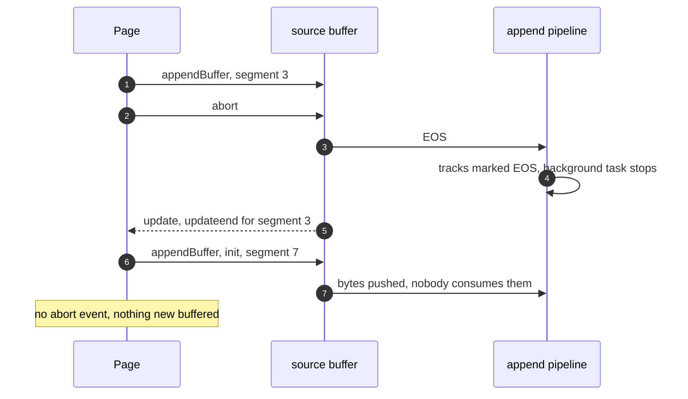
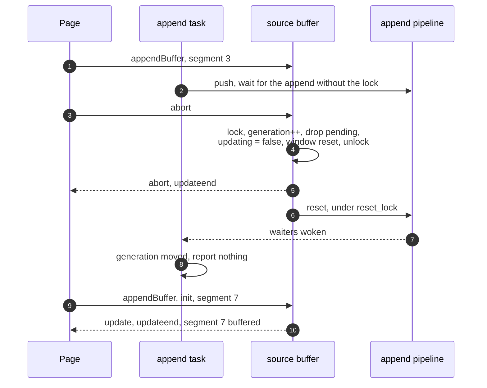

> One change of the GStreamer fork: `review/13`, 13 of 33 in the stack.
> Below it: [`review/12`](https://github.com/Airodonack/gstreamer/tree/review/12). Above it: [`review/14`](https://github.com/Airodonack/gstreamer/tree/review/14).
> The change itself: [commit d236fc03126f27e7307765ed4f4ee6be33f95d22](https://github.com/Airodonack/gstreamer/commit/d236fc03126f27e7307765ed4f4ee6be33f95d22). This README sits in a commit on top of it and is not part of the merge request.
> The whole stack: [overview README](https://github.com/Airodonack/gstreamer/blob/mse-fixes-main/README.md).

# Aborting a source buffer drops the append in progress

Upstream, `gst_source_buffer_abort()` sent an end of stream into the append
pipeline and did nothing else. The append in flight went on, `updating`
stayed set, no abort event fired, and the end of stream shut the parsing
down, so later appends were not parsed at all. Players call `abort()` on
every seek. This change implements the spec's `abort()` steps.

## The problem

[`gst_source_buffer_abort()` on main](https://github.com/Airodonack/gstreamer/blob/74f679f8de/subprojects/gst-plugins-bad/gst-libs/gst/mse/gstsourcebuffer.c#L2008-L2020)
is one call, `gst_append_pipeline_eos()`. The EOS reaches the pipeline's
background task, which marks every track EOS and stops itself. So:

- the append in progress is not stopped, and reports update-end as if
  nothing happened;
- `on-abort` is never emitted;
- the append window is left as it was;
- the background task is gone, so the next append's bytes are pushed but
  never handed to the track buffers.

`gst_media_source_end_of_stream()` relied on this behaviour: it
[aborted every source buffer](https://github.com/Airodonack/gstreamer/blob/74f679f8de/subprojects/gst-plugins-bad/gst-libs/gst/mse/gstmediasource.c#L953-L965)
to get the EOS into the track buffers.

## The change

[`gst_source_buffer_abort()`](https://github.com/Airodonack/gstreamer/blob/d236fc03126f27e7307765ed4f4ee6be33f95d22/subprojects/gst-plugins-bad/gst-libs/gst/mse/gstsourcebuffer.c#L2060-L2096)
now, under the object lock:

1. refuses on a removed buffer;
2. bumps `append_generation`, from `review/12`, and drops the pending data;
3. if an append was in progress, clears `updating` and schedules `on-abort`
   and `on-update-end`;
4. resets the append window to 0 and `GST_CLOCK_TIME_NONE`, which mean the
   presentation start time and positive infinity.

It then resets the append pipeline through `reset_parser_state()`, without
the lock, as `review/12` set up, and notifies the two window properties, as
their setters do. An append task waiting for the pipeline sees the
generation change and reports nothing.

The source buffer keeps its own copy of the window and drops frames by it
([`is_within_append_window_unlocked()`](https://github.com/Airodonack/gstreamer/blob/d236fc03126f27e7307765ed4f4ee6be33f95d22/subprojects/gst-plugins-bad/gst-libs/gst/mse/gstsourcebuffer.c#L801-L817)).
So a caller that reset only its own copy of the two attributes went on losing
the frames before the old start on every append after an `abort()`.

**End of stream** now calls a new
[`gst_source_buffer_mark_eos()`](https://github.com/Airodonack/gstreamer/blob/d236fc03126f27e7307765ed4f4ee6be33f95d22/subprojects/gst-plugins-bad/gst-libs/gst/mse/gstsourcebuffer.c#L2316-L2332)
on each buffer
([`mark_all_source_buffers_eos()`](https://github.com/Airodonack/gstreamer/blob/d236fc03126f27e7307765ed4f4ee6be33f95d22/subprojects/gst-plugins-bad/gst-libs/gst/mse/gstmediasource.c#L995-L1007)).
It marks each track buffer EOS without touching the parser, so the track
feeds push what is buffered and then EOS, as before. The track buffers' EOS
is not cleared when the source reopens on the next append, so media appended
after `endOfStream()` does not play, as upstream. `review/24` fixes that.

## Options considered

| Option | What it would take | Why not chosen |
|---|---|---|
| **The spec's steps, with a parser reset** (this change) | 50 lines in the source buffer, a rename in the media source | Chosen: follows the spec's order and reuses the reset and generation of `review/12`. |
| Flush the append pipeline instead of resetting it | Flush events through parsebin | Tried: qtdemux logs "Resetting demux" on the flush and drops its tracks, so the result is a reset without the bookkeeping. |
| Keep the demuxer's initialization segment across the reset | Keep demuxer state, or replay the initialization segment after the reset | The spec keeps the initialization segment. Doing so needs demuxer support or a replay. Left as the known gap below. |
| Leave the append window to the caller | Nothing in mselib | The library drops frames by its own copy, so the caller cannot fix it. |

## Known gap

The reset rebuilds the demuxer, which forgets the initialization segment.
The spec keeps it, so a media segment appended after `abort()` without a new
initialization segment is not parsed. Players re-send the initialization
segment after aborting, and the unit test below does too.

## Spec

[MSE, abort()](https://www.w3.org/TR/media-source-2/#dom-sourcebuffer-abort):

> If the updating attribute equals true, then run the following steps:
> Abort the buffer append algorithm if it is running.
> Set the updating attribute to false.
> Queue a task to fire an event named abort at this SourceBuffer object.
> Queue a task to fire an event named updateend at this SourceBuffer object.
> Run the reset parser state algorithm.
> Set appendWindowStart to the presentation start time.
> Set appendWindowEnd to positive Infinity.

The spec's earlier steps, which throw when the media source is not open or a
range removal is running, are left to the browser, as for the other methods.

## How it was checked

Unit test
[`test_source_buffer_append_after_abort`](https://github.com/Airodonack/gstreamer/blob/d236fc03126f27e7307765ed4f4ee6be33f95d22/subprojects/gst-plugins-bad/tests/check/libs/mse.c#L1253-L1287)
appends an MP4, waits for update-end, aborts, appends the MP4 again and waits
for the second update-end. It checks that no error was reported and that
`buffered` holds one range. With the track reuse of `review/11`, the tracks
after the reset are the old objects, so the feeds accept the new media.

- Before the change (run of 2026-10-23 on an earlier layout of the stack, the
  same test text): fails with `'events.error' (1) is not equal to '0' (0)`.
- With `review/11`'s reuse disabled: fails with "Unexpected critical/warning:
  get_track_feed_unlocked: assertion 'g_hash_table_contains
  (self->track_feeds, track)' failed".
- After: passes. Re-run for this README on a build of the stack's top of that day
  (2026-11-03): 5 of 5 runs pass.

The test aborts between appends, not during one. The abort of an append in
progress, with its abort and update-end events, was checked with browser
pages that append, abort and append again in one task, and with seeks that
abort: abort and update-end are reported for the aborted append, the next
append completes, and playback ends at the end of the buffered media.

**The window:** a C program, since a browser's DOM sets both properties on
mselib itself after `abort()` and so hides this, sets the window start to
2 s, appends an MP4 initialization segment with the first three media
segments (0 to 6 s), aborts, and appends the same bytes again. Before: the
window reads 2 s after `abort()` and the buffer holds 2.000 to 6.067 s, in 3
of 3 runs. After: the window reads 0 and the buffer holds 0.067 to 6.067 s,
3 of 3.

These browser and program runs are from when the change was made, not
repeated for this README.

Not yet done: a unit test that aborts while an append is waiting, and counts
the abort and update-end events.

At this commit, the gate on GStreamer main (2026-11-05) ran the whole unit
test suite: `100%: Checks: 73, Failures: 0, Errors: 0`, as on the 1.28 series.

## Questions a reviewer may ask

- **Why reset the parser even when not updating?** The spec runs the reset
  parser state algorithm in every `abort()`, not only during an append.
- **Why notify the window properties outside the lock?** GObject notifications
  run handlers synchronously. A handler reading the source buffer would take
  its lock.
