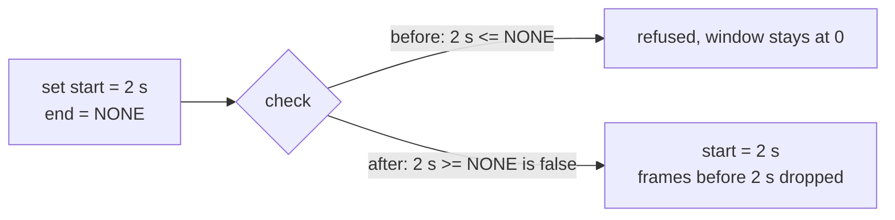

> One change of the GStreamer fork: `review/18`, 18 of 33 in the stack.
> Below it: [`review/17`](https://github.com/Airodonack/gstreamer/tree/review/17). Above it: [`review/19`](https://github.com/Airodonack/gstreamer/tree/review/19).
> The change itself: [commit 29272dc77cec87b1cd26ea2e597bafd9d86219e9](https://github.com/Airodonack/gstreamer/commit/29272dc77cec87b1cd26ea2e597bafd9d86219e9). This README sits in a commit on top of it and is not part of the merge request.
> The whole stack: [overview README](https://github.com/Airodonack/gstreamer/blob/mse-fixes-main/README.md).

# Setting a source buffer's append window start works again

`gst_source_buffer_set_append_window_start()` refused every valid value.
Its range check was written the wrong way round. This change flips one
comparison and adds a unit test.

## The problem

The append window is the time range a source buffer keeps; frames outside it
are dropped as they are appended. Its end defaults to
`GST_CLOCK_TIME_NONE`, the largest `GstClockTime`, meaning "no end". The
setter refused a start that was less than or equal to the end:

```c
if (!GST_CLOCK_TIME_IS_VALID (start) || start <= self->append_window_end) {
  /* "append window start must be between zero and append window end" */
```

Every real start is below the end, so every call failed with that error,
and the window always started at 0.

## The change

The comparison becomes `start >= self->append_window_end`
([the setter, lines 1175 to 1217](https://github.com/Airodonack/gstreamer/blob/29272dc77cec87b1cd26ea2e597bafd9d86219e9/subprojects/gst-plugins-bad/gst-libs/gst/mse/gstsourcebuffer.c#L1175-L1217)).
It now mirrors the end's setter, which refuses an end at or before the
start
([lines 1281 to 1286](https://github.com/Airodonack/gstreamer/blob/29272dc77cec87b1cd26ea2e597bafd9d86219e9/subprojects/gst-plugins-bad/gst-libs/gst/mse/gstsourcebuffer.c#L1281-L1286)).
The frames are then dropped where they already were, in
[`is_within_append_window_unlocked`](https://github.com/Airodonack/gstreamer/blob/29272dc77cec87b1cd26ea2e597bafd9d86219e9/subprojects/gst-plugins-bad/gst-libs/gst/mse/gstsourcebuffer.c#L806-L822).



## Options considered

| Option | Why not chosen |
|---|---|
| **Flip the comparison** (this change) | Chosen: it is the check the spec describes, and the end's setter already does the mirror check. |
| Special-case an unbounded end | Hides the inverted test instead of fixing it; a bounded end would still refuse every valid start. |

## Spec

[MSE, `appendWindowStart` setter](https://w3c.github.io/media-source/#dom-sourcebuffer-appendwindowstart):

> If the new value is less than 0 or greater than or equal to
> appendWindowEnd then throw a TypeError exception and abort these steps.

## How it was checked

- Unit test
  [`test_source_buffer_set_append_window_start`](https://github.com/Airodonack/gstreamer/blob/29272dc77cec87b1cd26ea2e597bafd9d86219e9/subprojects/gst-plugins-bad/tests/check/libs/mse.c#L1277-L1315):
  a start of 1 s with an unbounded end is accepted; with the end at 3 s, 2 s
  is accepted, while 3 s and `GST_CLOCK_TIME_NONE` are refused with a type
  error and leave the start at 2 s. It fails before this change, according
  to the commit message.
- Probed for the earlier README, on stock GStreamer 1.28.7 (the unfixed library) through PyGObject:
  `set_append_window_start(1 s)` with the end unbounded raised "append
  window start must be between zero and append window end", and the start
  stayed 0.
- From the commit message, not re-run: in a browser built on the library,
  with `appendWindowStart` 2 and 0 to 6 s appended, the buffered range went
  from 0.067-6.067 s to 2.000-6.067 s (3 of 3 runs each).

At this commit, the gate on GStreamer main (2026-11-05) ran the whole unit
test suite: `100%: Checks: 75, Failures: 0, Errors: 0`, as on the 1.28 series.

## Questions a reviewer may ask

- **Is the frame test right?** It drops a frame whose presentation time is
  before the start, as the spec's coded frame processing does. The spec
  then also drops the frames that follow until the next random access
  point; mselib does not, before or after this change. That is a separate
  gap.
- **The setter's doc comment says frames that "end before this point" are
  ignored.** The code drops frames that start before it. The comment is
  upstream's and is not changed here.
