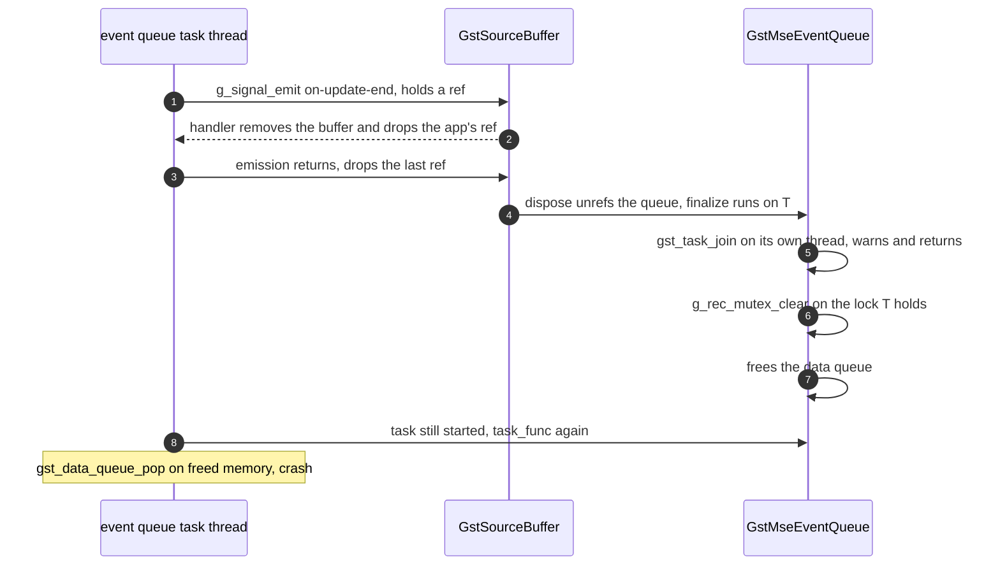
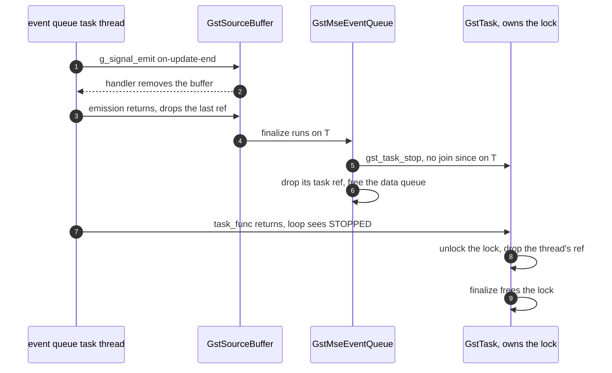

> One change of the GStreamer fork: `review/05`, 5 of 33 in the stack.
> Below it: [`review/04`](https://github.com/Airodonack/gstreamer/tree/review/04). Above it: [`review/06`](https://github.com/Airodonack/gstreamer/tree/review/06).
> The change itself: [commit 4f64c139e373bd6d9d24706ccc2e1cf5c78fd669](https://github.com/Airodonack/gstreamer/commit/4f64c139e373bd6d9d24706ccc2e1cf5c78fd669). This README sits in a commit on top of it and is not part of the merge request.
> The whole stack: [overview README](https://github.com/Airodonack/gstreamer/blob/mse-fixes-main/README.md).

# Removing a source buffer mid-event no longer crashes

When an application removed a source buffer, or detached the media source,
from inside a handler of one of that buffer's own events, the process crashed
in `gst_data_queue_pop()`. A web-platform-tests run in a browser hit it. The
fix lets the event queue be finalized on its own thread.

## The problem

Source buffers, source buffer lists and media sources deliver their events
(update-end, error, abort, ...) through a `GstMseEventQueue`: a `GstTask`
that pops each queued event and calls the owner's callback, which emits a
signal. `g_signal_emit()` holds a reference to the emitter for the length of
the emission. If the handler lets go of the source buffer, that reference is
the last one, and it is dropped on the event queue's own thread when the
emission returns. The buffer's
[dispose](https://github.com/Airodonack/gstreamer/blob/4f64c139e373bd6d9d24706ccc2e1cf5c78fd669/subprojects/gst-plugins-bad/gst-libs/gst/mse/gstsourcebuffer.c#L374-L390)
then drops its event queue, whose
[finalize on main](https://github.com/Airodonack/gstreamer/blob/74f679f8de/subprojects/gst-plugins-bad/gst-libs/gst/mse/gstmseeventqueue.c#L72-L83)
runs on that same thread:

1. `gst_task_join()` refuses, since a task cannot join itself: GStreamer warns
   "Trying to join task ... from its thread would deadlock" and returns.
2. `g_rec_mutex_clear()` destroys the task's lock, which the running task
   still holds.
3. The data queue is freed.

The task was never stopped, so `GstTask` calls `task_func` again with the freed
queue object, and the next `gst_data_queue_pop()` reads freed memory.

## The change

All in [gstmseeventqueue.c](https://github.com/Airodonack/gstreamer/blob/4f64c139e373bd6d9d24706ccc2e1cf5c78fd669/subprojects/gst-plugins-bad/gst-libs/gst/mse/gstmseeventqueue.c#L74-L149):

- [`task_func`](https://github.com/Airodonack/gstreamer/blob/4f64c139e373bd6d9d24706ccc2e1cf5c78fd669/subprojects/gst-plugins-bad/gst-libs/gst/mse/gstmseeventqueue.c#L105-L119)
  records the thread it runs on.
- [`finalize`](https://github.com/Airodonack/gstreamer/blob/4f64c139e373bd6d9d24706ccc2e1cf5c78fd669/subprojects/gst-plugins-bad/gst-libs/gst/mse/gstmseeventqueue.c#L74-L92)
  always stops the task, and joins it only when it runs on another thread.
  Stopped, the task leaves its loop as soon as `task_func` returns, and
  `task_func` touches neither the queue nor the event queue after the callback.
- The task's lock moves from the event queue struct to the heap and is owned
  by the `GstTask` object, through `g_object_set_data_full()`
  ([`gst_mse_event_queue_init`](https://github.com/Airodonack/gstreamer/blob/4f64c139e373bd6d9d24706ccc2e1cf5c78fd669/subprojects/gst-plugins-bad/gst-libs/gst/mse/gstmseeventqueue.c#L128-L149)).
  `GstTask` takes a reference to itself while its thread runs and drops it only
  after it has unlocked that lock
  ([gsttask.c on main, lines 407 to 435](https://github.com/Airodonack/gstreamer/blob/74f679f8de/subprojects/gstreamer/gst/gsttask.c#L407-L435)),
  so the lock outlives its last use.

## Options considered

| Option | What it would take | Why not chosen |
|---|---|---|
| **Stop always, join only from another thread, lock owned by the task** (this change) | About 30 lines in one file | Chosen: the event queue may die on any thread, and nothing else changes. |
| Keep a reference to the source buffer across dispatch in the caller | Change every owner's callback | The last reference is then dropped on the same thread a moment later. The problem moves, it does not go away. |
| Hand the last unref to another thread or a main loop | An idle source or a reaper thread | mselib has no main loop of its own, and an application may not run one. |
| Use GstTask's default lock | Not possible | `GstTask` refuses to start without a lock set by its user. |

## How it was checked

Unit test
[`test_source_buffer_removed_in_event_handler`](https://github.com/Airodonack/gstreamer/blob/4f64c139e373bd6d9d24706ccc2e1cf5c78fd669/subprojects/gst-plugins-bad/tests/check/libs/mse.c#L1025-L1095)
removes a source buffer from its own `on-update-end` handler and drops the
test's reference there, so the buffer is freed on its event thread. It waits
for the buffer to be disposed and checks the media source has no buffers left.

- Before the change (run of 2026-10-23, the same test text): it fails with
  "Unexpected critical/warning: Trying to join task ... from its thread would
  deadlock", from `gst_mse_background_event_queue_finalize` called by
  `gst_source_buffer_dispose`.
- After: passes. Re-run for this README on a build of the stack's top of that day
  (2026-11-03): 5 of 5 runs pass.
- The web-platform-tests file `media-source/mediasource-append-buffer`
  crashed the browser in `gst_data_queue_pop()` from `task_func` once
  `review/03` let it run past its old hang. With this change the whole
  `media-source` directory runs without a crash (runs from when the change
  was made).

At this commit, the gate on GStreamer main (2026-11-05) ran the whole unit
test suite: `100%: Checks: 70, Failures: 0, Errors: 0`, as on the 1.28 series.

## Questions a reviewer may ask

- **Why record the thread when GstTask has `task->thread`?** That field is
  private to GstTask and guarded by its object lock. `task_func` setting a
  pointer of its own is simpler and needs no access to GstTask's internals.
- **What if finalize runs before the task ever ran?** The recorded thread is
  then `NULL`, never equal to the caller's, so finalize joins as before.
- **Is an event lost?** Only events still queued when the owner is freed,
  which no one is left to receive. Dispose flushes the queue as it did before.
