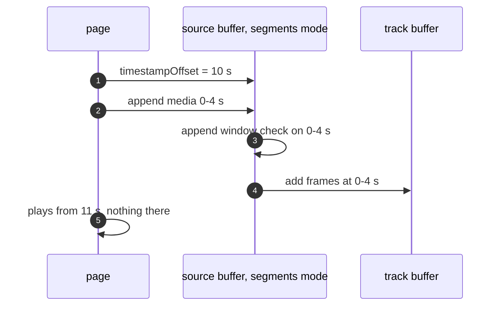
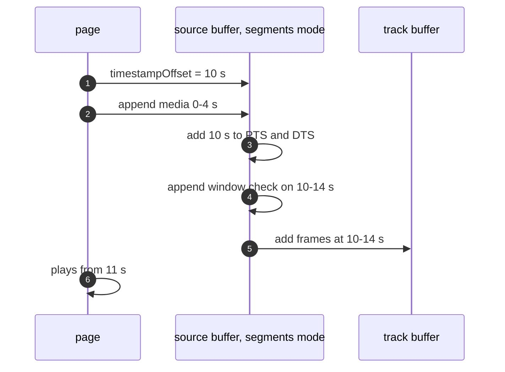

> One change of the GStreamer fork: `review/28`, 28 of 33 in the stack.
> Below it: [`review/27`](https://github.com/Airodonack/gstreamer/tree/review/27). Above it: [`review/29`](https://github.com/Airodonack/gstreamer/tree/review/29).
> The change itself: [commit 1d1ec0ea3c23b18861cbc80f509505b9e10e5a79](https://github.com/Airodonack/gstreamer/commit/1d1ec0ea3c23b18861cbc80f509505b9e10e5a79). This README sits in a commit on top of it and is not part of the merge request.
> The whole stack: [overview README](https://github.com/Airodonack/gstreamer/blob/mse-fixes-main/README.md).

# The timestamp offset applies in segments mode too

mselib applied `timestampOffset` only in sequence mode. Segments mode is
the default for MP4 and WebM, and there the offset was ignored. A page
that sets the offset to splice media, or to place a segment from another
timeline, got the segment at its original times. This change adds the
offset to each frame's timestamps in segments mode, before the append
window check.

## The problem

In sequence mode the track buffers place each frame after the last and use
the offset as the group start (`review/27`). In segments mode the frames kept
their own times, and nothing read the offset.

Probed for the earlier README, on stock GStreamer 1.28.7 through PyGObject: `mse.mp4` appended in
segments mode was buffered 0.033-5.717 s with an offset of 0, and
0.033-5.717 s with an offset of 2 s (3 of 3 runs).

## The change

[`apply_timestamp_offset_unlocked`](https://github.com/Airodonack/gstreamer/blob/1d1ec0ea3c23b18861cbc80f509505b9e10e5a79/subprojects/gst-plugins-bad/gst-libs/gst/mse/gstsourcebuffer.c#L865-L898)
runs in
[`on_new_sample`](https://github.com/Airodonack/gstreamer/blob/1d1ec0ea3c23b18861cbc80f509505b9e10e5a79/subprojects/gst-plugins-bad/gst-libs/gst/mse/gstsourcebuffer.c#L900-L928)
under the object lock, before the append window check. In segments mode
with a non-zero offset it adds the offset to the frame's presentation and
decode timestamps:

- a frame whose presentation time would fall before zero is dropped;
- a decode time that a negative offset moves before zero, while the
  presentation time stays at or after it (a reordered frame), is set to
  zero, since a `GstClockTime` cannot hold it.

Sequence mode is left to the track buffers, as before.

## Options considered

| Option | Why not chosen |
|---|---|
| **Shift the sample's timestamps in the source buffer, before the window check** (this change) | Chosen: it is where the spec puts the step, and the window check then sees the shifted times. |
| Shift in the track buffer, as sequence mode does | The window check runs in the source buffer before the track buffer sees the frame, so it would test unshifted times. |
| Shift with a segment event or a pad offset downstream | The buffered ranges, seeks and eviction all read the track buffers' times, which must be the media timeline's. |

## The cost

- `MAX (dts, 0)` can give two reordered frames at the start the same decode
  time, 0. Decoders take them in order of arrival, which is decode order.
- The sample's buffer is changed in place, without making it writable, as
  sequence mode already does in the track buffer. Whether anything else
  holds that buffer was not checked.

## Spec

[MSE, coded frame processing](https://w3c.github.io/media-source/#sourcebuffer-coded-frame-processing),
for each coded frame, after the sequence mode steps:

> If timestampOffset is not 0, then run the following steps: Add
> timestampOffset to the presentation timestamp. Add timestampOffset to
> the decode timestamp.

The step is not tied to the mode, and it comes before the append window
check.

## How it was checked

Unit test
[`test_source_buffer_timestamp_offset_segments`](https://github.com/Airodonack/gstreamer/blob/1d1ec0ea3c23b18861cbc80f509505b9e10e5a79/subprojects/gst-plugins-bad/tests/check/libs/mse.c#L1847-L1868):
`mse.mp4` in segments mode with offsets 0, 2 s and -1 s. With 2 s the
buffered range starts and ends 2 s later; with -1 s it starts within
100 ms of zero and ends 1 s earlier. It fails before this change (the
range does not move), per the commit message.

From the commit message, not re-run: in a browser built on this library, a
page that sets the offset to 10 between an MP4 initialization segment and
its first media segment (0-4 s) and plays from 11 s was buffered 0.07-3.97
and never reached 12 s before, and 10.07-13.97 and passed 12 s after. In
the media-source web-platform-tests in that browser, "Truncating the
duration throws an InvalidStateError exception when new duration is less
than a buffered coded frame presentation time" went from FAIL to PASS
(2 of 2 runs), and nothing else changed.

At this commit, the gate on GStreamer main (2026-11-05) ran the whole unit
test suite: `100%: Checks: 147, Failures: 0, Errors: 0`, as on the 1.28 series.

## Questions a reviewer may ask

- **The frames after a dropped key frame.** As in `review/27`, mselib drops
  only the frames before zero, not the dependent frames up to the next key
  frame that the spec drops. The -1 s case of the test relies on it
  (`mse.mp4`'s key frames are at 0.033 and 4.2 s).
- **A stale comment.** `test_media_source_element_plays_after_reopen`
  (`review/24`) still says "mselib applies the timestamp offset only there",
  meaning sequence mode. That is no longer true after this commit.
