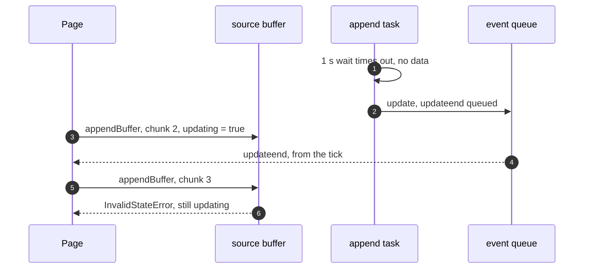
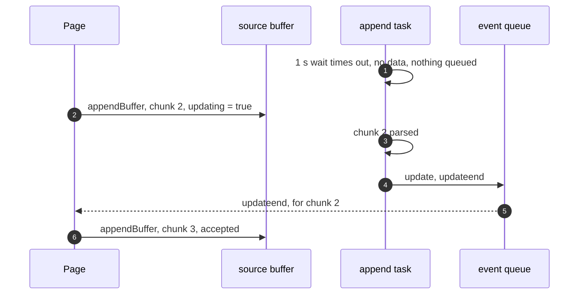

> One change of the GStreamer fork: `review/16`, 16 of 33 in the stack.
> Below it: [`review/15`](https://github.com/Airodonack/gstreamer/tree/review/15). Above it: [`review/17`](https://github.com/Airodonack/gstreamer/tree/review/17).
> The change itself: [commit f9e178cb03dc1d78c4ae291fce98c17f2a76f82f](https://github.com/Airodonack/gstreamer/commit/f9e178cb03dc1d78c4ae291fce98c17f2a76f82f). This README sits in a commit on top of it and is not part of the merge request.
> The whole stack: [overview README](https://github.com/Airodonack/gstreamer/blob/mse-fixes-main/README.md).

# An idle source buffer no longer reports finished appends

An idle source buffer reported a completed append every second. A page that
appended just after one of these ticks took the tick's update-end for its
own, appended again, and got `InvalidStateError`. The fix removes one call.

## The problem

The append task waits for data with a one-second deadline
([`await_pending_data_unlocked()`](https://github.com/Airodonack/gstreamer/blob/f9e178cb03dc1d78c4ae291fce98c17f2a76f82f/subprojects/gst-plugins-bad/gst-libs/gst/mse/gstsourcebuffer.c#L1723-L1731)).
When the wait timed out with nothing appended,
[the task on main](https://github.com/Airodonack/gstreamer/blob/74f679f8de/subprojects/gst-plugins-bad/gst-libs/gst/mse/gstsourcebuffer.c#L1763-L1767)
called `append_successful_unlocked()` all the same, which clears `updating`
and schedules update and update-end. The events are delivered later, from the
buffer's event queue. If the application starts an append between the tick
and the delivery, it receives the tick's update-end while its own append is
still running.

## The change

On timeout the task reports nothing and goes round to wait again
([gstsourcebuffer.c, lines 1798 to 1804](https://github.com/Airodonack/gstreamer/blob/f9e178cb03dc1d78c4ae291fce98c17f2a76f82f/subprojects/gst-plugins-bad/gst-libs/gst/mse/gstsourcebuffer.c#L1798-L1804)).
An append is reported only after it was made.

## Options considered

| Option | What it would take | Why not chosen |
|---|---|---|
| **Report nothing on timeout** (this change) | Remove one call | Chosen: a timeout is not an append. |
| Wait without a deadline | Change the wait | Would work too: stopping the task already signals the condition. Kept the deadline to change one thing, and once a timeout reports nothing it is harmless. |
| Number the appends and let the caller drop stale events | An append id in each event | The library would still send events for appends that never happened. |

## Spec

[MSE, Buffer Append](https://www.w3.org/TR/media-source-2/#sourcebuffer-buffer-append)
queues update and update-end only at the end of an append, after
`appendBuffer()` started it. Nothing in the spec fires them on an idle
buffer.

## How it was checked

There is no unit test, and the race was not made deterministic.

- A browser page appending a video and an audio source buffer in 32 KiB
  slices got `InvalidStateError` on the second video append in 2 of 5 runs.
  The mselib log of a failing run shows "no pending data" at 2.045 s and the
  page's append at about 2.06 s: the order in the first diagram.
- The browser's side gained its own guard at the same time, numbering its
  operations, so the later error-free runs do not test this change alone.

These runs are from when the change was made, not repeated for this README.

Not yet done: a unit test that leaves a source buffer idle for more than a
second and checks that no update-end arrives. It would fail before this change
on every run.

At this commit, the gate on GStreamer main (2026-11-05) ran the whole unit
test suite: `100%: Checks: 74, Failures: 0, Errors: 0`, as on the 1.28 series.

## Questions a reviewer may ask

- **Did anything rely on the tick?** An update-end every second could have
  hidden an append that never reported itself. Every path of the append task
  that handles data reports success, an error or an abort, or is discarded by
  a reset (`review/12` to `review/14`).
- **What about a removed buffer on timeout?** The task still calls
  `append_successful_unlocked()` there, but events for a removed buffer are
  not scheduled, so nothing reaches the application.
