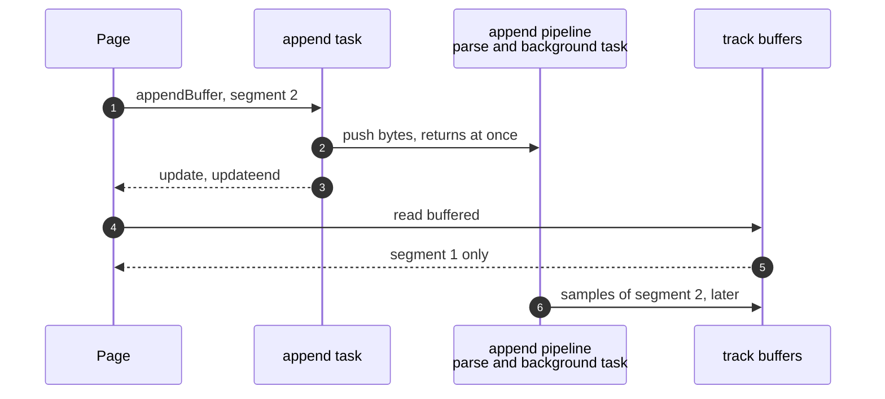
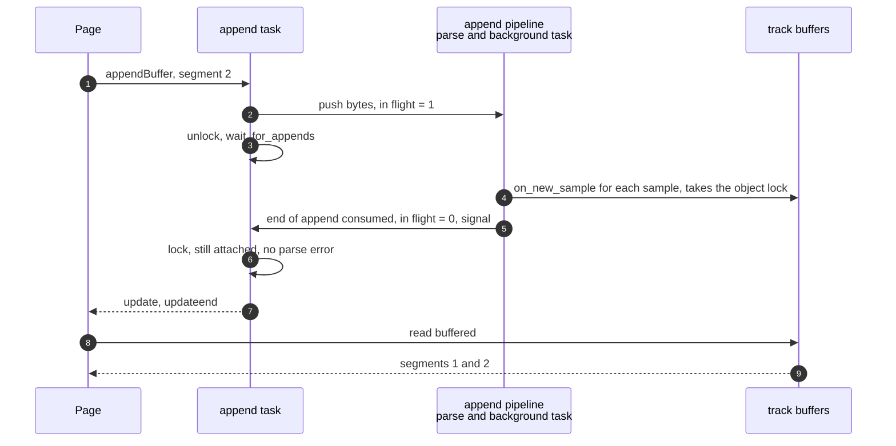

> One change of the GStreamer fork: `review/10`, 10 of 33 in the stack.
> Below it: [`review/09`](https://github.com/Airodonack/gstreamer/tree/review/09). Above it: [`review/11`](https://github.com/Airodonack/gstreamer/tree/review/11).
> The change itself: [commit 64837284609bccb012ada40a23843a35f4697ba1](https://github.com/Airodonack/gstreamer/commit/64837284609bccb012ada40a23843a35f4697ba1). This README sits in a commit on top of it and is not part of the merge request.
> The whole stack: [overview README](https://github.com/Airodonack/gstreamer/blob/mse-fixes-main/README.md).

# A source buffer's buffered ranges are current at update-end

A page reading `buffered` in its `updateend` handler saw the ranges as they
were one append earlier. Players decide what to fetch next from that value,
so they fetched the wrong segment or waited. This change makes the append
task wait until the append's samples are in the track buffers before it
reports update-end.

## The problem

Upstream, the
[append task](https://github.com/Airodonack/gstreamer/blob/74f679f8de/subprojects/gst-plugins-bad/gst-libs/gst/mse/gstsourcebuffer.c#L1769-L1778)
calls `gst_append_pipeline_append()`, which pushes the bytes into the append
pipeline's `appsrc` and returns at once. The task then clears `updating` and
schedules update and update-end. The parsing happens later, on the append
pipeline's threads. The samples reach the track buffers only when the
pipeline's background task pops the "end of append" message and hands every
parsed sample to the source buffer
([`on_new_sample()`](https://github.com/Airodonack/gstreamer/blob/64837284609bccb012ada40a23843a35f4697ba1/subprojects/gst-plugins-bad/gst-libs/gst/mse/gstsourcebuffer.c#L813-L830)).
So update-end usually reaches the page first.

## The change

**In the append pipeline**
([gstappendpipeline.c](https://github.com/Airodonack/gstreamer/blob/64837284609bccb012ada40a23843a35f4697ba1/subprojects/gst-plugins-bad/gst-libs/gst/mse/gstappendpipeline.c#L102-L122)):

- A count of appends in flight, with a mutex and a condition.
  [`gst_append_pipeline_append()`](https://github.com/Airodonack/gstreamer/blob/64837284609bccb012ada40a23843a35f4697ba1/subprojects/gst-plugins-bad/gst-libs/gst/mse/gstappendpipeline.c#L852-L869)
  raises it before it sends the end-of-append event.
- The background task lowers it and signals the condition after it has handed
  over every sample of an end of append
  ([line 359](https://github.com/Airodonack/gstreamer/blob/64837284609bccb012ada40a23843a35f4697ba1/subprojects/gst-plugins-bad/gst-libs/gst/mse/gstappendpipeline.c#L355-L361)).
- Every way the pipeline stops waking up marks the waiters "abandoned" and
  wakes them: shutdown, which covers EOS and parse errors, abort and stop.
  A reset clears the count and the mark
  ([lines 961 to 965](https://github.com/Airodonack/gstreamer/blob/64837284609bccb012ada40a23843a35f4697ba1/subprojects/gst-plugins-bad/gst-libs/gst/mse/gstappendpipeline.c#L961-L965)).
- [`gst_append_pipeline_wait_for_appends()`](https://github.com/Airodonack/gstreamer/blob/64837284609bccb012ada40a23843a35f4697ba1/subprojects/gst-plugins-bad/gst-libs/gst/mse/gstappendpipeline.c#L872-L884)
  waits until the count is zero or the waiters were abandoned.

**In the source buffer's append task**
([gstsourcebuffer.c, lines 1778 to 1796](https://github.com/Airodonack/gstreamer/blob/64837284609bccb012ada40a23843a35f4697ba1/subprojects/gst-plugins-bad/gst-libs/gst/mse/gstsourcebuffer.c#L1778-L1796)):
after pushing the data, the task releases the source buffer's object lock,
waits, and takes the lock again. `on_new_sample()` takes that lock, so waiting
while holding it would deadlock. It then checks again whether the buffer was
removed or the parse failed meanwhile, before it reports success.

## Options considered

| Option | What it would take | Why not chosen |
|---|---|---|
| **Count appends in flight and wait for them** (this change) | 60 lines in the append pipeline, 18 in the source buffer | Chosen: update-end then means what the spec says. The wait is on a condition the background task already reaches. |
| Report update-end from the background task, after the samples | Move the end of the append algorithm to the pipeline's thread | The append task owns `updating` and the error path. Two threads finishing appends would need their own ordering. |
| Push the bytes synchronously through the pipeline | Replace `appsrc` with direct pad pushes | A redesign of the append pipeline, and the parse would then run on the append task's thread. |
| Compute `buffered` from the pipeline's parsed position | New bookkeeping | `buffered` comes from the track buffers. A second source would drift from them. |

## What it costs

An append now takes as long as its parse, instead of returning before it.
That is the spec's model: `updating` stays true while the segment parser
loop runs. Nothing extra is parsed.

## Spec

[MSE, Buffer Append](https://www.w3.org/TR/media-source-2/#sourcebuffer-buffer-append):

> Run the segment parser loop algorithm.
> If the segment parser loop algorithm in the previous step was aborted, then
> abort this algorithm.
> Set the updating attribute to false.
> Queue a task to fire an event named update at this SourceBuffer object.
> Queue a task to fire an event named updateend at this SourceBuffer object.

The segment parser loop runs the coded frame processing, which adds the
frames to the track buffers, before `updating` is cleared.

## How it was checked

Unit test
[`test_source_buffer_buffered_at_update_end`](https://github.com/Airodonack/gstreamer/blob/64837284609bccb012ada40a23843a35f4697ba1/subprojects/gst-plugins-bad/tests/check/libs/mse.c#L1223-L1251)
appends an MP4, waits for update-end, and checks that `buffered` holds one
range, starting before 1 s.

- Before the change (run of 2026-10-23, the same test text): fails with
  `'buffered->len' (0) is not equal to '1' (1)`.
- After: passes. Re-run for this README on a build of the stack's top of that day
  (2026-11-03): 5 of 5 runs pass.
- A program driving `GstMediaSource` from Rust through gstreamer-mse appended
  a fragmented MP4 one segment at a time and read `buffered` at each
  update-end and again 300 ms later. Before, the first reading lagged by one
  segment on every append. After, both readings were equal on every append.
  That run is from when the change was made.

At this commit, the gate on GStreamer main (2026-11-05) ran the whole unit
test suite: `100%: Checks: 72, Failures: 0, Errors: 0`, as on the 1.28 series.

## Questions a reviewer may ask

- **Can the wait hang?** It ends when the count reaches zero or the
  pipeline is marked abandoned. Every path that stops the background task
  marks it: EOS and errors through shutdown, abort, and stop. A reset clears
  both and wakes any waiter.
- **What if the push of the end-of-append event fails?** `append()` lowers the
  count again before returning the error, so nothing waits for it.
- **Why the second removed and failed check?** The buffer may have been
  removed, or the parse may have failed, while the task waited without its
  lock. Reporting success then would be wrong.
