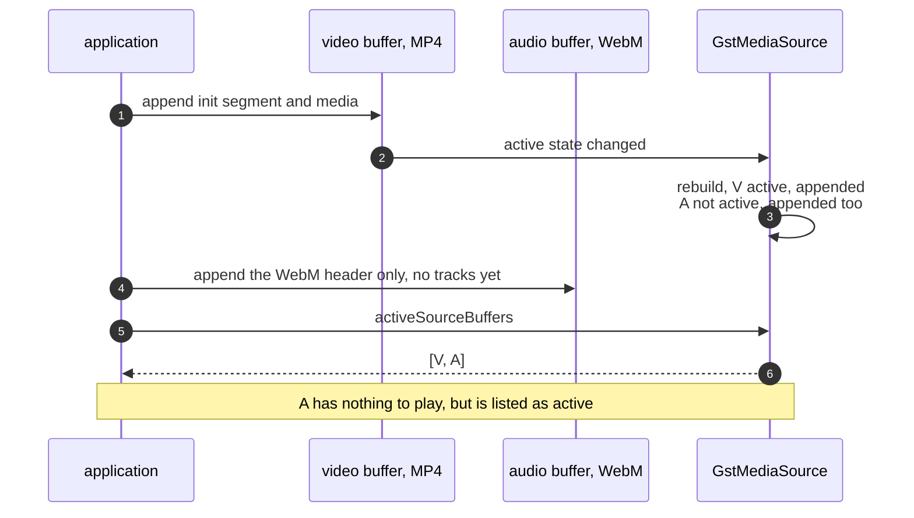

> One change of the GStreamer fork: `review/17`, 17 of 33 in the stack.
> Below it: [`review/16`](https://github.com/Airodonack/gstreamer/tree/review/16). Above it: [`review/18`](https://github.com/Airodonack/gstreamer/tree/review/18).
> The change itself: [commit 8827aafcc50da4a8f12c47dfe45be0d74f0ef975](https://github.com/Airodonack/gstreamer/commit/8827aafcc50da4a8f12c47dfe45be0d74f0ef975). This README sits in a commit on top of it and is not part of the merge request.
> The whole stack: [overview README](https://github.com/Airodonack/gstreamer/blob/mse-fixes-main/README.md).

# Source buffers without media no longer count as active

A media source lists its active source buffers: those with a track that
plays. mselib listed every source buffer as soon as any one of them
changed state, including buffers that had no tracks at all. This change
deletes the one line that did it.

## The problem

`activeSourceBuffers` is rebuilt each time a source buffer's active state
changes, which happens when it receives an initialization segment
([`on_received_init_segment`](https://github.com/Airodonack/gstreamer/blob/8827aafcc50da4a8f12c47dfe45be0d74f0ef975/subprojects/gst-plugins-bad/gst-libs/gst/mse/gstsourcebuffer.c#L896-L927)
ends with the callback). The rebuild,
[`rebuild_active_source_buffers`](https://github.com/Airodonack/gstreamer/blob/8827aafcc50da4a8f12c47dfe45be0d74f0ef975/subprojects/gst-plugins-bad/gst-libs/gst/mse/gstmediasource.c#L803-L882),
empties the list and walks all buffers. Each buffer is either active or not,
and both branches appended it:

```c
if (g_array_index (active, gboolean, i)) {
  gst_source_buffer_list_append (self->active_buffers, buf);
  added |= !g_hash_table_contains (previously_active, buf);
} else {
  gst_source_buffer_list_append (self->active_buffers, buf);   /* removed */
  removed |= g_hash_table_contains (previously_active, buf);
}
```

So the list always held every buffer. The line is upstream too, on main and in 1.28
([gstmediasource.c, line 803](https://github.com/Airodonack/gstreamer/blob/74f679f8de/subprojects/gst-plugins-bad/gst-libs/gst/mse/gstmediasource.c#L798-L805)).



mselib's own ready state reads the list. msesrc's
[`has_current_data`, `has_future_data` and `has_enough_data`](https://github.com/Airodonack/gstreamer/blob/8827aafcc50da4a8f12c47dfe45be0d74f0ef975/subprojects/gst-plugins-bad/gst-libs/gst/mse/gstmsesrc.c#L1383-L1468)
ask every listed buffer whether the position is buffered. A listed buffer
with nothing in it answers no, so msesrc's ready state, which a browser
passes on as the media element's `readyState`, stays at `HAVE_METADATA`
while it is listed
([`update_ready_state`](https://github.com/Airodonack/gstreamer/blob/8827aafcc50da4a8f12c47dfe45be0d74f0ef975/subprojects/gst-plugins-bad/gst-libs/gst/mse/gstmsesrc.c#L1470-L1498)).
That follows from the code; it was not measured on its own. Applications
read the list as well.

## The change

The inactive branch no longer appends; it only records that a buffer that
was active is gone, so the "removed" notification still fires
([lines 856 to 862](https://github.com/Airodonack/gstreamer/blob/8827aafcc50da4a8f12c47dfe45be0d74f0ef975/subprojects/gst-plugins-bad/gst-libs/gst/mse/gstmediasource.c#L856-L862)).
"Active" is what
[`gst_source_buffer_get_active`](https://github.com/Airodonack/gstreamer/blob/8827aafcc50da4a8f12c47dfe45be0d74f0ef975/subprojects/gst-plugins-bad/gst-libs/gst/mse/gstsourcebuffer.c#L2345-L2360)
answers: at least one of the buffer's tracks is active.

## Options considered

| Option | Why not chosen |
|---|---|
| **Delete the append in the inactive branch** (this change) | Chosen: the branch exists to compute `removed`, and appending there contradicts the list's meaning. |
| Filter inactive buffers when the application reads the list | Leaves the stored list wrong, and the "added" and "removed" signals would still describe the wrong list. |

## Spec

[MSE, `activeSourceBuffers`](https://w3c.github.io/media-source/#dom-mediasource-activesourcebuffers):

> Contains the subset of sourceBuffers that are providing the selected video
> track, the enabled audio tracks, and the "showing" or "hidden" text tracks.

## How it was checked

- Probed for the earlier README, on stock GStreamer 1.28.7 from nixpkgs through PyGObject (the
  unfixed library): a `video/mp4` buffer gets `mse.mp4`, an `audio/webm`
  buffer gets only the WebM header (the bytes before the first Cluster).
  `activeSourceBuffers` was `[video, audio]` in 4 of 4 runs.
- From the commit message, not re-run: the same page in a browser built on
  the library before and after this commit listed the audio buffer in 4 of
  4 runs before and in none of 4 after.

Not yet done: a unit test. None in `tests/check/libs/mse.c` checks this
list after two buffers' initialization segments; later in the stack,
`test_source_buffer_init_segment_alone_activates` (`review/23`) counts the
active buffers of a single buffer only.

At this commit, the gate on GStreamer main (2026-11-05) ran the whole unit
test suite: `100%: Checks: 74, Failures: 0, Errors: 0`, as on the 1.28 series.

## Questions a reviewer may ask

- **Does anything rely on the old behaviour?** Not that the code shows.
  msesrc's ready state reads the list, and gets a more accurate answer
  now. A buffer that never gets tracks no longer holds `readyState` back.
- **Why is the buffer counted when its own state did not change?** The
  rebuild always walks every buffer, so whichever buffer triggered it, the
  bug listed all of them.
