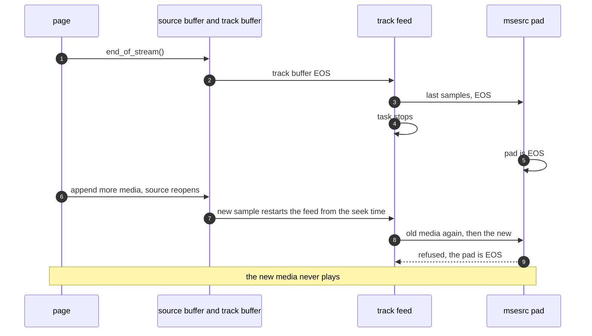
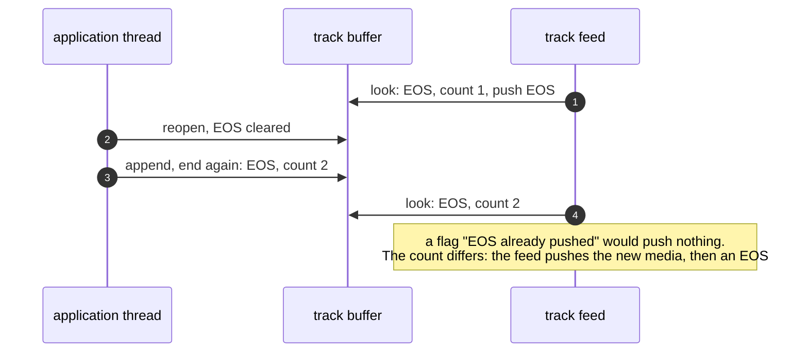
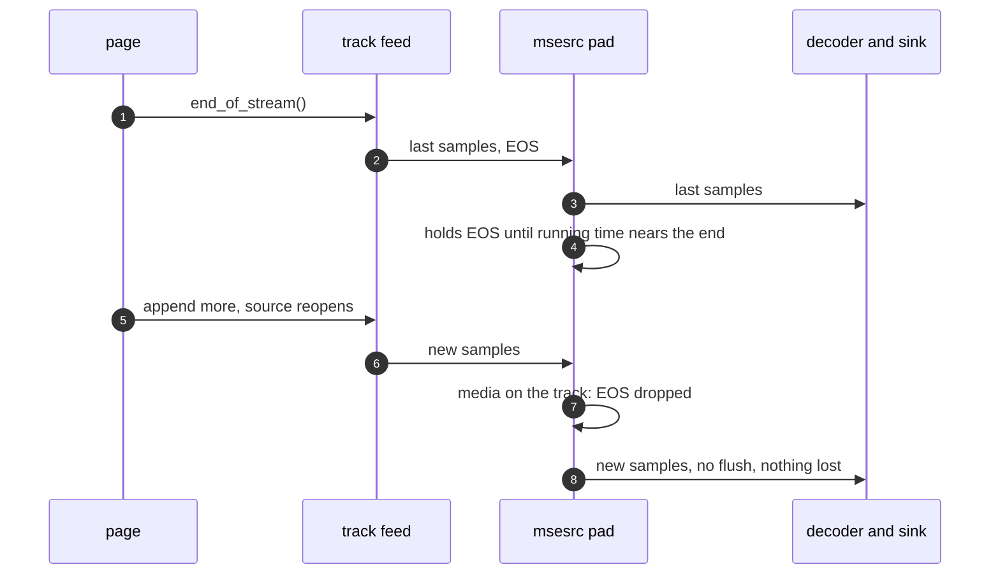

> One change of the GStreamer fork: `review/24`, 24 of 33 in the stack.
> Below it: [`review/23`](https://github.com/Airodonack/gstreamer/tree/review/23). Above it: [`review/25`](https://github.com/Airodonack/gstreamer/tree/review/25).
> The change itself: [commit 0fd7ed68a308ca9b9fd266c50d9481794858d431](https://github.com/Airodonack/gstreamer/commit/0fd7ed68a308ca9b9fd266c50d9481794858d431). This README sits in a commit on top of it and is not part of the merge request.
> The whole stack: [overview README](https://github.com/Airodonack/gstreamer/blob/mse-fixes-main/README.md).

# A source reopened after its end of stream plays again

MSE lets a page end the stream and then append more: the append reopens the
source, and the new media plays like any other. mselib reopened the source
but left every layer below in its end-of-stream state, so the new media never
played. This change takes the end of stream back at each layer: the track
buffers, the track feeds and msesrc's pads. Since a GStreamer EOS is final
once it is sent, msesrc now holds each pad's EOS until playback nears the end
of what the pad pushed.

It is the largest change of the stack's second half after `review/23`:
about 380 changed lines of library code in seven files, and six new unit tests.

## The problem

Three layers each kept the EOS:

- the **track buffers**, marked EOS by `gst_source_buffer_mark_eos()` at the
  end of stream;
- the **track feeds**, which pushed EOS and then stopped their task;
- **msesrc's pads**, which had sent EOS downstream and refuse buffers after
  it.

A VOD player that extends the media, or appends again after seeking into an
evicted range, hit all three:

Undoing the first two is bookkeeping. The pads are harder: in GStreamer an EOS
is final for the stream, downstream acts on it as soon as it arrives, and only
a flush clears it, which throws away what downstream still holds. A browser
does not have this problem: Chromium and Firefox pull from the demuxer, and a
decoder learns of the end only when it reads at the end. MSE's end of stream
is a flag until then.

## The change

**Reopen clears EOS.**
[`gst_media_source_open()`](https://github.com/Airodonack/gstreamer/blob/0fd7ed68a308ca9b9fd266c50d9481794858d431/subprojects/gst-plugins-bad/gst-libs/gst/mse/gstmediasource.c#L580-L598),
when it moves an ended source back to open, calls
[`clear_all_source_buffers_eos()`](https://github.com/Airodonack/gstreamer/blob/0fd7ed68a308ca9b9fd266c50d9481794858d431/subprojects/gst-plugins-bad/gst-libs/gst/mse/gstmediasource.c#L1070-L1082),
which clears each track buffer's EOS through
[`gst_source_buffer_clear_eos()`](https://github.com/Airodonack/gstreamer/blob/0fd7ed68a308ca9b9fd266c50d9481794858d431/subprojects/gst-plugins-bad/gst-libs/gst/mse/gstsourcebuffer.c#L2502-L2516).
That takes each buffer's `TRACKS_LOCK`, so `append_buffer()` now reopens
before it takes its own
([lines 2165 to 2169](https://github.com/Airodonack/gstreamer/blob/0fd7ed68a308ca9b9fd266c50d9481794858d431/subprojects/gst-plugins-bad/gst-libs/gst/mse/gstsourcebuffer.c#L2165-L2169)).
`remove()`, the mode setter and the `timestampOffset` setter already
reopened before taking it. The reopen and the end of stream's marking of the
buffers
([`mark_all_source_buffers_eos()`](https://github.com/Airodonack/gstreamer/blob/0fd7ed68a308ca9b9fd266c50d9481794858d431/subprojects/gst-plugins-bad/gst-libs/gst/mse/gstmediasource.c#L1043-L1066))
both run under a new `eos_lock`, and the marking happens only if the source
is still ended, so an end of stream and a reopen on two threads leave the
buffers' EOS matching `readyState`.

**The feed outlives its EOS, counted.** The track buffer counts how often it
has become EOS
([`gst_media_source_track_buffer_eos()`](https://github.com/Airodonack/gstreamer/blob/0fd7ed68a308ca9b9fd266c50d9481794858d431/subprojects/gst-plugins-bad/gst-libs/gst/mse/gstmediasourcetrackbuffer.c#L176-L187),
[`get_eos_count()`](https://github.com/Airodonack/gstreamer/blob/0fd7ed68a308ca9b9fd266c50d9481794858d431/subprojects/gst-plugins-bad/gst-libs/gst/mse/gstmediasourcetrackbuffer.c#L209-L214)).
[`track_feed_task()`](https://github.com/Airodonack/gstreamer/blob/0fd7ed68a308ca9b9fd266c50d9481794858d431/subprojects/gst-plugins-bad/gst-libs/gst/mse/gstsourcebuffer.c#L2021-L2098)
pushes one EOS each time the count moves and keeps running, from where it left
off, so the old media is not pushed again. It pushes the EOS only if the EOS
held for the whole walk of the track buffer; if the source reopened or ended
again during the walk, or an append changed the buffer under it
(`GST_ITERATOR_RESYNC`), it walks again at once
([lines 2059 to 2083](https://github.com/Airodonack/gstreamer/blob/0fd7ed68a308ca9b9fd266c50d9481794858d431/subprojects/gst-plugins-bad/gst-libs/gst/mse/gstsourcebuffer.c#L2059-L2083)).
Otherwise an EOS read before the walk could follow media appended during it.

**The pad holds its EOS.** When an msesrc pad pops an EOS,
[`hold_eos()`](https://github.com/Airodonack/gstreamer/blob/0fd7ed68a308ca9b9fd266c50d9481794858d431/subprojects/gst-plugins-bad/gst-libs/gst/mse/gstmsesrc.c#L1071-L1138)
waits on the element's clock until running time comes within a margin of the
end of the media the pad pushed, and only then is the EOS sent
([lines 1298 to 1312](https://github.com/Airodonack/gstreamer/blob/0fd7ed68a308ca9b9fd266c50d9481794858d431/subprojects/gst-plugins-bad/gst-libs/gst/mse/gstmsesrc.c#L1298-L1312)).
The margin
([`eos_hold_margin()`](https://github.com/Airodonack/gstreamer/blob/0fd7ed68a308ca9b9fd266c50d9481794858d431/subprojects/gst-plugins-bad/gst-libs/gst/mse/gstmsesrc.c#L1039-L1062))
is 4 frames for video, from the last frame's duration or else the caps'
framerate, and 0 for audio and text: a video decoder may keep its last frames
until the EOS drains it, and Chromium's renderer keeps 4 frames queued. The
wait ends early, through
[`wake_eos_hold()`](https://github.com/Airodonack/gstreamer/blob/0fd7ed68a308ca9b9fd266c50d9481794858d431/subprojects/gst-plugins-bad/gst-libs/gst/mse/gstmsesrc.c#L1028-L1037),
when the track gets media (its `on-not-empty` signal), when the pad starts
flushing, and when the element goes to or leaves `PLAYING`; while not
`PLAYING` it waits for `PLAYING`. New media during the wait means the source
reopened: the EOS is dropped, and the media follows the old with nothing in
between.

**The pad resumes after an EOS it did send.** If the source reopens inside the
margin or after the end, the EOS is already out. A pad that is EOS and pops a
sample flushes (`flush-start`, then `flush-stop` with `reset_time` false,
since playback goes on from where it ended) and sends its segment again; a pad
that is EOS and pops another EOS drops it
([lines 1165 to 1193](https://github.com/Airodonack/gstreamer/blob/0fd7ed68a308ca9b9fd266c50d9481794858d431/subprojects/gst-plugins-bad/gst-libs/gst/mse/gstmsesrc.c#L1165-L1193)).
A seek sets the pad flushing before its own `flush-start`
([`flush_stream()`](https://github.com/Airodonack/gstreamer/blob/0fd7ed68a308ca9b9fd266c50d9481794858d431/subprojects/gst-plugins-bad/gst-libs/gst/mse/gstmsesrc.c#L820-L854)),
and the pad does not resume while flushing, so its `flush-stop` cannot undo
a seek's `flush-start`.

## Options considered

| Option | Why not chosen |
|---|---|
| **Hold the EOS until playback nears the end** (this change) | Chosen: a reopen before the end loses nothing, and at a real end the EOS still comes on time. It follows the browsers' model: the end reaches the decoder when playback gets there. |
| Flush the pad on new media after an EOS, with no hold | Measured below: drops up to 0.8 s of video and 1.6 s of audio that downstream had queued, and a reopen after the decoder saw the EOS froze video. Kept only for a reopen after the EOS left. |
| A `STREAM_START` behind the EOS instead of a flush | The EOS still reaches the sinks: GstPlay ended at the old end and the H.264 decoder stopped. It also needs `review/01`'s `queue` fix. |
| Hold with no margin | The last 3 video frames came up to 100 ms late at a real end. |
| A fixed 200 ms margin | Does not follow the frame rate. |
| Restart the feeds on reopen | A restarted feed walks from the seek time and replays what was pushed, the bug itself. |
| A boolean "EOS pushed" in the feed | Misses an end, a reopen and an end between two looks (diagram above). |

## What it costs

- An EOS comes up to 4 video frames before the end of the media, in running
  time, instead of when the last sample was pushed. A pipeline with
  `sync=false` sinks gets its EOS in real time, not as fast as it can run.
- Video with neither a frame duration nor a framerate falls back to a margin
  of 0.
- Each track feed now runs until the source buffer goes, and wakes once a
  second to walk its track buffer.

## Spec

[MSE, prepare append algorithm](https://w3c.github.io/media-source/#sourcebuffer-prepare-append),
step 5:

> If the readyState attribute of the parent media source is in the "ended"
> state then run the following steps: Set the readyState attribute of the
> parent media source to "open". Queue a task to fire an event named
> sourceopen at the parent media source.

`remove()`, the `mode` setter and the `timestampOffset` setter take back an
end of stream the same way. Media appended then is processed like any other,
and [HTML's ended playback](https://html.spec.whatwg.org/multipage/media.html#ended-playback)
is the current playback position reaching the end of the media, which the hold
keeps for msesrc.

## How it was checked

Unit tests in `tests/check/libs/mse.c`, msesrc into fakesinks:

- [`test_media_source_element_plays_after_reopen`](https://github.com/Airodonack/gstreamer/blob/0fd7ed68a308ca9b9fd266c50d9481794858d431/subprojects/gst-plugins-bad/tests/check/libs/mse.c#L2247-L2328):
  an end of stream, a reopen by a setter that ends again with no media, a
  reopen by an append (which deadlocks if `append_buffer()` takes its tracks
  lock before reopening) and a second end of stream; it fails before this
  change, with no buffer reaching the sinks after the first EOS (commit
  message).
- [`test_media_source_element_ends_after_append_during_feed`](https://github.com/Airodonack/gstreamer/blob/0fd7ed68a308ca9b9fd266c50d9481794858d431/subprojects/gst-plugins-bad/tests/check/libs/mse.c#L2357-L2425):
  reopens and appends while the feeds may still be pushing; no old media may
  follow an EOS.
- [`test_media_source_element_keeps_queued_media_on_reopen`](https://github.com/Airodonack/gstreamer/blob/0fd7ed68a308ca9b9fd266c50d9481794858d431/subprojects/gst-plugins-bad/tests/check/libs/mse.c#L2553-L2654):
  each pad's media held in a multiqueue across the end and the reopen, on a
  test clock at the start; every buffer pushed before the reopen reaches the
  sink, and each pad pushes one EOS.
- [`test_media_source_element_holds_eos_until_end`](https://github.com/Airodonack/gstreamer/blob/0fd7ed68a308ca9b9fd266c50d9481794858d431/subprojects/gst-plugins-bad/tests/check/libs/mse.c#L2678-L2797):
  no EOS before the test clock reaches the end, one after.
- [`test_media_source_element_seeks_while_resuming`](https://github.com/Airodonack/gstreamer/blob/0fd7ed68a308ca9b9fd266c50d9481794858d431/subprojects/gst-plugins-bad/tests/check/libs/mse.c#L2843-L2914):
  a seek while the pads resume; nothing is pushed inside the seek's flush.
- [`test_media_source_end_of_stream_races_reopen`](https://github.com/Airodonack/gstreamer/blob/0fd7ed68a308ca9b9fd266c50d9481794858d431/subprojects/gst-plugins-bad/tests/check/libs/mse.c#L2942-L3023):
  an end of stream on one thread and a reopen on another.

The other msesrc tests run on a pipeline whose running time is an hour in, so
their EOS comes at once. The races need temporary delays to fail before the
change (the feed's snapshot, a slow feed walk, the pad's resume, the end of
stream's marking); those runs are from the review of 2026-11-04 and are not
repeated here. The two hold tests failed before the hold and pass with it
(2026-11-05).

The gate on GStreamer main (2026-11-05), the whole suite at this commit:
`100%: Checks: 94, Failures: 0, Errors: 0`, as on the 1.28 series.

Measured on 2026-11-05 in a pipeline shaped like a browser's: GstPlay over
playbin3, `decodebin3`, `playsink`, sinks that sync, the H.264 decoder
openh264dec, 30 fps media. A page reopens and appends at a lead before the old
end. Each cell is the largest gap in the timestamps of the buffers reaching the sinks, in ms (3 runs each, every run the same):

| Lead before the old end | Flush, video | Flush, audio | Hold, video | Hold, audio |
|---|---|---|---|---|
| 2000 ms | 833 | 1625 | 0 | 0 |
| 500 ms | 567 | 488 | 0 | 0 |
| 100 ms | 167 | 70 | 0 | 0 |
| 50 ms | 100 | 23 | 100 | 0 |

At 100 ms the flush build's video also stopped for good (GstPlay "stopped"
in 3 of 3); with the hold it played on. At 50 ms, inside the 4-frame margin
of 133 ms, the EOS has left and both builds stop. At a real end with the hold,
no frame was more than 2 ms late, and GstPlay ended as before.

## Questions a reviewer may ask

- **What if the pipeline has no clock, or never goes to `PLAYING`?** With no
  clock the EOS goes at once: sinks without a clock do not wait either. In
  `PAUSED` the EOS is held, as the end is not reached.
- **A sink with `sync=false`?** The EOS waits for real running time.
- **Does the flush of a late reopen disturb the other tracks?** It goes down
  this pad's branch only.
- **Lock order of the reopen:** `gst_media_source_open()` runs under the
  calling buffer's object lock and takes every buffer's `TRACKS_LOCK` in
  turn. Object lock before `TRACKS_LOCK` is the series' order. `eos_lock`
  comes after a source buffer's object lock and before the media source's
  object lock and the buffers' `TRACKS_LOCK`: a reopen is called under a
  buffer's object lock but never under its tracks lock, as the comment on
  `gst_media_source_open()` says.
- **The test comment "mselib applies the timestamp offset only there"**
  (sequence mode) is true at this commit. `review/28` makes it false and
  does not update it.
