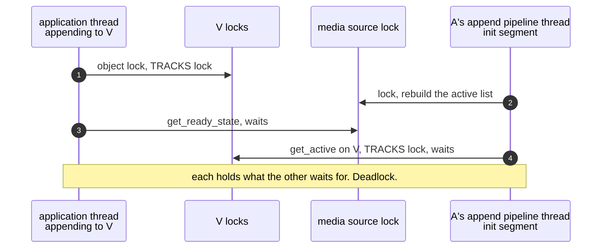
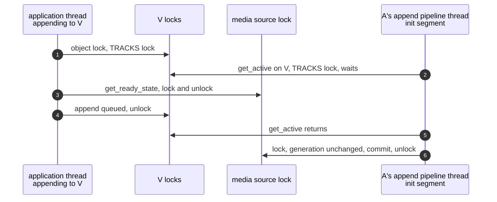

> One change of the GStreamer fork: `review/07`, 7 of 33 in the stack.
> Below it: [`review/06`](https://github.com/Airodonack/gstreamer/tree/review/06). Above it: [`review/08`](https://github.com/Airodonack/gstreamer/tree/review/08).
> The change itself: [commit 91c03df1c0e72efdc42ad9807607c5d75c554ecf](https://github.com/Airodonack/gstreamer/commit/91c03df1c0e72efdc42ad9807607c5d75c554ecf). This README sits in a commit on top of it and is not part of the merge request.
> The whole stack: [overview README](https://github.com/Airodonack/gstreamer/blob/mse-fixes-main/README.md).

# Two source buffers no longer deadlock on an init segment

A page with two source buffers could hang for good in `appendBuffer()`: one
buffer's initialization segment and an append to the other buffer each held
a lock the other needed. This change makes the media source stop calling into
source buffers while it holds its own lock, in the two places that did.

## The problem

The locks involved, and the order most paths take them:

1. a source buffer's object lock;
2. the same buffer's `TRACKS` lock;
3. the media source's object lock.

An append takes them in that order.
[`gst_source_buffer_append_buffer()`](https://github.com/Airodonack/gstreamer/blob/91c03df1c0e72efdc42ad9807607c5d75c554ecf/subprojects/gst-plugins-bad/gst-libs/gst/mse/gstsourcebuffer.c#L1932-L1962)
holds 1 and 2 and then asks the media source for its ready state, position
and duration, each of which takes 3
([`is_ended_unlocked()`](https://github.com/Airodonack/gstreamer/blob/91c03df1c0e72efdc42ad9807607c5d75c554ecf/subprojects/gst-plugins-bad/gst-libs/gst/mse/gstsourcebuffer.c#L1011-L1023)
calls `gst_media_source_get_ready_state()`).

Two media source paths took 3 first and then 2 of each buffer:

- [`on_active_state_changed()` on main](https://github.com/Airodonack/gstreamer/blob/74f679f8de/subprojects/gst-plugins-bad/gst-libs/gst/mse/gstmediasource.c#L823-L831)
  rebuilds the list of active source buffers under the media source's lock and
  calls [`gst_source_buffer_get_active()`](https://github.com/Airodonack/gstreamer/blob/91c03df1c0e72efdc42ad9807607c5d75c554ecf/subprojects/gst-plugins-bad/gst-libs/gst/mse/gstsourcebuffer.c#L2228-L2243)
  on every buffer, which takes that buffer's `TRACKS` lock. It runs whenever a
  buffer receives an initialization segment, on that buffer's append pipeline
  thread.
- [`gst_media_source_seek()` on main](https://github.com/Airodonack/gstreamer/blob/74f679f8de/subprojects/gst-plugins-bad/gst-libs/gst/mse/gstmediasource.c#L1144-L1160)
  holds the media source's lock while it calls `gst_source_buffer_seek()` on
  every buffer, which takes the `TRACKS` lock too.

With a video buffer V and an audio buffer A:

The page then hangs in `appendBuffer()`.

## The change

**The active-list rebuild**
([`rebuild_active_source_buffers()`](https://github.com/Airodonack/gstreamer/blob/91c03df1c0e72efdc42ad9807607c5d75c554ecf/subprojects/gst-plugins-bad/gst-libs/gst/mse/gstmediasource.c#L781-L861))
now runs in two steps:

1. **Snapshot, without the media source's lock**
   ([lines 792 to 806](https://github.com/Airodonack/gstreamer/blob/91c03df1c0e72efdc42ad9807607c5d75c554ecf/subprojects/gst-plugins-bad/gst-libs/gst/mse/gstmediasource.c#L792-L806)):
   walk the buffer list, which has a lock of its own and returns a reference
   from `index()`, and ask each buffer whether it is active.
2. **Commit, under the lock**
   ([lines 808 to 860](https://github.com/Airodonack/gstreamer/blob/91c03df1c0e72efdc42ad9807607c5d75c554ecf/subprojects/gst-plugins-bad/gst-libs/gst/mse/gstmediasource.c#L808-L860)):
   rebuild `active_buffers` from the snapshot and send the added and removed
   notifications as before. A buffer removed since the snapshot is left out.

Two buffers' initialization segments can rebuild at the same time, and the
one that took its snapshot first may commit last, with an older view. So each
rebuild takes a number from a new counter, `active_buffers_generation`, before
its snapshot. If the counter has moved by the time it commits, another
rebuild started after it, and it starts over
([lines 808 to 815](https://github.com/Airodonack/gstreamer/blob/91c03df1c0e72efdc42ad9807607c5d75c554ecf/subprojects/gst-plugins-bad/gst-libs/gst/mse/gstmediasource.c#L808-L815)).

[`on_active_state_changed()`](https://github.com/Airodonack/gstreamer/blob/91c03df1c0e72efdc42ad9807607c5d75c554ecf/subprojects/gst-plugins-bad/gst-libs/gst/mse/gstmediasource.c#L863-L869)
calls the rebuild without taking the lock.

**The seek**
([`gst_media_source_seek()`](https://github.com/Airodonack/gstreamer/blob/91c03df1c0e72efdc42ad9807607c5d75c554ecf/subprojects/gst-plugins-bad/gst-libs/gst/mse/gstmediasource.c#L1182-L1198))
walks the buffer list without the media source's lock. It reads nothing else
of the media source.

The rebuild still keeps upstream's behaviour of listing inactive buffers too
(both branches append). That is a separate bug, fixed in `review/17`.

## Options considered

| Option | What it would take | Why not chosen |
|---|---|---|
| **Snapshot without the lock, commit under it, retry on a newer rebuild** (this change) | About 80 lines in one function, plus the seek | Chosen: the media source no longer calls into a source buffer under its own lock on these paths, and nothing changes on the source buffer side. |
| Snapshot without the lock, no retry | Simpler | Two concurrent rebuilds can commit in the wrong order, and the older view wins until the next initialization segment. |
| Make the source buffer release its locks before asking the media source | Restructure appends, evictions and removals in gstsourcebuffer.c | Many call sites read the ready state, position or duration in the middle of work that needs the buffer's locks. |
| Keep an atomic "active" flag per buffer, readable without a lock | New state kept in step with the tracks | Duplicates what the tracks already say, and would need updating everywhere a track's active state changes. |
| Rebuild on a separate task | A new thread per media source | A large change for one ordering problem. The list would also lag behind the init segment that changed it. |

## Spec

[MSE, activeSourceBuffers](https://www.w3.org/TR/media-source-2/#dom-mediasource-activesourcebuffers):

> SourceBuffer objects in this list MUST appear in the same order as they
> appear in the sourceBuffers attribute

The commit walks the snapshot in list order, so the order is kept.

## How it was checked

There is no unit test. The race is timing-dependent and was not made
deterministic for this change.

- A page appending video and audio to two source buffers in small slices hung
  in `appendBuffer()` in 1 of 40 runs before the change. gdb showed the
  application thread in `gst_source_buffer_append_buffer()` ->
  `gst_media_source_get_ready_state()`, and the audio append pipeline's thread
  in `on_active_state_changed()` -> `gst_source_buffer_get_active()` on the
  video buffer: the cycle in the first diagram.
- With the snapshot alone, before the retry was added, 40 of 40 runs
  completed. With the retry and the next changes in the stack, 20 more runs of
  that page and 30 runs removing or detaching a buffer mid-append completed.

These are runs from when the change was made, not repeated for this README.
Since the hang was rare, the runs show the change breaks nothing. The
argument that it removes the deadlock is the lock order above.

At this commit, the gate on GStreamer main (2026-11-05) ran the whole unit
test suite: `100%: Checks: 71, Failures: 0, Errors: 0`, as on the 1.28 series.

## Questions a reviewer may ask

- **Can the retry loop spin forever?** Each pass bumps the counter, so two
  rebuilds can make each other retry. One of them wins as soon as it commits
  without the other bumping in between. Rebuilds happen once per
  initialization segment, so the loop ends.
- **Is the list lock taken under the media source lock?** Yes, in the commit's
  `contains()` and `append()` calls. The list lock is a leaf: nothing is called
  out while it is held.
- **What does the snapshot miss?** A buffer removed between two `index()`
  calls shifts the list, and the walk can skip the buffer after it. The
  removal does not move the counter here. `review/09` makes it do so.
