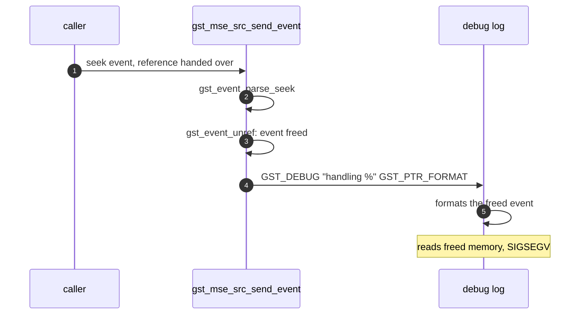

> One change of the GStreamer fork: `review/02`, 2 of 33 in the stack.
> Below it: [`review/01`](https://github.com/Airodonack/gstreamer/tree/review/01). Above it: [`review/03`](https://github.com/Airodonack/gstreamer/tree/review/03).
> The change itself: [commit c9aa134bfcfe2b81ff989d93b511eebcd6ac2ca8](https://github.com/Airodonack/gstreamer/commit/c9aa134bfcfe2b81ff989d93b511eebcd6ac2ca8). This README sits in a commit on top of it and is not part of the merge request.
> The whole stack: [overview README](https://github.com/Airodonack/gstreamer/blob/mse-fixes-main/README.md).

# Seeking msesrc no longer crashes with debug output on

With mselib's debug category at debug level, every seek on msesrc read freed
memory, and an unsupported seek did so whenever error messages are shown.
`gst_mse_src_send_event()` dropped the seek event right after parsing it and
then printed it. The change moves the unref after the last print. It is two
lines in one file, applies to stock GStreamer main alone, and the bug is the same
in 1.28.6.

## The problem

Every seek reaches
[`gst_mse_src_send_event()`](https://github.com/Airodonack/gstreamer/blob/c9aa134bfcfe2b81ff989d93b511eebcd6ac2ca8/subprojects/gst-plugins-bad/gst-libs/gst/mse/gstmsesrc.c#L916-L944):
an application may send it to the element, and msesrc's src pads forward the
seeks that come upstream from the sinks
([lines 1142 and 1143](https://github.com/Airodonack/gstreamer/blob/c9aa134bfcfe2b81ff989d93b511eebcd6ac2ca8/subprojects/gst-plugins-bad/gst-libs/gst/mse/gstmsesrc.c#L1142-L1143)).
Upstream, the function parses the event, unrefs it, and then prints it with
`GST_PTR_FORMAT` in two places
([gstmsesrc.c on main, lines 930 to 943](https://github.com/Airodonack/gstreamer/blob/74f679f8de/subprojects/gst-plugins-bad/gst-libs/gst/mse/gstmsesrc.c#L930-L943)):

- the "Rejecting unsupported seek event" error, for a seek that is not in
  time format, not `GST_SEEK_TYPE_SET`, or backwards;
- the "handling" debug line, for every other seek.

`gst_element_send_event()` hands the element the caller's reference, so the
unref frees the event. The debug macros only format their arguments when the
category's level lets the message through, so nothing happens with debug
output off; with it on, printing the event walks its freed structure.

## The change

The unref moves after the last use on each path: after the error message
before `return FALSE`, and after the debug line before the seek
([lines 933 to 942](https://github.com/Airodonack/gstreamer/blob/c9aa134bfcfe2b81ff989d93b511eebcd6ac2ca8/subprojects/gst-plugins-bad/gst-libs/gst/mse/gstmsesrc.c#L933-L942)).
`gst_mse_src_seek()` takes only the parsed start and rate, so it needs no
event.

## Options considered

| Option | Why not chosen |
|---|---|
| **Unref after the last print on each path** (this change) | Chosen: two moved lines, the same ownership as before. |
| Drop the event from the messages | Loses the seek's flags and stop position from the log, which is what a reader of a seek log wants. |
| One unref at a shared exit label | A restructure of a 25-line function for the same effect. |

## How it was checked

Unit test
[`test_media_source_element_seeks_with_debug_output`](https://github.com/Airodonack/gstreamer/blob/c9aa134bfcfe2b81ff989d93b511eebcd6ac2ca8/subprojects/gst-plugins-bad/tests/check/libs/mse.c#L385-L426)
replaces the default log function with one that formats every message,
turns the `gst-mse` category to debug level, attaches a media source to an
msesrc in a paused pipeline, and sends a supported and an unsupported seek.

From the gate on GStreamer main (2026-11-05):

- The test against main's gstmsesrc.c: "(after this point) Received signal
  11 (Segmentation fault)".
- This commit alone on main 74f679f8de, without `review/01`, three runs:
  `100%: Checks: 68, Failures: 0, Errors: 0`.

The 1.28 series' gate gave the same on 1.28.6.

## Questions a reviewer may ask

- **Does it need a special build?** No. The level is checked at run time, so
  `GST_DEBUG=gst-mse:5` on a normal build is enough to read freed memory on the first
  seek; for an unsupported seek, showing errors is enough
  (`GST_DEBUG=1` or higher).
- **Why replace the log function in the test?** It makes the test format
  every message itself, so it does not depend on what the default log
  function prints, and keeps the suite's output quiet.
