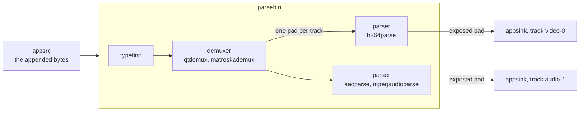
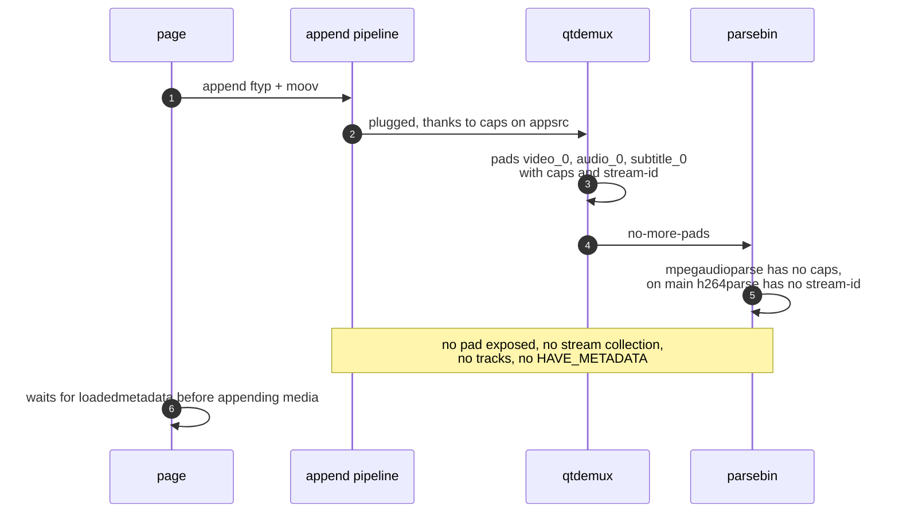
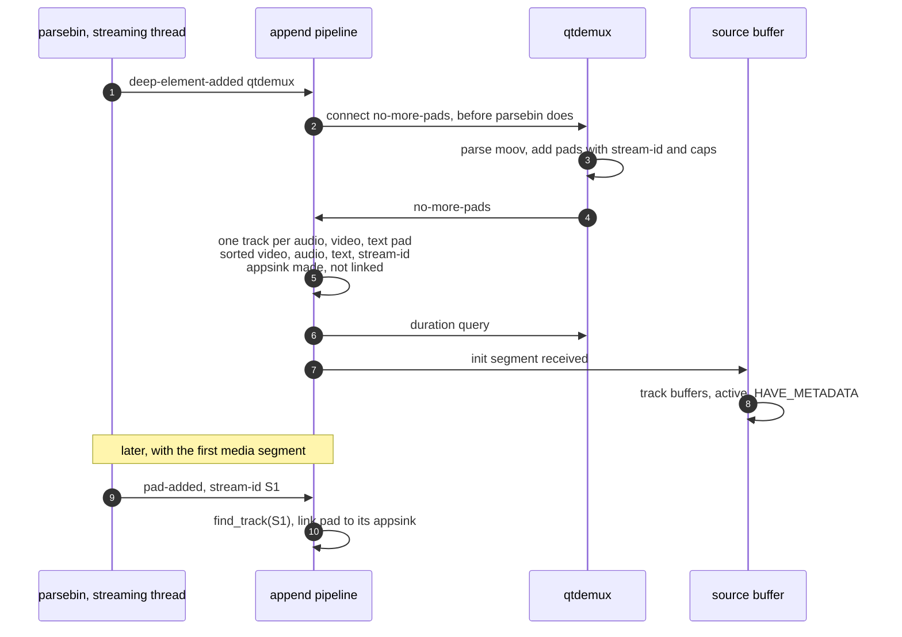

> One change of the GStreamer fork: `review/23`, 23 of 33 in the stack.
> Below it: [`review/22`](https://github.com/Airodonack/gstreamer/tree/review/22). Above it: [`review/24`](https://github.com/Airodonack/gstreamer/tree/review/24).
> The change itself: [commit fd62b474f284ba9bce65c751a212738852f2ddda](https://github.com/Airodonack/gstreamer/commit/fd62b474f284ba9bce65c751a212738852f2ddda). This README sits in a commit on top of it and is not part of the merge request.
> The whole stack: [overview README](https://github.com/Airodonack/gstreamer/blob/mse-fixes-main/README.md).

# An MP4 initialization segment alone now exposes its tracks

A source buffer learns its tracks from the initialization segment. In
mselib they appeared only with the first media segment. Players and
web-platform-tests wait for `loadedmetadata` before they append any media,
so they waited for good. This change takes the tracks from the demuxer,
which parses the initialization segment, instead of from the pads
`parsebin` exposes later.

It is the second of two changes: `review/22` reports an initialization
segment once, and this one gives MP4 buffers caps so that `parsebin` plugs
qtdemux without typefinding, then makes the tracks from qtdemux. On the 1.28
series these are two commits; on main they are one, since the caps alone
fail this change's test there (`h264parse` has no stream-id before its first
frame). It is the largest commit of the second half of the stack, and it
was redesigned on 2026-11-02 for a change in upstream `parsebin`. Both the
problem and the reasons for the design are below.

## Background: the append pipeline

Each source buffer parses its bytes in a small private pipeline:

Before this change, a track was made when `parsebin` exposed a pad, and the
initialization segment was reported when every stream of `parsebin`'s
stream collection had a track.

## The problem

Three things stood between the initialization segment and the tracks.

1. **Typefinding needs more bytes.** With no caps on `appsrc`, `parsebin`
   runs typefind first, and an `ftyp` plus `moov`, a kilobyte or two, does
   not let it decide. Nothing is plugged until a media segment brings more
   bytes.
2. **A parser without caps holds its pad back.** Once the demuxer
   is plugged, `parsebin` exposes a stream only when the parser behind it
   has fixed caps
   ([gstparsebin.c, the caps wait](https://github.com/Airodonack/gstreamer/blob/74f679f8de/subprojects/gst-plugins-base/gst/playback/gstparsebin.c#L1599-L1615)).
   `h264parse` and `aacparse` take theirs from the sample description;
   `mpegaudioparse` needs its first frame. One such stream holds back the
   whole group, so `mse.mp4` (H.264, MPEG audio, text) exposed nothing.
3. **On GStreamer main, not in 1.28, a parser without a stream-id holds
   its pad back too.** Upstream `parsebin` now treats a parsed chain as complete only
   once the parser's pad has a stream-id
   ([main, `gst_parse_chain_is_complete`](https://github.com/Airodonack/gstreamer/blob/74f679f8de/subprojects/gst-plugins-base/gst/playback/gstparsebin.c#L3160-L3170);
   on 1.28.6 a plugged parser was enough,
   [lines 3151 to 3154](https://github.com/Airodonack/gstreamer/blob/1.28.6/subprojects/gst-plugins-base/gst/playback/gstparsebin.c#L3151-L3154)).
   `h264parse` makes its stream-id with its first frame, and a `moov` has
   none. So even H.264 waits for media.

Probed for the earlier README, on stock GStreamer 1.28.7 (nixpkgs), `appsrc ! parsebin` fed only an
initialization segment and watched for 3 s (probe below):

| Bytes | appsrc caps | What happened |
|---|---|---|
| `mse.mp4` up to its first `moof` (H.264, MPEG audio, text) | none | nothing plugged, no pad |
| same | `video/quicktime, variant=iso` | qtdemux plugged; its 3 pads, each with caps and stream-id, and `no-more-pads` at 11 ms; **no pad exposed** |
| `mse-h264-aac-init.mp4` (H.264, AAC) | none | nothing plugged, no pad |
| same | `video/quicktime, variant=iso` | qtdemux's 2 pads and `no-more-pads` at 9 ms; both exposed at 10 to 11 ms, H.264's without caps |
| WebM header up to the first Cluster | none | nothing plugged, no pad |
| same | `video/webm` | matroskademux's pads and `no-more-pads` at 8 ms; no pad exposed in 3 s |

The demuxer knew every track within milliseconds in every case where it
was plugged. Waiting for `parsebin`'s exposure is what lost them.

## The change

### Caps on appsrc

- [`gst_source_buffer_new()`](https://github.com/Airodonack/gstreamer/blob/fd62b474f284ba9bce65c751a212738852f2ddda/subprojects/gst-plugins-bad/gst-libs/gst/mse/gstsourcebuffer.c#L326-L332)
  notes whether the MIME type is `video/mp4` or `audio/mp4`, and if so gives
  the append pipeline `video/quicktime, variant=iso` caps
  ([lines 361 to 366](https://github.com/Airodonack/gstreamer/blob/fd62b474f284ba9bce65c751a212738852f2ddda/subprojects/gst-plugins-bad/gst-libs/gst/mse/gstsourcebuffer.c#L361-L366)).
- The new private
  [`gst_append_pipeline_set_caps()`](https://github.com/Airodonack/gstreamer/blob/fd62b474f284ba9bce65c751a212738852f2ddda/subprojects/gst-plugins-bad/gst-libs/gst/mse/gstappendpipeline.c#L1240-L1247)
  sets them on `appsrc`, so `parsebin` plugs qtdemux at once.

WebM buffers get no caps and still typefind, which waits for the first
Cluster.

### Tracks from the demuxer

The append pipeline watches `parsebin` for the
container demuxer and makes the tracks from the demuxer's pads; `parsebin`'s
pads, whenever they come, only carry the samples.

The pieces, all in `gstappendpipeline.c`:

| Code | What it does |
|---|---|
| [`on_deep_element_added`](https://github.com/Airodonack/gstreamer/blob/fd62b474f284ba9bce65c751a212738852f2ddda/subprojects/gst-plugins-bad/gst-libs/gst/mse/gstappendpipeline.c#L1024-L1047), [`is_container_demuxer`](https://github.com/Airodonack/gstreamer/blob/fd62b474f284ba9bce65c751a212738852f2ddda/subprojects/gst-plugins-bad/gst-libs/gst/mse/gstappendpipeline.c#L1009-L1022) | The first demuxer `parsebin` plugs, not a tag demuxer such as id3demux, gets a `no-more-pads` handler. The signal fires inside `gst_bin_add()`, before `parsebin` connects its own handlers to the element ([gstparsebin.c, `connect_element`](https://github.com/Airodonack/gstreamer/blob/74f679f8de/subprojects/gst-plugins-base/gst/playback/gstparsebin.c#L2405-L2415)), so ours runs first. The handler is connected in [the init function](https://github.com/Airodonack/gstreamer/blob/fd62b474f284ba9bce65c751a212738852f2ddda/subprojects/gst-plugins-bad/gst-libs/gst/mse/gstappendpipeline.c#L1144-L1147). |
| [`on_demuxer_no_more_pads`](https://github.com/Airodonack/gstreamer/blob/fd62b474f284ba9bce65c751a212738852f2ddda/subprojects/gst-plugins-bad/gst-libs/gst/mse/gstappendpipeline.c#L952-L1007), [`add_demuxer_stream`](https://github.com/Airodonack/gstreamer/blob/fd62b474f284ba9bce65c751a212738852f2ddda/subprojects/gst-plugins-bad/gst-libs/gst/mse/gstappendpipeline.c#L896-L913) | Reads each demuxer pad's stream-id and current caps, sorts them with [`compare_demuxer_streams`](https://github.com/Airodonack/gstreamer/blob/fd62b474f284ba9bce65c751a212738852f2ddda/subprojects/gst-plugins-bad/gst-libs/gst/mse/gstappendpipeline.c#L883-L894), makes a track for each new one and reports the initialization segment, unless nothing was added and one was already reported. |
| [`check_track`](https://github.com/Airodonack/gstreamer/blob/fd62b474f284ba9bce65c751a212738852f2ddda/subprojects/gst-plugins-bad/gst-libs/gst/mse/gstappendpipeline.c#L512-L532), [`append_track`](https://github.com/Airodonack/gstreamer/blob/fd62b474f284ba9bce65c751a212738852f2ddda/subprojects/gst-plugins-bad/gst-libs/gst/mse/gstappendpipeline.c#L536-L561), [`link_track`](https://github.com/Airodonack/gstreamer/blob/fd62b474f284ba9bce65c751a212738852f2ddda/subprojects/gst-plugins-bad/gst-libs/gst/mse/gstappendpipeline.c#L563-L579), [`find_track`](https://github.com/Airodonack/gstreamer/blob/fd62b474f284ba9bce65c751a212738852f2ddda/subprojects/gst-plugins-bad/gst-libs/gst/mse/gstappendpipeline.c#L592-L603) | The old `add_track()` split in three: whether a stream can be a track, making the track with an unlinked appsink, and linking a `parsebin` pad later. A track now carries its stream-id. |
| [`process_init_segment_track`](https://github.com/Airodonack/gstreamer/blob/fd62b474f284ba9bce65c751a212738852f2ddda/subprojects/gst-plugins-bad/gst-libs/gst/mse/gstappendpipeline.c#L647-L703) | On `parsebin`'s `pad-added`: a pad whose stream-id names a known track is linked to it. Otherwise the old path, a new track for the pad. |
| [`report_init_segment`](https://github.com/Airodonack/gstreamer/blob/fd62b474f284ba9bce65c751a212738852f2ddda/subprojects/gst-plugins-bad/gst-libs/gst/mse/gstappendpipeline.c#L752-L772) | Takes the duration from the element that parsed the header. |
| [`find_track_with_new_id`](https://github.com/Airodonack/gstreamer/blob/fd62b474f284ba9bce65c751a212738852f2ddda/subprojects/gst-plugins-bad/gst-libs/gst/mse/gstappendpipeline.c#L915-L948), [`unlink_track`](https://github.com/Airodonack/gstreamer/blob/fd62b474f284ba9bce65c751a212738852f2ddda/subprojects/gst-plugins-bad/gst-libs/gst/mse/gstappendpipeline.c#L581-L590) | A later initialization segment whose only track of a type has a new stream-id continues that track instead of adding one; with more than one track of a type, the ids must match. |
| [`gst_append_pipeline_stream_type_from_caps`](https://github.com/Airodonack/gstreamer/blob/fd62b474f284ba9bce65c751a212738852f2ddda/subprojects/gst-plugins-bad/gst-libs/gst/mse/gstappendpipeline.c#L808-L848) | The stream type of a demuxer pad's caps, with the pbutils description as a fallback, so WebVTT and SSA get one; it brings `gstpbutils_dep` into mselib's `meson.build`. |
| [`process_init_segment`](https://github.com/Airodonack/gstreamer/blob/fd62b474f284ba9bce65c751a212738852f2ddda/subprojects/gst-plugins-bad/gst-libs/gst/mse/gstappendpipeline.c#L778-L803) | The old report, kept for bytes without a demuxer (ADTS AAC, MPEG audio) and for a demuxer that never says `no-more-pads`, with `review/22`'s guard; it returns early once the demuxer path has reported. |

Why each detail:

- **The stream-id matches.** Parsers are `GstBaseParse` subclasses and pass
  the demuxer's `stream-start` on unchanged, so the pad `parsebin` exposes
  for a track has the demuxer pad's stream-id.
- **The order is `parsebin`'s.** Tracks are named by position
  (`video-0`, `audio-1`), and after a reset a track object is reused for
  the same type and name (`review/11`). Sorting video, audio, text, then
  stream-id, as `parsebin`'s
  [`sort_end_pads`](https://github.com/Airodonack/gstreamer/blob/74f679f8de/subprojects/gst-plugins-base/gst/playback/gstparsebin.c#L3486-L3570)
  does, keeps names independent of the container's track order (`review/29` tests it).
- **The duration comes from the demuxer.** Probed for the earlier README, on 1.28.7, with the
  `mvhd` duration of `mse-h264-aac-init.mp4` set to 4 s: at `no-more-pads`
  a duration query answered 4.0 s on qtdemux and nothing on `parsebin`;
  `parsebin` answered 4.0 s only after it had exposed pads.
- **A track's first caps are the demuxer's**, for H.264 qtdemux's `avc`
  caps with `codec_data`, width and height. The parser's caps reach msesrc
  with the first sample, as any caps change does.

## Options considered

The first version of this work (until 2026-11-02) did only the caps on
appsrc and kept tracks from exposed pads. On 1.28 it worked for H.264 and
AAC but not for MPEG audio in MP4. On main, after upstream's stream-id
change, four unit tests failed: an MP4 initialization segment exposed no
H.264 pad. With that upstream change reverted in a scratch build, all
passed: `100%: Checks: 141, Failures: 0, Errors: 0` (2026-11-02).

| Option | What it would take | Why not chosen |
|---|---|---|
| **Tracks from the demuxer's pads, `parsebin` pads matched by stream-id** (this change) | About 470 changed lines in the append pipeline | Chosen: the demuxer is where the header is parsed, so it holds on 1.28 and main, for MPEG audio as for H.264, and does not depend on when `parsebin` exposes. |
| Caps on appsrc only (the 1.28 series' first commit of the two) | 25 lines | Fails for any stream whose parser needs a frame (MPEG audio on 1.28) and for H.264 on main. |
| Ask upstream to expose a parser whose caps are fixed before its stream-id | A change to `parsebin` | Upstream made the change on purpose, so that a collection is never built from one stream-id and then followed by another. Even granted, MPEG audio would still wait for its caps, and mselib would stay tied to exposure timing. |
| Make tracks from `parsebin`'s stream collection | Small | `parsebin` posts the collection when it exposes ([gst_parse_bin_expose](https://github.com/Airodonack/gstreamer/blob/74f679f8de/subprojects/gst-plugins-base/gst/playback/gstparsebin.c#L3669-L3678)), so it comes no earlier. The probe saw no collection for `mse.mp4` in 3 s. |
| Caps on appsrc for WebM too | One flag | matroskademux then gives its pads from the header alone, but no pad is exposed before the first Cluster on 1.28. Left for a decision; see the cost below. |
| A typefind helper that accepts a lone `moov` | A change to the typefinder | It changes typefinding for every user, to answer what the MIME type already answers. |
| Replace `parsebin` with mselib's own typefind and demuxer | A new parsing layer | Much more code, and the parsers are still needed to frame H.264 and AAC as the decoders want. |

## The cost

- Two ways to get tracks: the demuxer path and the exposed-pad path for
  bytes without a demuxer. Both are tested, but they are two.
- A track's initial caps are the demuxer's, not the parser's; msesrc
  announces the parser's caps as a caps change on the first sample.
- WebM is not helped yet: WebM source buffers get no caps, so typefinding
  waits for the first Cluster. With `video/webm` caps, matroskademux gives
  the tracks from the header alone (table above). Turning that on is one
  flag in `review/26`'s table, left for a decision.

## Spec

[MSE, Initialization Segment Received](https://w3c.github.io/media-source/#sourcebuffer-init-segment-received):
the tracks, with their codecs, are those the initialization segment
describes; once every source buffer has had its first one, the media
element goes to `HAVE_METADATA`. Nothing in it waits for media.

## How it was checked

Unit tests in `tests/check/libs/mse.c`, failing before this change as the
commit message records:

- [`test_source_buffer_init_segment_alone_activates`](https://github.com/Airodonack/gstreamer/blob/fd62b474f284ba9bce65c751a212738852f2ddda/subprojects/gst-plugins-bad/tests/check/libs/mse.c#L1918-L1964):
  an H.264 and AAC initialization segment alone
  (`tests/files/mse-h264-aac-init.mp4`, new with this change) makes the
  buffer active;
  so does `mse.mp4`'s H.264, MPEG audio and text, and its media segment
  then adds none. On 1.28 the MPEG audio case failed, on main both.
- [`test_append_pipeline_init_segment_alone_has_tracks`](https://github.com/Airodonack/gstreamer/blob/fd62b474f284ba9bce65c751a212738852f2ddda/subprojects/gst-plugins-bad/tests/check/libs/mse.c#L1084-L1123):
  one report, two tracks, H.264 and MPEG-4 audio caps with `codec_data`,
  and the 4 s duration of the patched `mvhd`. Failed on main.
- [`test_append_pipeline_media_segment_feeds_init_segment_tracks`](https://github.com/Airodonack/gstreamer/blob/fd62b474f284ba9bce65c751a212738852f2ddda/subprojects/gst-plugins-bad/tests/check/libs/mse.c#L1216-L1270):
  the media segment's samples all go to the initialization segment's
  tracks, no track is added and no second report comes. Failed on both.

New with them, for the details above:
[`_init_segment_new_track_id`](https://github.com/Airodonack/gstreamer/blob/fd62b474f284ba9bce65c751a212738852f2ddda/subprojects/gst-plugins-bad/tests/check/libs/mse.c#L1125-L1157) (a lone video track whose
stream-id changes keeps its track),
[`_init_segment_webvtt_track`](https://github.com/Airodonack/gstreamer/blob/fd62b474f284ba9bce65c751a212738852f2ddda/subprojects/gst-plugins-bad/tests/check/libs/mse.c#L1159-L1181) and
[`_stream_type_from_caps`](https://github.com/Airodonack/gstreamer/blob/fd62b474f284ba9bce65c751a212738852f2ddda/subprojects/gst-plugins-bad/tests/check/libs/mse.c#L1183-L1214).

The gate on GStreamer main (2026-11-05), the whole suite at this commit,
three runs: `100%: Checks: 88, Failures: 0, Errors: 0`. On the 1.28 series, where this is two commits, the
caps alone gave 83 checks and both together 88, all passing. The `parsebin` probe above was run for the
earlier README, on stock 1.28.7, with Python probes kept outside the
repository.

## Questions a reviewer may ask

- **Why `video/quicktime` for `audio/mp4` too?** GStreamer's typefinder
  names ISO BMFF bytes `video/quicktime, variant=iso` whatever their tracks,
  and qtdemux takes those caps; the change gives the same caps typefinding
  would have given.

- **What if a demuxer never says `no-more-pads`?** The exposed-pad path
  still reports once every stream of the collection has a track.
- **What about a demuxer pad without caps or stream-id at `no-more-pads`?**
  It is skipped, and the initialization segment is reported without it. If
  `parsebin` later exposes the pad, it gets a track through the exposed-pad
  path, but no report follows: with a demuxer, `process_init_segment()`
  stops once a report was made. If no pad qualified, an initialization
  segment with no tracks is reported, where the spec runs the append error
  algorithm. qtdemux and matroskademux set caps before adding a pad, so
  neither reaches this.
- **A later initialization segment with fewer tracks, without a reset.**
  The demuxer path adds nothing and does not report it, so the spec's
  track-count check does not run for it. `review/31` adds that check, for reports that come. Not tested here.
- **The bus task writes `self->streams` without the object lock**
  ([lines 406 to 414](https://github.com/Airodonack/gstreamer/blob/fd62b474f284ba9bce65c751a212738852f2ddda/subprojects/gst-plugins-bad/gst-libs/gst/mse/gstappendpipeline.c#L406-L414)),
  while the streaming thread reads it under the lock. That is upstream's
  and not changed here.
- **Two tracks of one type with swapped track ids** in a later
  initialization segment would come up in stream-id order, so the reused
  track objects could swap. `review/29` covers the reorder across types only.
