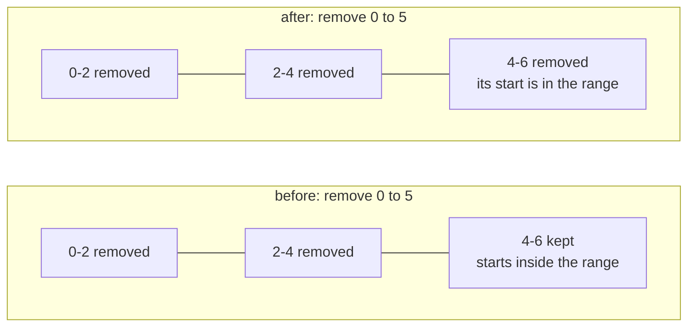
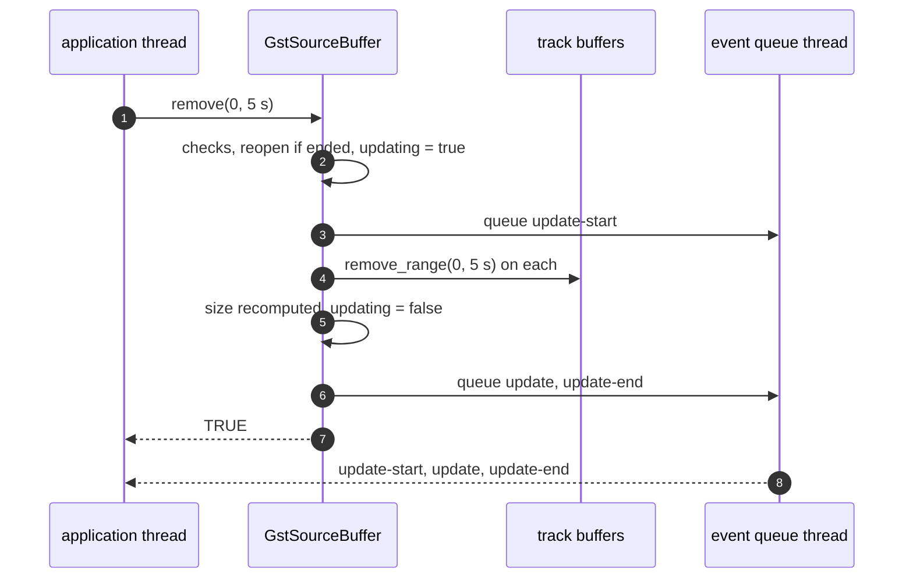

> One change of the GStreamer fork: `review/19`, 19 of 33 in the stack.
> Below it: [`review/18`](https://github.com/Airodonack/gstreamer/tree/review/18). Above it: [`review/20`](https://github.com/Airodonack/gstreamer/tree/review/20).
> The change itself: [commit d4b5b7965d8afed5f40cedb7dab288ac42191367](https://github.com/Airodonack/gstreamer/commit/d4b5b7965d8afed5f40cedb7dab288ac42191367). This README sits in a commit on top of it and is not part of the merge request.
> The whole stack: [overview README](https://github.com/Airodonack/gstreamer/blob/mse-fixes-main/README.md).

# Removing a range from a source buffer removes the media

`gst_source_buffer_remove()` was a stub: it returned `TRUE` and did
nothing. It sent no events and removed no media. This change implements
MSE's range removal, and fixes which frames the shared removal code
takes.

## The problem

Two faults, one in each layer.

**The API did nothing.** Players call `remove()` to drop media behind the
playhead or before a quality switch, and then wait for `updateend`. A
browser that forwards `remove()` to mselib waited forever, and the media
stayed buffered.

**The removal code missed the edges.** Track buffers store frames in coded
frame groups: a key frame and the frames that depend on it, up to the next
key frame. The removal helper, already used by eviction, took only groups
lying wholly inside `[start, end)`. A group crossing `end` stayed, and a
range starting inside a group took nothing from it. With groups 0-2, 2-4
and 4-6 s:

## The change

[`gst_source_buffer_remove`](https://github.com/Airodonack/gstreamer/blob/d4b5b7965d8afed5f40cedb7dab288ac42191367/subprojects/gst-plugins-bad/gst-libs/gst/mse/gstsourcebuffer.c#L1503-L1562)
now runs the range removal algorithm:

1. It refuses a removed or updating buffer (`INVALID_STATE`) and a range
   with `end <= start` (`TYPE`). An `end` of `GST_CLOCK_TIME_NONE` means "to
   the end".
2. It reopens an ended media source, as `append_buffer()` and
   `set_timestamp_offset()` do, through
   [`is_ended_unlocked`](https://github.com/Airodonack/gstreamer/blob/d4b5b7965d8afed5f40cedb7dab288ac42191367/subprojects/gst-plugins-bad/gst-libs/gst/mse/gstsourcebuffer.c#L1029-L1043)
   and
   [`open_parent_unlocked`](https://github.com/Airodonack/gstreamer/blob/d4b5b7965d8afed5f40cedb7dab288ac42191367/subprojects/gst-plugins-bad/gst-libs/gst/mse/gstsourcebuffer.c#L1045-L1052).
3. It sets `updating` and queues `update-start`.
4. Under the tracks lock, it removes the range from every track buffer with
   the existing `gst_media_source_track_buffer_remove_range()` and
   recomputes the buffer's size.
5. It clears `updating` and queues `update` and `update-end`.

In the sample map,
[`find_start_point`](https://github.com/Airodonack/gstreamer/blob/d4b5b7965d8afed5f40cedb7dab288ac42191367/subprojects/gst-plugins-bad/gst-libs/gst/mse/gstmediasourcesamplemap.c#L261-L298)
now takes the first group whose start lies in `[start, end)`, and
[`find_end_point`](https://github.com/Airodonack/gstreamer/blob/d4b5b7965d8afed5f40cedb7dab288ac42191367/subprojects/gst-plugins-bad/gst-libs/gst/mse/gstmediasourcesamplemap.c#L300-L332)
keeps taking groups until one starts at or after `end`: that group's first
frame is the next random access point.

Eviction shares this code through `remove_range (0, max_dts)`
([`evict_coded_frames_unlocked`](https://github.com/Airodonack/gstreamer/blob/d4b5b7965d8afed5f40cedb7dab288ac42191367/subprojects/gst-plugins-bad/gst-libs/gst/mse/gstsourcebuffer.c#L1682-L1713)).
For eviction the only difference is a group that crosses `max_dts`, five
seconds behind the playhead, which may now go too.

## Options considered

| Option | Why not chosen |
|---|---|
| **Run removal synchronously in the caller, events through the queue** (this change) | Chosen: the application still sees the events later, on the event thread, as for an append. Removal is a walk over the sample map, with no parsing to wait for. |
| Run removal on the append task, as the spec's "asynchronously" suggests | More code and a second kind of job for that task. The one visible difference is `updating` (below). |
| Remove single frames, not whole groups | The spec removes frames from `start` up to the next random access point, so a frame inside a group whose key frame stays would be removed. The sample map has no per-frame removal, and eviction works by groups. Kept to groups: removal keeps a little more than the spec in that case (below). |
| Leave the sample map as it was | `remove(0, 5)` on 0-6 s would leave 4-6 s, which no page expects. |

## Spec

[MSE, `remove()`](https://w3c.github.io/media-source/#dom-sourcebuffer-remove):

> If the readyState attribute of the parent media source is in the "ended"
> state then run the following steps: Set the readyState attribute of the
> parent media source to "open". Queue a task to fire an event named
> sourceopen at the parent media source.

[Coded frame removal](https://w3c.github.io/media-source/#sourcebuffer-coded-frame-removal):

> Remove all media data, from this track buffer, that contain starting
> timestamps greater than or equal to start and less than the remove end
> timestamp.

and then the frames that depend on them, "between those frames removed in
the previous step and the next random access point after those removed
frames".

## How it was checked

Unit tests in `tests/check/libs/mse.c`, failing before this change (per
the commit message):

- [`test_source_buffer_remove_range`](https://github.com/Airodonack/gstreamer/blob/d4b5b7965d8afed5f40cedb7dab288ac42191367/subprojects/gst-plugins-bad/tests/check/libs/mse.c#L1423-L1457):
  after `mse.mp4`, `remove(0, NONE)` ends with a second `update-end`, no
  error, `updating` false and no buffered range.
- [`test_source_buffer_remove_reopens_ended_source`](https://github.com/Airodonack/gstreamer/blob/d4b5b7965d8afed5f40cedb7dab288ac42191367/subprojects/gst-plugins-bad/tests/check/libs/mse.c#L1459-L1487):
  an ended source is open again right after `remove()`.
- [`test_sample_map_remove_range_group_boundaries`](https://github.com/Airodonack/gstreamer/blob/d4b5b7965d8afed5f40cedb7dab288ac42191367/subprojects/gst-plugins-bad/tests/check/libs/mse.c#L1798-L1848):
  three groups 0-2, 2-4, 4-6; `remove(2, 3)` takes only the middle group,
  `remove(0, 4)` the first two.

Probed for the earlier README, on stock GStreamer 1.28.7 (the unfixed library) through PyGObject:
after `mse.mp4` was buffered 0.033-5.717 s, `remove(0, NONE)` returned
`TRUE`, no second `update-start` came in 3 s, and the buffered range was
still 0.033-5.717 s.

From the commit message, not re-run: in a browser built on the library,
web-platform-tests `mediasource-remove` and `mediasource-duration` now get
`update` and `updateend` from `remove()`; init plus groups 0-2, 2-4, 4-6 s
then `remove(0, 5)` left 4.067-6.067 s before and nothing after (3 of 3);
four groups then `remove(6, 7)` left 0.067-8.067 before and 0.067-6.067
after (3 of 3).

At this commit, the gate on GStreamer main (2026-11-05) ran the whole unit
test suite: `100%: Checks: 79, Failures: 0, Errors: 0`, as on the 1.28 series.

## Questions a reviewer may ask

- **Does a range that starts inside a group remove anything from that
  group?** No. With groups 0-2 and 2-4, `remove(1, 3)` takes 2-4 and keeps
  0-2 whole, where the spec would also take the frames from 1 to 2 s. The
  page sees 0-2 still buffered.
- **Times are decode times.** Groups are ordered and compared by decode
  timestamp, while the spec speaks of presentation timestamps. With
  reordered frames the two differ by a frame or two at the group edges.
- **Can eviction now take the group being played?** Only when a group is
  longer than the five seconds eviction keeps behind the playhead: a group
  that starts before `position - 5 s` and runs past the playhead is now
  taken. Before, such a group was never taken.
- **`updating` is already false when `remove()` returns.** The spec keeps
  it true until the removal has run "asynchronously". A caller that reads
  `updating` right after `remove()` sees false, while `update-start` is
  still queued. A browser with its own `updating` flag does not notice.
- **What the spec asks that this does not do:** the check that `start` is
  within the duration (left to the caller), and the step that drops
  `readyState` to `HAVE_METADATA` when the removed range holds the current
  position.
